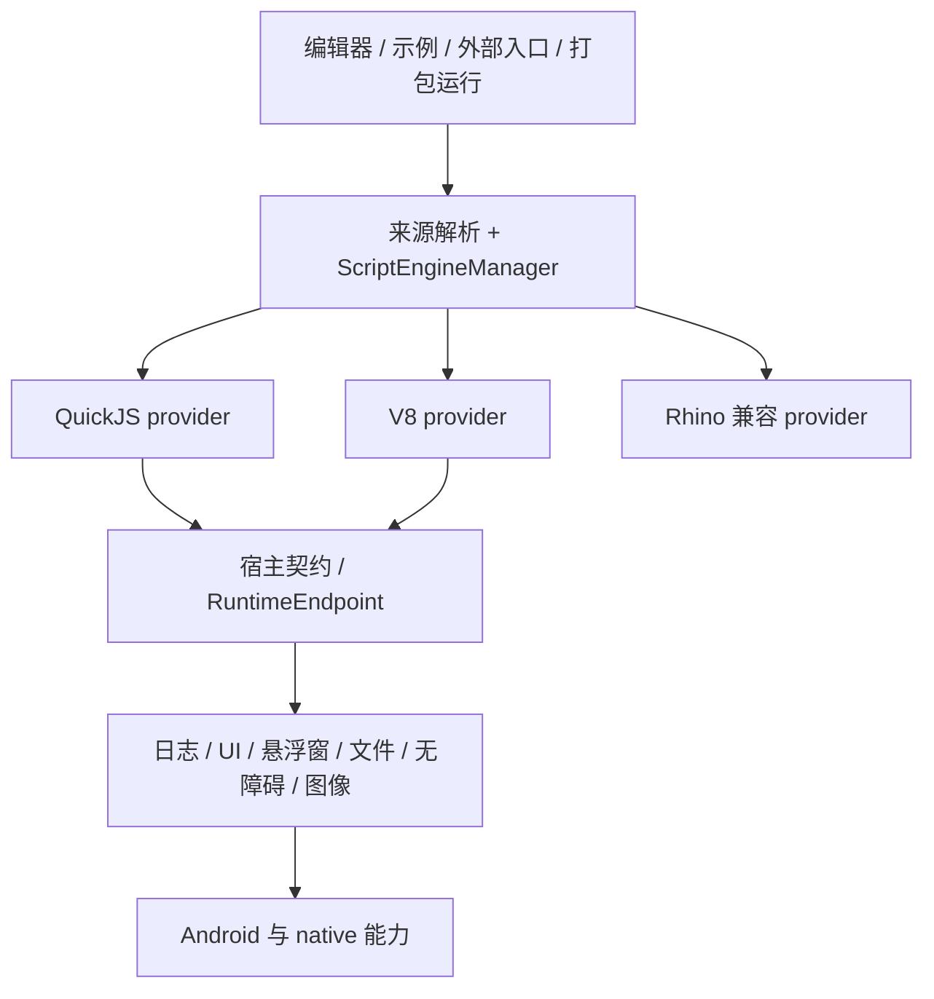

# AI.js Pro 接入 V8：框架瓶颈与迁移方案

日期：2026-09-14。讨论范围是整个 AI.js Pro Android 项目，不是象棋示例工程。

> **2026-10-19 时效说明（dev-1112）**：本文写作时 V8 尚未接入；之后仓库已通过 **Node24 第三引擎**（真实 Node v24.22.0 / V8 13.6 / ABI 137，独立 `:node24` 进程）落地了 V8 路线，详见 [Node24 第三引擎接入](../reports/2026-10-17_Node24第三引擎与AutoJsPro示例集接入.md)。本文仍可作为宿主解耦、线程/回调、数据桥与可选 provider 的设计参考；其中“尚未接入”的表述只对 2026-09-14 时点成立。

本文为源码审阅后的接入设计。本次只新增设计文档，不修改默认引擎，不发布新 APK。

## 1. 结论

可以增加 V8。现有 `ScriptEngineManager.registerEngine()` 已提供 provider 注册入口；最大的改造在宿主 API、事件循环、线程和资源生命周期，而不是执行一段 JavaScript。

建议先增加可显式选择的 V8 provider，保留现有 QuickJS/Rhino，再用相同宿主契约比较性能和兼容性。只有验收通过后才考虑改变新建脚本默认引擎。

V8 是 JS 引擎。它不会自动提供 Node.js、CommonJS、Android UI、无障碍、截图、定时器或 Auto.js 的 Java 互操作；这些仍由应用宿主实现。V8 使用 isolate/context/handle 管理执行环境和对象。[V8 官方嵌入指南](https://v8.dev/docs/embed)

## 2. 当前框架的关键瓶颈

| 瓶颈 | 当前源码证据 | 接 V8 时必须解决 |
|---|---|---|
| 宿主服务与引擎绑定 | `QuickJsHostBridge.java` 接近 6,000 行；直接调用 `QuickJsNativeBridge` 创建截图资源、执行 JS 回调 | 将 Android 服务与 JS 运行时入口拆开，V8 和 QuickJS 复用宿主能力 |
| UI、线程和回调生命周期 | `QuickJsJavaScriptEngine` 保存 native handle、执行线程、UI Activity，并负责停止与销毁 | 定义 owner 线程、回调投递、取消和退出顺序，禁止跨线程随意使用 V8 对象 |
| 数据跨桥开销 | 当前桥有 JSON 回调参数、图像及 native frame 句柄路径 | 小型控制数据先保持兼容；大量像素、Tensor、TypedArray 使用明确所有权的 buffer/资源句柄 |
| 来源与引擎选择规则 | `JavaScriptSource`、工程配置、入口及 worker 均参与引擎选择 | 加入 v8 标识，统一优先级、校验及子脚本继承，禁止忽略显式 QuickJS 指令 |
| 打包与运行格式绑定 | `QuickJsBytecodeCompiler`、`QuickJsBytecodeSource`、APK 打包端使用 QuickJS 字节码 | QuickJS 字节码继续交给 QuickJS；V8 首先运行源码，不冒用原字节码格式 |
| 原生发行链 | 现有 QuickJS 库、ABI、宿主与 inrt 模板配套打包 | 独立 V8 构建与校验流程；核对 ABI、Android API、NDK/STL、数据文件及页大小兼容 |
| 调试与语言兼容 | 现有编辑器、Token/AST、部分公共运行时仍依赖 Rhino 类型 | 不把 V8 执行接入等同于移除 Rhino 类型；调试器需要单独接 Inspector |

当前 QuickJS 的销毁路径还有一个应独立审查的边界：等待执行线程约 2 秒后，即使线程仍存活也继续释放 native runtime。新增 V8 时不能照搬这条行为，应先保证执行和回调停止再销毁 isolate。此项是源码风险判断，不是本次已复现或修复的新崩溃。

## 3. 目标框架



第一轮复用现有 `:engine` 公共接口，将 V8 放在可选 `:engine-v8` 中。V8 模块依赖公共运行时，公共运行时通过 provider loader 注册它，避免 `:engine → :engine-v8 → :engine` 循环依赖。后续按需要把公共接口提取为更小模块，不以一次全量重构作为启动前提。

建议新增结构（均尚未创建）：

```text
modules/engine/
  .../engine/RuntimeEndpoint.java       # JS 回调、事件投递、停止状态的公共入口
  .../engine/UiHostAwareEngine.java      # 脚本 Activity 注入的公共接口
  .../runtime/host/HostServices.java     # 引擎无关的 Android 服务组织
  .../runtime/host/HostResourceTable.java# 帧、窗口等资源及 owner 管理
  .../engine/V8EngineLoader.java        # 可选 provider 加载与可用性检查

modules/engine-v8/
  src/main/java/.../V8JavaScriptEngine.java
  src/main/java/.../V8NativeBridge.java
  src/main/cpp/v8_jni.cpp
  src/main/cpp/runtime_state.h
  src/main/jniLibs/arm64-v8a/            # 独立生成并验证的 V8 JNI/native 库
  src/androidTest/.../                  # 生命周期、回调与宿主契约测试

tools/build-v8-android.*                # 固定版本、可重复的构建入口
```

`RuntimeEndpoint` 的示例约定如下，需结合现有回调行为实施；不能把建议接口当作当前已实现 API：

```java
interface RuntimeEndpoint {
    void postEvent(long callbackId, String argsJson);
    boolean isStopping();
    void requestStop();
    String engineId();
}
```

先将异步事件统一为 owner 队列。确实需要同步返回值的 Java 回调单独定义契约和调用线程，不能用一次通用 postEvent 替代所有同步 API，也不能在 Android 主线程无限等待 JS 回调。

## 4. 第一阶段：把宿主接口从 QuickJS 中抽出来

不直接把 `QuickJsHostBridge` 改名为 `V8HostBridge` 再复制 6,000 行。逐组提取公共服务：

1. 日志、文件、存储：调用参数和返回值先保持一致，用 fake endpoint 验证不依赖 QuickJS。
2. 回调与事件：把 `invokeJsCallback`、事件队列入口接到 RuntimeEndpoint；不再让业务服务直接持有 QuickJS native handle。
3. UI 与悬浮窗：公共层管理窗口和控件，回调只保存 callbackId 和 owner。脚本 Activity 通过 UiHostAwareEngine 注入，不根据具体引擎类到处加分支。
4. 图像与 native frame：将资源生命周期从 QuickJS runtime 句柄中分离。公共资源表校验 owner 和释放状态，再由各引擎映射为 JS 包装对象。
5. Java 互操作：保留公共方法调用规则，但分离 JS 值转换、异常和回调绑定；QuickJS 的 Java wrapper 不直接移交给 V8。

每提取一组，先让现有 QuickJS 使用公共实现并完成回归，再接入 V8。兼容 Rhino 的类型和行为先保留，不在同一轮顺带移除。

## 5. 第二阶段：最小 V8 provider

首个可交付目标：Android arm64 真机上，通过统一执行服务运行显式 V8 脚本，支持日志、普通返回值、Promise/定时器、CommonJS 模块，并可正常停止。

建议未来的选择方式：

```javascript
// @engine v8
console.log("V8 probe");
```

```json
{
  "engine": "v8",
  "main": "main.js"
}
```

这两个例子是**目标语法，目前尚不支持**。现有带 `// @engine quickjs` 的脚本仍优先选择 QuickJS，不能只改工程顶层配置就宣称迁移完成。

实施清单：

- `JavaScriptSource`：新常量、指令解析、配置映射和未知引擎错误。
- `ScriptEngineManager` / `AutoJs`：可选注册、缺失 provider 明确报错，失败走现有执行监听器。
- 工程配置、编辑器和运行入口：检查是否存在只接受 quickjs/rhino 的白名单，统一增加 v8。
- `engines.execScript*` 和 worker：明确继承规则，每个并发 worker 使用自己的执行环境；跨引擎数据传递走序列化或资源契约。
- 原生实现：创建 isolate/context、安装宿主函数、执行源码、异常与源码行号映射、任务队列和停止。

选取固定 V8 revision 和对应工具链，先构建 arm64。官方提供 Android/ARM 交叉编译路线，但文档中的示例和参数仍需与所选 revision 核对，不能直接用桌面 x64 Hello World 命令产出 Android 库。[官方交叉编译说明](https://v8.dev/docs/cross-compile-arm)

## 6. 生命周期必须先于 UI 扩展验收

- 每个执行环境规定一个 owner 线程；JS 调用和回调在这个线程进入相应 isolate/context。
- UI 点击、无障碍事件、定时器回调投递到 owner 队列，不能携带 `Local<Value>` 跨线程或跨 HandleScope 存活。
- 持久函数和对象使用适当的 persistent/global handle，生命周期结束时释放；JNI global reference 也要配对清理。
- Promise microtask 和宿主事件循环有明确调度策略；事件能继续推进，长时间同步 JS 可被停止。
- STOP 先阻止新任务、请求中断、取消宿主等待和 worker，再结束 owner 执行及清理资源，最后销毁运行时。线程未退出时不能仅因超时就强制 Dispose。
- `sleep`、无障碍等待、shell 等宿主阻塞也要响应停止；只中断 V8 内部计算不能取消 Java/native 的所有等待。
- 线程名沿用短 ASCII 规则，避免中文路径触发系统 proc/JNI 编码问题。

V8 的 handle 与 GC 规则需要专门实现，不能按 QuickJS 的 `JSValue` 引用计数直接替换类型名。[官方 handle 与 GC 说明](https://v8.dev/docs/embed#handles-and-garbage-collection)

## 7. 数据桥与性能验证

先跑一致性，再优化传输：原有 JSON 可用于小型命令，像素和 Tensor 不应先转巨大 JSON。定义 native buffer/资源 owner、有效期、共享方式及释放责任；V8 ArrayBuffer backing store 与 Java ByteBuffer/native 图像资源分别管理，跨边界不能提前释放。

V8 值得验证的收益是纯 JS 搜索、循环、对象处理等计算。截图、ONNX/OpenCV 推理、shell 点击、Android UI 布局不因换 JS 引擎自动变快。收益与冷启动、JIT 预热、桥调用密度、内存有关，当前不提供未经实测的倍数。

同设备、同脚本、同模型、同输入分别记录：

| 维度 | 测量 |
|---|---|
| 冷启动 | provider 加载、运行时初始化、第一条脚本完成 |
| 纯 JS | 相同棋局搜索或固定计算，分别测首次和预热后 |
| 跨桥 | 1/100/1000 次小调用及批量调用，核对相同结果 |
| 图像 | 截图、buffer 转换、推理分别计时，明确引擎所占部分 |
| 响应 | 运行期间按钮响应、暂停受理、停止完成时间 |
| 内存 | 空环境、多个 worker、图像负载及反复启动退出后的 PSS |
| 发布体积 | 单 ABI APK 增量及 native/data 文件组成 |

指标输出固定脚本和 JSON 记录，禁止把耗时步骤删掉或换算法后归因于引擎。

## 8. 打包、ABI 与调试

现有 QuickJS 字节码只能由匹配的 QuickJS 运行端执行。V8 第一版打包采用当前项目支持的源码载荷/加密路径，并明确记录 engine、payloadFormat、runtimeRevision；不满足要求的加密等级应可控拒绝，不能交给 V8 执行 QuickJS 字节码。

以后需要 V8 code cache 时，单独验证格式与版本约束，不能把 cache 当成通用字节码或源码保护方案。打包端、inrt 模板、解包后引擎选择及依赖库必须一起支持 V8，不能只让编辑器运行成功。

原生构建验证包括固定版本、ABI/API、C++ ABI 与 STL、所选配置需要的 ICU/snapshot 数据、ELF 页对齐及目标设备实际加载。先验收 arm64，再按发行目标扩展其他 ABI，未提供的 ABI 明确报错。V8 包体积和内存成本必须由实际产物测量。

编辑器高亮与解析不依赖执行引擎名称自动切换；保持现状直到单独验收。断点、单步、变量查看如需支持 V8，应增加 Inspector session 与应用端调试通道，不沿用 Rhino 调试器。[官方 Inspector 接入](https://v8.dev/docs/inspector)

## 9. 推进顺序与完成标准

| 阶段 | 交付 | 验收 |
|---|---|---|
| A | 公共 RuntimeEndpoint、宿主服务逐组提取 | QuickJS 原功能回归；宿主测试无需加载 QuickJS |
| B | 可选 V8 provider，显式选择 | 真机执行、异常行号、Unicode、模块、Promise、定时器、死循环停止 |
| C | UI/悬浮窗/事件/Java 互操作 | 相同脚本能力矩阵；返回键、暂停、退出、回调竞争不崩溃 |
| D | 图像与 worker | ownership/GC/并发压力；截图推理正确；旧回调和资源不得跨会话复用 |
| E | 打包和调试 | 独立 APK 启动成功；旧 QuickJS 包仍可运行；Inspector 功能单独标注 |
| F | 决定默认引擎 | 冷/热性能、内存、体积、兼容性数据支持，保留可回退路径 |

**第一轮只做 A 的一组公共服务和 B 的最小垂直流程，不一次承诺完整 Auto.js API 兼容。** 运行 Hello World 是基础探针，能够停止、继续处理事件并正确释放资源才是可用 provider 的起点。

后续实施者先检查工作区已有并行改动，按小步可验证提交推进；本方案不要求重写原生 Android 主界面，也不要求先重构象棋项目的 UI。
