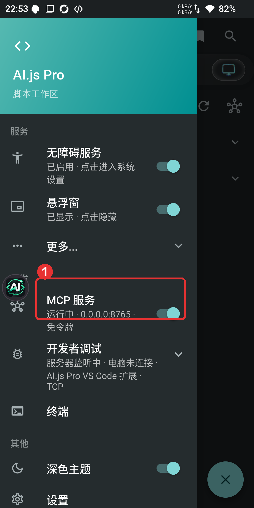
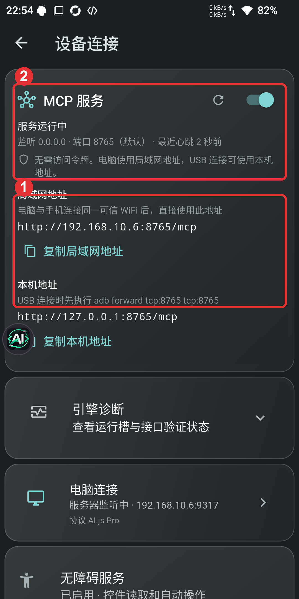
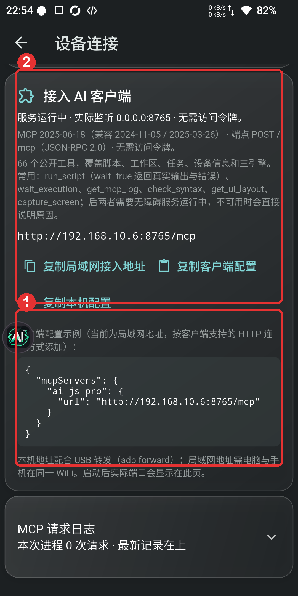
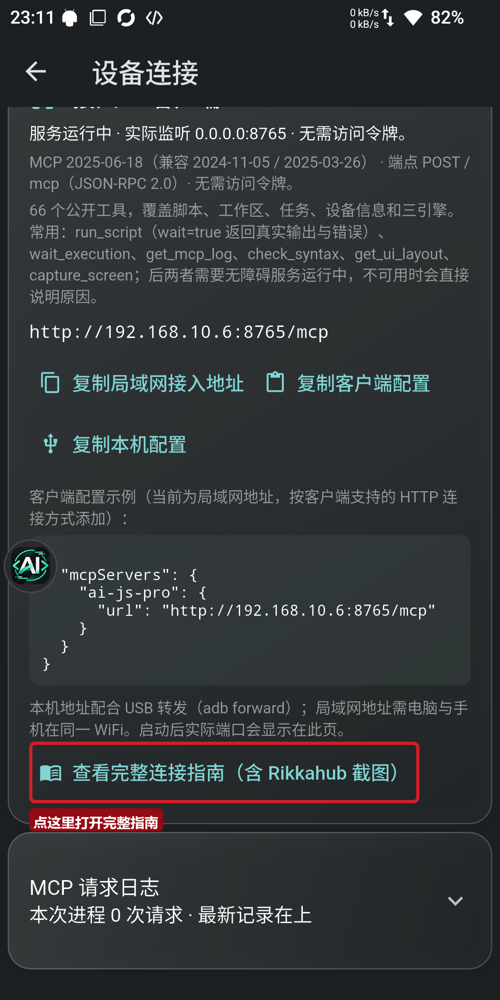
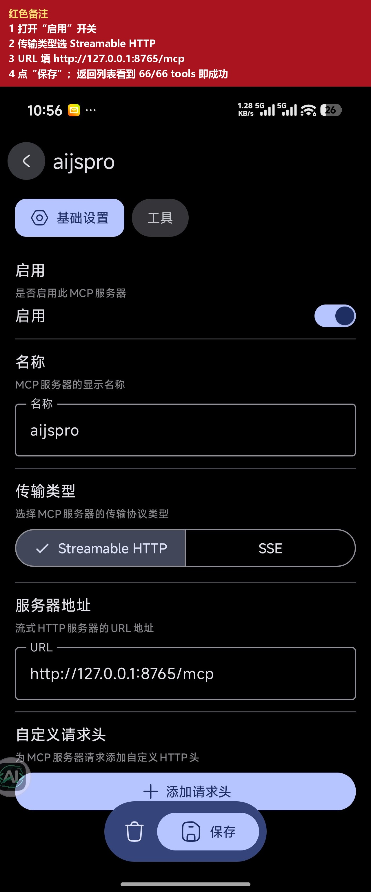
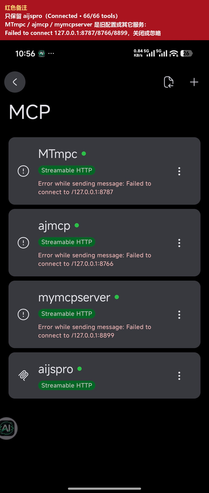

# MCP 连接指南（手机 AI.js Pro ↔ 电脑 AI 客户端）

<a id="rik"></a>

本文对应 **dev-1251+**；文件/APK 工具一节对应 **dev-1326候选**，验证和发布状态见[本轮验收](../reports/2026-11-03_MCP对齐实现进度.md)。

**dev-1257 起**：MCP 新增 `search_api_docs` / `read_api_doc`，与 App「API 文档」共用离线索引。更新后在客户端重新连接/刷新工具列表，即可让 AI 先查接口、参数和示例再写代码。

**dev-1294 起**：Node 节点 API 增加快照完整性/分页与跨布局身份（`accessibility.snapshotInfo()`、`accessibility.treePage(limit[,cursor][,{signal}])`、`select(...).findPage(...)`、`node.token/generation/isStale()`），Java 反射 varargs 与 QuickJS `ui.inflate` 亦有变化。这些是脚本侧 API，**没有新增 MCP 工具**；`ui_find` / `ui_node_action` / `ui_input` 仍是固定定位子集，要分页/身份请用 `run_script`（engine=nodejs）。详见 [Node24 控件选择器 API](Node24控件选择器API.md)「dev-1294 新增」、[API 参考](API_REFERENCE.md) §9.1 与 App 内 `learn_autojs_skill` 返回的 MCP 使用说明「dev-1294 后的节点 API 变化」。

> **2026-11-02 在设备 dev-1314 上实测 `tools/list`：共 128 个名称（119 个规范工具 + 9 个高级版别名）**，新增「文件与 APK 工具」60 个（`toolkit_status`、`file_*`、`zip_*`、`apk_*`），全部由 AI.js Pro 本地实现、不依赖 MT；早先 dev-1294 记录为 69（60+9）。**数量以客户端实际 `tools/list` 为准**。工具进程与主/脚本进程隔离；ELF 指令分析在原生库可用时用 Capstone 5.0.6 覆盖 AArch64/ARM/Thumb/x86/x86-64，原生库不可用时只回退有界 AArch64 子集。附带说明：Node UI 仍有多项已知边界，见 [API 参考的 Node UI 已知问题表](API_REFERENCE.md)。
>
> **2026-11-03 dev-1326候选验收**：Java有界正则、AES/ZipCrypto、签名元数据、资源逐项预算、四架构补丁、工作流及分页已更新。597项App回归、双端57方法各80调用、20项扩展、80MiB流程及拒绝/原子性真机通过；实际工具仍128名称。小米8已装测试候选，LAN自动源仍1318，尚未发布；细节以验收报告为准。

> 同一台手机上用 Rikkahub / Rikk 连接：直接用本机地址 `http://127.0.0.1:8765/mcp`，见下文 [Rikkahub 配置示例](#rik)。目标：让电脑上的 MCP 客户端连接到手机的 AI.js Pro，在电脑上列脚本、跑脚本、读日志、控制手机界面。

## 一、准备

- 手机安装 AI.js Pro 开发版（当前 dev-1251 或更高）。
- 电脑与手机连同一个可信 WiFi；或电脑装好 ADB 用 USB。
- 可选：要用 `get_ui_layout` / `capture_screen` / `ui_*` / `app_*` 时，先在手机开启 AI.js Pro 无障碍服务。
- 不需要 root；MCP 以应用 UID 运行，权限与 AI.js Pro 自身相同。

## 二、在手机上开启 MCP

1. 打开 AI.js Pro，点左上角菜单（☰），找到 **MCP 服务**。
2. 打开右侧开关，等待状态变成 **服务运行中**。
3. 点 MCP 服务这一行进入“设备连接”页。



> 图中 1 是 MCP 服务入口。开关打开后默认监听 `0.0.0.0:8765`，端口被占用时自动在 `8765..8795` 顺延；实际端口以页面显示为准。

## 三、复制地址

进入“设备连接”页后，会看到两组地址：

| 地址 | 使用场景 |
|---|---|
| 局域网地址 `http://<手机IP>:8765/mcp` | 电脑和手机在同一 WiFi，推荐 |
| 本机地址 `http://127.0.0.1:8765/mcp` | USB 连接，先执行 `adb forward tcp:8765 tcp:8765` |

MCP 服务当前**免访问令牌**；端点固定为 `POST /mcp`，JSON-RPC 2.0。



> 图中 1 是局域网地址，2 是服务状态/端口。复制地址按钮会自动带入当前实际端口。

## 四、填入客户端

向下滚动到 **接入 AI 客户端**：



客户端必须支持 **HTTP MCP server / Streamable HTTP**。在客户端的 MCP 设置里新增一个 HTTP server，名称可填 `ai-js-pro`，URL 填：

```text
http://192.168.10.6:8765/mcp
```

把 IP 换成你手机页面上的实际地址。也可以直接点“复制客户端配置”，得到：

```json
{
  "mcpServers": {
    "ai-js-pro": {
      "url": "http://192.168.10.6:8765/mcp"
    }
  }
}
```

不同客户端的字段略有差异：

- 通用 `mcpServers` 配置：使用上面的 `url`；
- Claude Code / 支持 remote MCP 的客户端：通常补 `"type": "http"`；
- 只接受 stdio 的旧客户端：需要额外的 HTTP-to-stdio 代理，本项目不内置；优先用支持 HTTP MCP 的新版客户端。

### USB 方式

```powershell
adb devices
adb forward tcp:8765 tcp:8765
```

然后客户端 URL 填：

```text
http://127.0.0.1:8765/mcp
```

如果手机页面显示端口不是 8765，把两处端口一起替换。

## 五、Rikkahub / Rikk 示例（同一台手机）

> **App 内入口**：AI.js Pro 的“设备连接 → 接入 AI 客户端”底部有 **查看完整连接指南（含 Rikkahub 截图）** 按钮；App 内置同一份本地 HTML，点开不联网。



如果 Rikkahub（包名 `me.rerere.rik`）和 AI.js Pro 在**同一台手机**，不需要 ADB 转发，直接用本机地址：

```text
http://127.0.0.1:8765/mcp
```

### 操作步骤

1. 在 Rikkahub 打开 **MCP** 页面，点右上角 **+** 新建服务器。
2. 名称填 `aijspro`，传输类型选 **Streamable HTTP**。
3. 服务器地址填 `http://127.0.0.1:8765/mcp`（端口以 AI.js Pro 页面实际显示为准）。
4. 打开 **启用**，点 **保存**。
5. 回到 MCP 列表，看到 `aijspro`、**Connected** 且工具已加载即连接成功；2026-11-02 在 dev-1314 实测为 **128 个名称**（119 规范 + 9 别名，含新增的 60 个文件与 APK 工具），以 `tools/list` 为准。



<p style="color:#c62828;font-weight:700">红色备注：① 启用 ② 传输类型 Streamable HTTP ③ URL 填 http://127.0.0.1:8765/mcp ④ 保存；Connected 且工具已加载即成功。截图是旧版 66 项，dev-1257 为 68 个名称。</p>



### 列表里的 Failed 项

截图中的 `MTmpc`、`ajmcp`、`mymcpserver` 显示 `Failed to connect to /127.0.0.1:8787/8766/8899`，是旧配置或其它本地服务，与 AI.js Pro 无关。只保留 `aijspro` 这一项，避免同时启用多个同名/同端口服务。

### Rikkahub 在另一台设备上

- 同一 WiFi：把地址换成 AI.js Pro 页面上的局域网地址，例如 `http://192.168.10.6:8765/mcp`；
- USB：先在电脑执行 `adb forward tcp:8765 tcp:8765`，再填 `http://127.0.0.1:8765/mcp`；
- 手机 IP 变化后重新复制地址；Rikkahub 内保存后若仍是 Failed，关闭再启用一次。

### 使用链接

- 在 Rikkahub 中调用 `learn_autojs_skill` 获取完整工具说明；其末尾附带「MCP 实战要点」（冷进程/dlopen 粘住、terminal 大输出轮询、借目标 App 解密函数的外部进程流程、坑表），逆向/解密类任务先读这一节；
- 调 `get_status` / `list_engines` 检查手机端状态；
- 用 `run_script` 时加 `wait: true` 获取真实输出和错误；
- 设备工具（`get_ui_layout` / `capture_screen` / `ui_*` / `app_*`）需要 AI.js Pro 无障碍服务。

## 六、确认连接成功

客户端连接后，先调用 `learn_autojs_skill`，再调用：

- `get_status`：确认 `scriptRoot`、MCP 服务、当前任务状态；
- `list_engines`：确认 Rhino / QuickJS / Node24 可用；
- `search_api_docs`（如 `query=loadResources, engine=nodejs`）→ `read_api_doc`（使用返回的 id 和 indexSha256）：查 API 说明与代码；文档标注不代表运行已验证；
- `list_scripts` / `read_script`：读手机脚本；
- `run_script`（`wait:true`）：运行脚本并拿真实输出；
- `get_mcp_log` / `read_apk_logs`：查日志。

连接正常时 `tools/list` 会返回当前公开工具（2026-11-02 在 dev-1314 实测为 119 个规范工具 + 9 别名 = 128 个名称，实际以客户端显示为准；本轮未重新计数），分为：状态与诊断、脚本与执行、工作区、引擎与 API、设备与无障碍、终端与构建、悬浮窗、示例与帮助、文件与 APK 工具。文件/APK 工具在独立 `:tools` 进程执行，APK 采用不可变快照 + 编辑会话；ELF 指令分析和补丁的当前源码行为见下文第九节，完整说明见 App 内 MCP 指南「文件与 APK 工具」一节。

## 七、常见问题

### 电脑打不开地址

- 确认手机页面状态是“服务运行中”，不是“心跳过期”；点页面刷新。
- 确认电脑和手机在同一 WiFi，且路由器未开启 AP 隔离。
- 检查 Windows 防火墙是否拦截出站/入站；换 USB 方式验证。
- 手机 IP 可能变化，重新复制页面上的局域网地址。

### 端口不是 8765

MCP 会从 8765 起自动顺延，避免占用冲突。以页面显示的端口/地址为准；USB 转发时两处端口要一致。

### 手机锁屏/后台一段时间后断开

MCP 是前台服务；保持 AI.js Pro 后台存活，必要时重新打开应用并确认开关仍为开。系统清理后台后需要重新开启 MCP。

### 无障碍工具报错

`get_ui_layout`、`capture_screen`、`ui_*`、`app_*` 需要 AI.js Pro 无障碍服务；抽屉里确认“无障碍服务 已启用”。截图还要求 Android 11+ 且页面没有 `FLAG_SECURE`。

### 安全提醒

MCP 当前免令牌，任何能访问该端口的设备都能控制脚本和部分设备操作。只在可信局域网使用，不要把 8765 端口映射到公网；需要跨网络时用 SSH/VPN 等安全通道。

## 八、当前工具概览

| 分类 | 工具 |
|---|---|
| 状态与诊断 | `get_status`、`read_apk_logs`、`get_mcp_log` |
| 脚本与执行 | `list_scripts`、`read_script`、`search_scripts`、`continue_result`、`run_script`、`check_syntax`、`list_executions`、`get_execution`、`wait_execution`、`stop_script`、`stop_all_scripts` |
| 工作区 | `workspace_*`（open/list/read/write/delete/diff/request_apply/mkdir/cancel/cleanup） |
| 引擎与 API | `list_engines`、`list_engine_api`、`probe_engine_api`、`engine_api_diff`、`call_engine_api` |
| 设备与无障碍 | `get_ui_layout`、`capture_screen`、`ui_*`、`app_*`、`apk_install`、`apk_uninstall` |
| 终端与构建 | `terminal_exec/read/write/stop/list`、`shell_rish`、`get_build_tools` |
| 悬浮窗 | `list_overlays`、`close_overlays` |
| 示例与帮助 | `search_api_docs`、`read_api_doc`、`list_samples`、`read_sample`、`learn_autojs_skill` |
| 文件与 APK 工具 | `toolkit_status`、`file_*`、`zip_*`、APK 快照/会话/读取/编辑/搜索/DEX/资源/ELF/构建/签名元数据（`apk_workspace_*` 等；`apk_install/uninstall` 属设备类） |

## 九、文件与 APK 工具（dev-1326候选）

> 参数以当前设备 `tools/list` 的 inputSchema 和工具返回为准；不同版本可能有差异。验收覆盖场景和能力上限见报告。

- **工作流**：`toolkit_status` → `apk_list_available_apks` → `apk_workspace_open`（已有 APK 上下文用 `aijs://current-apk` 取回，没有上下文先按实际路径打开；已保存工作区用 `aijs://workspace/<id>` 且 `temporary=false`）→ `apk_session_create` → 读取/搜索 → 修改 → `apk_session_check(runBuildChecks=true)` → `apk_build`。会话只改写时复制副本，源 APK 不变；构建默认不签名，`sign=true` 用本机 AI.js Pro 身份重签并移除原签名。
- **分页/陈旧**：列表、搜索、DEX、native、资源 xref 按类型分页（APK列表/DEX大纲最多1000、native列表500，其余列表200），返回 `nextCursor` 后用 `apk_continue` 续页；游标 5 分钟过期并绑定会话 revision，编辑后必须重查。语义编辑用 `targetVersion`；`apk_edit_text` 新建目标用 `targetVersion="missing"` + 单个 `write_target`；字节/原生补丁用 `expectedHex`/`expectedText` 防旧写。
- **搜索/正则**：`apk_search` 覆盖 ZIP/AXML/资源/DEX（类、字段、方法、字符串）/Smali/native。`queryType=regex` 是 Java `java.util.regex`（支持环视/反向引用），每个 matcher 默认 750ms、最多 8,000,000 次字符访问；文件搜索总预算 3 秒、APK 搜索 8 秒，搜索超预算会标记部分结果/跳过范围；不能返回部分结果的操作报 `REGEX_BUDGET_EXCEEDED`。`includeMatchOffsets` 为 Java UTF-16 偏移，`snippetMaxChars=0` 关闭预览。
- **ZIP**：读取支持 ZipCrypto/AES，写入只生成 AES-256 或明文，加密条目密码必填。`zip_test` 才做完整 CRC/HMAC 校验，`zip_read_*` 只是预览。预算为 50,000 条目/512MiB 校验或解压、250:1 压缩比（256KiB 阈值）、2GiB 创建/更新；`zip_list` 游标 30 分钟过期。
- **签名**：`apk_read_signature` 与构建结果的 `signatureSummary` 只读取 V1/V2/V3/V3.1 证书与方案元数据，`verified` 始终为 false；工作区打开摘要只给 present/schemes/certificateCount。不做密码学验签、证书链信任或内容摘要核对，不保证可安装、可升级或未被篡改。解析失败时 `available=false`，详情见 `warnings`。
- **资源**：`apk_resource_read` 每批 1..200 项，`variant` 默认 `default`；`maxValueChars` 默认 4096、`maxValueXmlChars` 默认 32768、`maxItemsPerValue` 默认 50、`resolveDepth` 0..1。单项错误不丢其他结果；`valueXml` 超预算返回 null，不能写回半截 XML；`resolveDepth=1` 只解析一级直接引用。
- **原生**：Capstone 5.0.6 原生库可用时解码 AArch64/ARM/Thumb/x86/x86-64，不可用时回退有界 AArch64 子集；未知指令标 `decoded=false`。指令补丁支持四架构小端等长补丁，内置汇编器仅覆盖 AArch64 常见子集，其余/复杂形式需可选 clang（应用终端 `aijs-toolchain install cpp`）；字符串增长只利用已有 NUL/空格 padding，不改长度/指针/重定位。
- **上限**：APK 快照 512MiB/总量 1GiB、16 个工作区、每工作区 8 会话、2000 变更条目/512MiB、单条分析 64MiB、文本 10MiB、响应 24MiB。旧 `mt_*` 名称只是 dispatch 别名，规范名是 `apk_*`；公开 URI 使用 `aijs://`。

## 十、相关文档

- [MCP 手机终端与编译入口](../reports/2026-10-25_MCP手机终端与编译入口.md)
- [MCP 无障碍 UI 自动化](../reports/2026-10-25_MCP无障碍UI自动化.md)
