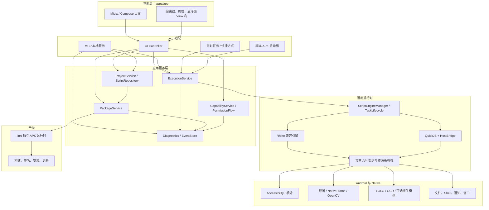

# AI.js Pro 整体框架重构任务书

日期：2026-09-23  
范围：`C:\Users\18101\Documents\ai-js-pro` 整个 Android 项目，不限于象棋示例。  
用途：交给 DeepSeek / 接手开发者分批实施与验收。**本文是目标方案，不代表这些改造已经完成。**

## 0. 先固定事实与边界

AI.js Pro 是 Android 端 JavaScript IDE、自动化运行时和脚本 APK 打包器。当前源码保留 Rhino 兼容脚本，`// @engine quickjs` 进入 QuickJS。主 App 使用 Miuix/Compose，编辑器、终端、悬浮窗等仍有 View 实现；脚本打包产物由 `:inrt` 模板运行。仓库 `settings.gradle` 当前包含 `:app`、`:inrt`、`:engine`、`:engine-rhino`、`:rhino-language`、`:automator`、`:common` 和若干第三方模块；`apps/app/build.gradle` 只有 `miuix` 界面 flavor，以及 `compat`、`lite` 引擎 flavor。**旧 ImGui 工作台不是现行主界面，不应按旧架构文档复活。**

本任务书以 2026-09-23 工作树为调研对象。当前分支 `chore/upgrade-gradle-8`、HEAD `0c24cd6`，但有大量未提交改动，且 DeepSeek 正在修改其中一部分。实施前必须重查 `git status` 和目标文件，不能用本文替代实时源码。`docs/architecture/项目说明.md` 是 2026-09-04 的归档快照，`docs/PROJECT_STATUS.md` 更新于 2026-09-08，也不能单独代表 09-23 的全部事实。

目标是**收敛模块边界、统一脚本生命周期和 API 契约、使打包运行时与主 App 行为一致、把 UI/MCP/文件管理纳入同一业务服务层**。继续支持现有用户脚本和数据；不以更换 JavaScript 引擎、全面重画 UI 或一次性移动全仓文件为前置条件。象棋工程是验证 QuickJS、截图、OCR、YOLO、Pikafish 和长跑资源管理的一个高负载样例，专项方案见 `docs/plans/象棋自动走棋_框架重构任务书_2026-09-23.md`，不应把专项逻辑塞进通用平台层。

## 1. 当前问题归类

| 问题 | 影响 | 本轮处理方向 |
|---|---|---|
| 主界面已 Miuix 化，仍有 View/转发壳/反射桥/旧菜单 | 页面行为、主题、返回键及文件操作容易出现两套口径 | 将页面状态与文件操作抽为共享服务；按页面逐项迁移与回归，不改成熟操作语义 |
| Rhino / QuickJS API 面接近，但语义、线程和资源所有权差异仍可能存在 | “有同名 API”不等于脚本可迁移；长跑可能泄漏或回调错线程 | 为每项能力建立可执行的参数/异常/线程/释放契约与双引擎对照测试 |
| 运行入口多：编辑器、文件页、示例、任务、MCP、打包产物 | 停止、日志、权限、异常和工作目录可能不一致 | 所有入口走统一 `ExecutionService`，记录请求来源和实际引擎 |
| `:app` 与 `:inrt` 共用部分运行时，但打包会改写脚本、项目配置、清单与签名 | 主 App 内可跑而独立 APK 不可跑，或权限/路径/加密行为不同 | 统一项目清单与运行时契约，做主 App ↔ 打包 APK 的成对回归 |
| MCP 有独立工作区和应用流程 | 若绕过文件/运行服务，UI 与远程编辑的路径、冲突和撤销口径不一致 | MCP 作为受授权的应用层入口；继续使用复制工作区、哈希冲突检查、备份/回退 |
| 截图、NativeFrame、OpenCV、YOLO、OCR、Pikafish 等对象跨 JS/Java/JNI | 长时间运行时占用难归因，停止不彻底会留下资源 | 统一资源租约与诊断指标；每个运行任务持有并释放自己的资源 |
| 构建、发布、更新源脚本存在会自动发布的入口 | 验证脚本时可能改动真实更新源 | 文档和工具把“编译、安装、发布”分开，重构阶段默认只构建/测试 |

这些是**架构风险和待验收方向**，不是宣称每项当前都存在可复现故障。具体缺陷应由 P0 基线及对应真机/自动测试给出证据。

## 2. 目标全景图



依赖方向固定为入口 → 应用服务 → 运行时/平台。UI 不直接管理引擎实例，MCP 不绕过项目仓库修改用户文件；`modules/engine` 不依赖 `apps/app` 的 Miuix 页面。`apps/inrt` 复用运行时契约，不复制一套不同的 API 语义。下层不通过全局静态 UI 对象反向调用页面；状态以显式事件或只读快照向上通知。

## 3. 模块职责与允许的迁移

| 模块 | 目标职责 | 应保持的现有约束 |
|---|---|---|
| `apps/app` | 编辑、项目/文件管理、示例/资源、任务、MCP、打包和 Miuix UI；把入口适配到服务 | 保留脚本目录、文件操作、转发壳对外 Intent/extra 契约，逐页迁移 |
| `apps/inrt` | 独立 APK 解包项目、读取 `project.json`、选择引擎、启动/停止 | 与 App 的项目格式、加密等级、资源路径和权限一致 |
| `modules/engine` | `ScriptEngineManager`、QuickJS、共享脚本执行接口、HostBridge 和通用 API/Native 能力 | 每脚本独立运行时；停止、销毁和跨线程回调顺序清晰 |
| `modules/engine-rhino` | Rhino 执行与 Auto.js 旧脚本兼容 | `compat` 中旧脚本默认 Rhino；不得因 QuickJS 迁移而静默改变旧行为 |
| `modules/rhino-language` | 编辑器中 Rhino 语法/语言支持 | `lite` 可使用语法能力，但不因此启用 Rhino 执行 |
| `modules/automator` | 无障碍选择器、控件操作、手势 | 权限未授予时明确失败，执行前台/线程规则与运行任务一致 |
| `modules/common` | Android/文件等真正共享的基础设施 | 不逐渐变成所有业务代码的“杂物箱”；迁入前确认多模块需求 |
| `third-party/*` | 外部/封装库 | 升级与删减独立做兼容验证，不在主框架迁移中无依据替换 |

新增服务优先放在 App 现有源码内，以接口和测试收口。只有两个以上模块确需共享、且依赖方向清楚时再抽 Gradle 模块；不为画出整洁目录而大规模搬文件。

## 4. 四个核心契约

### 4.1 项目与脚本契约

`ScriptRepository` 是主 App 对脚本目录的唯一业务入口，负责扫描、路径规范化、项目识别、版本/哈希、读写与变更通知。编辑器、Compose 文件页、示例导入、资源安装、MCP 工作区、打包器都基于它读取项目事实。MCP 仍先在私有工作区编辑，申请应用时经授权、原文件哈希检查和备份后写回；不因“统一服务”削弱已有防覆盖语义。

建议请求对象：

```text
ScriptDescriptor {
  canonicalPath, projectRoot?, mainScript?, projectManifest?,
  sourceRevision, engineSelection, requiredCapabilities
}
```

`engineSelection` 的来源和优先级必须在一个函数中判定：项目声明、首行 `// @engine quickjs`、默认 Rhino，冲突时给可读错误或明确规则。入口不能凭扩展名、UI 类型或“最近使用引擎”另做一套选择。记录原始选择依据和最终引擎，以便复现实测。更改优先级前必须确认当前源码和既有脚本兼容性。

### 4.2 执行与任务生命周期契约

现有 `ScriptEngineManager`、`ScriptEngineService` 继续负责引擎注册和运行；上层增加统一的 `ExecutionService`（可先是门面），收口编辑器运行、文件页运行、示例运行、定时任务、MCP `run_script` 与 inrt 启动。请求与状态建议如下：

```text
ExecutionRequest {
  scriptDescriptor, origin, args, workingDirectory,
  requestedEngine?, runMode, permissionContext
}
ExecutionHandle {
  executionId, sourceRevision, actualEngine, state,
  startedAt, stoppedAt?, exitReason?, error?, ownedResources
}
状态：CREATED → STARTING → RUNNING → STOPPING → STOPPED / FAILED
```

`stop` 幂等；UI 关闭、单任务停止、`stopAll`、MCP 停止和脚本异常都走相同清理顺序。先请求引擎中断、等待脚本/回调退出，再释放 Native/窗口/帧对象；超时要报告仍存活的线程和对象，不在后台默默留下“已停止”的假状态。跨线程 JS 回调只在对应引擎线程执行。日志和异常绑定 `executionId`，避免多脚本混淆。

### 4.3 API/能力契约

QuickJS 与 Rhino 的兼容性不能只按全局函数数量判断。每个公开能力需要一条可测试的 `CapabilitySpec`：API 名和版本、两个引擎是否支持、参数/返回值、同步或异步、异常、线程、所需 Android 权限、创建资源的释放责任、主 App/inrt 可用性、最小设备版本。先覆盖高风险能力：截图/NativeFrame、无障碍与手势、悬浮窗、文件/Shell、Java 互操作、OpenCV、YOLO、OCR、Pikafish、任务/定时器、UI/worker。

适配层保留现有 API 名称。新增接口先写能力契约和最小示例，再实现 HostBridge/JNI，再做 Rhino/QuickJS 对照；无法对齐时文档写出差异、错误和替代用法，不假称 100% 等价。`lite` 缺 Rhino 执行时应在选择阶段给明确错误；`compat` 的老脚本不因平台重构而变更默认引擎。

### 4.4 项目打包契约

`PackageService` 将“解析项目 → 校验资源/权限 → 准备 inrt 模板 → 写入脚本与资源 → 加密/签名 → 校验产物”拆成阶段结果。`project.json` 是 App 与 inrt 的共同协议，关键字段（入口、引擎、资源路径、加密等级、存储方式、权限声明、包名和版本）集中定义并做版本迁移/默认值测试。打包流程保留现有签名、加密与自动身份语义；不在框架重构时擅自改密钥派生或脚本保护格式。

至少做成对验证：同一项目在主 App 与打包 APK 中，能加载相同模块、取到相同资源路径、选择相同引擎、报告相同 API 可用性；截图、无障碍、悬浮窗、OCR/YOLO 等按权限与 ABI 分层验收。不能用“APK 安装成功”代替“项目脚本跑完”。

## 5. UI、MCP 与平台能力的边界

- Miuix/Compose 页只管理交互状态；页面状态由 `ViewModel`/Presenter 订阅服务快照，文件删除、脚本运行、项目打包走统一用例。编辑器、终端、悬浮窗作为 View 岛保留，性能/输入法/窗口行为确认后再迁。保持现有 Intent、返回键、窗口 token、主题和安全区语义。
- MCP 是本机已授权的另一个入口，不是第二套文件系统或脚本管理器。`McpWorkspaceStore` 的 copy-on-write、路径约束、哈希冲突、备份和回退继续有效；执行工具返回真实 `ExecutionHandle` 与异常，而非只给“命令已提交”。工具目录/描述与实际工具集合由自动测试同步。
- Android 权限由 `CapabilityService` 说明功能、申请时机、失败/降级方式；不同 API 的行为不应在各页面重复编码。无障碍、截图、悬浮窗、存储、通知、前台服务和包可见性要分设备/系统版本回归。对 `targetSdk` 的提升作为单独兼容项目，不能与框架迁移同时一次性切换。
- 本地模型和视觉能力应作为可查询能力，而不是所有脚本启动时都初始化。NativeFrame、Mat、YOLO/OCR 会话、Pikafish、窗口与回调由创建它的 `ExecutionHandle` 持有；释放采用 `finally`/确定顺序和泄漏诊断。模型可按需共享，但共享实例必须有引用计数或服务级所有者。

## 6. 可观察性与数据流

一条统一事件链覆盖 `open project → edit/apply → run → API calls → stop/error → package/install`，至少含 `timestamp`、`executionId` 或 `workspaceId`、入口、实际引擎、阶段、结果和耗时。UI 日志、MCP 结果、任务页状态与崩溃报告引用同一个执行 ID。截图/模型输入、脚本文本和用户路径默认不进普通日志；诊断包由用户主动导出、可预览和删除。日志与截图有上限和轮转，防止 C 盘及手机存储长期增长。

建议针对资源记录：每个脚本的 JS/native 堆、PSS、活跃线程、NativeFrame/Mat 数、截图会话、YOLO/OCR/Pikafish 实例、悬浮窗数及未释放句柄。测试中用“停止后的稳定基线”和多轮运行比较，不能只看运行中内存峰值就断言泄漏。

## 7. 分批实施与回退

| 阶段 | 具体任务 | 交付门槛 |
|---|---|---|
| P0 基线与依赖图 | 更新模块/入口/API 调用图；列出改动中的文件和可复现问题；采集 compat/lite、主 App/inrt、K40/Mi8 当前结果 | 有源码路径、版本、设备、日志；把过期文档标为历史，不直接改业务行为 |
| P1 统一脚本事实 | 建 `ScriptDescriptor/ScriptRepository` 门面；文件页、编辑器、MCP、打包逐入口切换；保持工作区备份/冲突语义 | 同一项目在各入口路径、清单、版本一致；重命名/删除/覆盖/回退有测试 |
| P2 统一执行生命周期 | `ExecutionRequest/Handle` 与任务状态；停止/异常/资源所有权收口；UI、定时任务和 MCP 接入 | 同一脚本从各入口运行与停止结果一致；反复启动/停止无遗留线程和窗口 |
| P3 双引擎 API 契约 | 能力清单、共享契约测试、实际引擎报告、HostBridge 资源规则；逐项修语义缺口 | Rhino 旧脚本基线不退化；QuickJS 差异有可执行测试或显式不支持说明 |
| P4 UI 与工作流 | 继续按既有 Miuix 迁移方案逐页迁尾巴；视图状态与文件/运行服务绑定 | 浅/深色、大字体、横屏、输入法、返回键、悬浮窗口与文件操作不倒退 |
| P5 打包/inrt | 项目清单版本化、成对运行测试、权限与 ABI 矩阵、构建产物校验 | 主 App 与独立 APK 行为可解释；旧项目升级或拒绝有确定规则 |
| P6 性能与发布 | 60 分钟长跑、内存与启动耗时、CI/真机矩阵、正式发布准备 | 构建/安装/发布分离，回归报告有量化指标，更新源只有明确发布任务才改变 |

每个阶段以**小 PR/小提交**实现，不跨 P1–P5 一次改所有模块。引入新服务时让旧调用点委托到新接口，完成两端回归后再删旧路径。若实际源码已有同等服务，复用现成实现并把任务标记为“已满足”，不要重复造类。

## 8. 必跑验证矩阵

| 维度 | 最小回归 |
|---|---|
| 构建 | `:app:assembleMiuixCompatDebug`、`:app:assembleMiuixLiteDebug`、`:inrt:assembleDebug`；改 C++/JNI 先按 `AGENTS.md` 的原生构建顺序刷新 `.so` |
| 单测 | `:app:testMiuixCompatDebugUnitTest` + 受影响模块测试；QuickJS 示例首行标记、无 Node 依赖等 Gradle 校验 |
| 双引擎 | 相同基础 API 的参数/返回/异常/线程/释放对照；compat Rhino 旧脚本、QuickJS 新脚本、lite 中 Rhino 明确拒绝 |
| 入口 | 文件页、编辑器、示例、定时任务、MCP 均能运行、停止、拿到实际引擎和同一格式日志 |
| 文件/MCP | 新建、编辑、冲突、应用、备份、回退；路径穿越和符号链接按现有安全边界拒绝 |
| APK | 单文件/多文件项目，0/1/2 级加密、资源、图标、权限、签名；主 App/inrt 成对验证入口脚本 |
| 真机 | K40 + 可用的另一台设备；前后台、无障碍/截图拒绝、悬浮窗、深浅色、大字体、横屏、长跑资源释放 |

文档改动只核对 Markdown 结构和源码引用；真正实施阶段再运行构建与真机测试，不能把本任务书的验收表写成“已通过”。

## 9. 给 DeepSeek 的执行约束

1. 先读仓库 `AGENTS.md`、`docs/PROJECT_STATUS.md`、本任务书及受影响模块的当前源码；有 `.codegraph/`，定位代码先用 CodeGraph。检查当前工作树和并行修改，保留未提交工作，不覆盖他人文件。
2. 每批提交前说明**真实问题、影响路径、接口变化、兼容策略、可回退办法**。先改纯契约和测试，再迁一个调用入口，避免整仓重排。
3. 文档和 UI 必须区分“支持”“已构建”“已真机验证”“已发布”。API 清单按真实运行结果更新，不以源文件存在或全局函数计数代替行为测试。
4. 构建只用原生 Gradle 命令或确认不会发布的参数。仓库 `build-miuix-debug.ps1` 默认会自动发布；`tools/dev-update.ps1 -NoServe` **仍会发布**。重构测试禁止触发真实更新源；发布只能在明确单独任务中用 `tools/publish.ps1` 的正式流程。
5. 每批交付实际修改文件、测试命令与结果、真机/ABI 范围、遗留风险。若一项策略或性能优化没有同条件对照，标记为假设，不宣称提高稳定性或速度。

本方案对应的是 AI.js Pro **平台框架**；象棋重构方案是使用平台 API 的工程级任务，两份文档应分别评审和实施。
