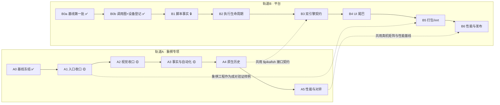

# AI.js Pro 整仓重构 · 全程里程碑表（2026-09-23）

> 用途：把两份任务书合成**一张执行顺序表**（轨道划分、依赖、验收门槛、当前状态），供逐阶段执行。
> 细则仍以原文为准：
> - 平台：[`AI.js_Pro_整体框架重构任务书_2026-09-23.md`](AI.js_Pro_整体框架重构任务书_2026-09-23.md)（P0–P6）
> - 象棋：[`象棋自动走棋_框架重构任务书_2026-09-23.md`](象棋自动走棋_框架重构任务书_2026-09-23.md)（P0–P5）
> 为避免与任务书的「P1/P2…」混淆，本表用 **A=象棋轨道、B=平台轨道** 编号。
> 状态快照：2026-09-23 晚（象棋工程工作树已清零；全仓尚有约 123 个其他区域未提交改动）。

## 0. 状态图例

✅ 完成 ｜ 🟡 部分完成 ｜ ⏳ 待开始 ｜ 🔒 被阻塞

## 1. 两条轨道与依赖

## 2. 里程碑总表

| 编号 | 里程碑 | 核心交付 | 验收门槛（摘要） | 前置 / 阻塞 | 状态 |
|---|---|---|---|---|---|
| **A0** | 象棋基线冻结 | `docs/reports/2026-09-23_象棋重构P0_基线冻结.md`；WIP 落库 `a2d280e` + `2306bfa` | 两入口/视觉路径/引擎后端可指认；PC 与手机证据分离 | — | ✅ |
| **A1** | 象棋入口收口 | `main.js` 与悬浮窗改走 `bootstrap → controller → game-session/board-service`；单所有权 + 会话令牌 | 两个 UI 在同一棋局显示相同局面版本/后端/运行态；不可能同时启动两套点击循环 | A0（已满足） | 🟡 批次1 `2bb3deb`、批次2 `f9de636`、批次3（跨引擎协议归一）`4610903` 已提交；剩余：带画面真机验收（卡在 K40 截屏授权） |
| **A2** | 象棋视觉收口 | `vision-pipeline` 为唯一生产路径；检测/OCR/颜色/规则分离；旧识别仅显式兼容模式；修 `requireTypeLimits` 遗留用例 | 回放与真机可列每格候选及证据；正常空位未知数 0；不可信帧 0 次点击 | A1 | 🟡 批次1 已提交 `a1c478a`：两入口共用 `pipeline-factory`（装配/OCR holder/采样三件套）+ 严格模式契约修复（19/0）+ 真机自检 280/0；「带画面」验收待 K40 截屏授权 |
| **A3** | 事实与自动化 | 抽 `PositionTracker` + `VerifiedMoveLedger`；缩小 `auto-driver`；完善恢复/点击验证/结算页 | 快速应手、漏点、遮挡、重建基准、撤回、换局能暂停或正确追加棋谱；失败不推进版本 | A2 | 🟡 批次1 `5e15d1b`（事实层+影子接线）、批次2 `487b077`（预算+佐证门）、批次3 `83612e4`（连续帧共识）、批次4 `c137d0e`（已知事实表）、批次5 `6da1a4c`（**驱动回放用例上线** + join 碰撞修复）、批次6 `e733982`（**失败路径/换局回放场景** + `budgetPauses` 补记数）——双端自检 293/0、场景 11/0；剩余：P4 切换读取源（待引擎侧落库）、恢复/结算页 |
| **A4** | 原生历史 | `$pikafish` Java/JNI/JS 扩展携带已验证着法（`position fen … moves …`）；竞技模式禁静默降级 | 同一 `initialFen+moves` 在 PC 与 K40 得到一致合法局面；每手可查实际后端；历史断裂明确标记 | A3；接口格式与 B3 对齐 | ⏳ |
| **A5** | 性能与对弈 | 资源释放、回放压测、同条件多盘 A/B；开局/求胜/残局策略独立开关 | 内存与耗时达目标或附测量说明；报告完整胜/和/负与终局类型；策略收益有对照数据 | A4；与 B6 共用真机矩阵 | ⏳ |
| **B0a** | 平台基线第一批 | `docs/reports/2026-09-23_平台重构P0_基线与入口概览.md`；compat/lite/inrt/单测 四绿落盘 | git/版本/模块/构建基线齐；过期文档已标注历史 | — | ✅ |
| **B0b** | 平台调用图 + 设备登记 | 模块/入口/API 调用图（CodeGraph 辅助）；K40/Mi8 序列号与机型登记；四态状态表（已支持/已构建/已真机验证/已发布） | 有源码路径、版本、设备、日志 | —（纯文档） | ✅ 平台报告 §7（脚本链+设备）+ §8（MCP/inrt/定时任务三条链+汇聚图）+ §9（四态表）；剩余「UI/设置/打包器面的完整调用图」并入 B1 前置 |
| **B1** | 统一脚本事实 | `ScriptDescriptor / ScriptRepository` 门面；文件页、编辑器、示例、MCP、打包逐入口切换 | 同一项目在各入口的路径/清单/版本一致；重命名/删除/覆盖/回退有测试 | B0b；**其余 123 个未提交改动需先落库** | 🔒 |
| **B2** | 执行生命周期 | `ExecutionRequest / ExecutionHandle` 与任务状态；停止/异常/资源所有权收口；UI、定时任务、MCP 接入 | 同一脚本从各入口运行与停止结果一致；反复启停无遗留线程与窗口 | B1 | ⏳ |
| **B3** | 双引擎契约 | `CapabilitySpec` 能力清单、共享契约测试、实际引擎报告、HostBridge 资源规则 | Rhino 旧脚本基线不退化；QuickJS 差异有可执行测试或显式不支持说明 | B2；与 A4 共用 `$pikafish` 接口格式 | ⏳ |
| **B4** | UI 与工作流 | Miuix 迁移尾巴逐页收；视图状态与文件/运行服务绑定 | 浅/深色、大字体、横屏、输入法、返回键、悬浮窗口与文件操作不倒退 | B2 | ⏳ |
| **B5** | 打包 / inrt | `project.json` 版本化；主 App ↔ 打包 APK 成对运行测试；权限与 ABI 矩阵 | 主 App 与独立 APK 行为可解释；旧项目升级或拒绝有确定规则 | B3；用象棋工程做成对验证样例 | ⏳ |
| **B6** | 性能与发布 | 60 分钟长跑、内存与启动耗时、CI/真机矩阵；构建/安装/发布分离 | 回归报告有量化指标；更新源仅在明确发布任务中改变 | B5、A5 | ⏳ |

## 3. 可开工 / 阻塞一览（截至 2026-09-23）

- **可立即开工**：`A1`（象棋入口收口，改动集中且工程已清零）；`B0b`（纯文档，不碰代码，可与 A1 并行）
- **被阻塞**：`B1~B6` 的代码改动 → 需先把其余 123 个未提交改动（apps 其余 ~54 / docs 38 / modules 14 / 其他）落库或明确归属，否则必然交叉
- **互相让路**：`A4` 要动 `modules/engine`（Java/JNI/JS）→ 实施时按 `B3` 的 CapabilitySpec 格式记录接口，避免二次返工；`A5` 与 `B6` 共用真机/性能基线，先做的一方把指标与脚本固化

## 4. 执行约定（摘自两份任务书，执行时逐条遵守）

1. **小 PR / 小提交**：不跨阶段一次改所有模块；新服务先让旧调用点委托，两端回归通过后再删旧路径
2. **不夹带**：不换引擎、不重画 UI、不一次性搬动全仓文件；模型/权限/签名等既有语义不动
3. 每批先说明：**真实问题、影响路径、接口变化、兼容策略、可回退办法** → 再改代码
4. **构建 / 安装 / 发布分离**：重构期禁止触发真实更新源（`build-miuix-debug.ps1` 默认自动发布；`tools/dev-update.ps1 -NoServe` **仍会发布**）
5. 文档与 UI 必须区分「已支持 / 已构建 / 已真机验证 / 已发布」；没有同条件对照的数据不宣称提升
6. 改 `modules/engine/src/main/cpp/` 后先重编原生库；QuickJS 样本 `.js` 首行保持 `// @engine quickjs`

## 5. 下一步（本表给出的默认顺序）

1. **A1**：象棋入口收口（先做接口盘点与委托层，小步提交；旧路径保持可回退）
   - 批次1（已提交 `2bb3deb`）：两入口的装配/生命周期改走 bootstrap + session；驱动不再直建
   - 批次2（已提交 `f9de636`）：controller 命令接入（两入口 16 个 handler）+ 跨引擎状态对齐
     （状态行统一带 运行态/几何 vN/引擎；面板显示「页面：跑中｜v9｜Pi…」已真机验证）
   - 批次3（已提交 `4610903`）：跨引擎协议归一 —— panel-bus 成为唯一实现
     （新增 `createBus` 唯一创建口 / `createNullBus` 空总线；两入口同一实例注入 `app.bus`；
     删 `owner-channel.js`）；顺手修掉它遗留的 **dispose 还锁令牌静默 no-op**
     （"main"/"floaty" → loop-lock 中文令牌，入口改传 `lockOwner`）
2. **A2 批次1（已提交 `a1c478a`）**：`pipeline-factory` 收口两入口视觉装配 + `grid-search` 严格模式
   契约修复 + 自检用例宿主确定性（真机 280/0）；「不可信帧 0 点击 / 正常空位未知数 0」的
   带画面验收待 K40 截屏授权（离线回放可作替代证据）
3. **B0b（已完成）**：平台报告 §7/§8/§9（脚本链 + 设备登记 + MCP/inrt/定时任务链 + 四态表）；
   未做真机回归的格子（MCP 端到端、inrt 装机、lite 变体、定时任务）已在报告 §10 挂账
3. **A3 批次1（已提交 `5e15d1b`）**：`move-ledger.js`（只收已验证着法 / `positionCommand`）
   + `position-tracker.js`（单点写入 / 失败不推进版本）+ auto-driver 17 个写点影子接线
   （`trackerMismatch/trackerRejects` 守护；本批**不改行为**）
3b. **A3 批次2（已提交 `487b077`）**：抽出 `attempt-budget.js`（尝试预算）与 `cross-frame-gate.js`
   （跨帧佐证门）；auto-driver 净缩 ~68 行；顺手删死变量 `toleranceEvidence`
3c. **A3 批次3（已提交 `83612e4`）**：抽出 `frame-consensus.js`（OCR 连续帧共识账本）；
   A3 累计 auto-driver 292.7KB → 288.8KB
3d. **A3 批次4（已提交 `c137d0e`）**：抽出 `known-facts.js`（已知事实补齐表）；
   A3 累计 auto-driver 292.7KB → 287.7KB；工程内静态可抽项到此清空
3e. **A3 批次5（已提交 `6da1a4c`）**：**驱动回放用例上线**（`tools/regress/cases/driver-replay-turns.js`，
   PC+真机同跑，逐手输出「观测→已确认局面→positionCommand」轨迹）——首次运行即抓到
   「join 碰撞导致的重复记账」回归，同批修复（cellsKey null 安全比较 + 重复确认幂等）
3f. **A3 批次6（已提交 `e733982`）**：**失败路径/换局回放场景**（`driver-replay-budget-rebuild.js`、
   `driver-replay-newsession.js`）：预算超限→暂停清基准→恢复按观测降级 partial；换局→账本不跨局
   带历史；补 `stats.budgetPauses` 累加（原声明未自增）；场景实现自身两次踩 join 碰撞（已改用
   cellsKey）；regress 场景 9→11
4. 其余未提交改动落库后 → **B1** 开工

## 6. A1 批次1 真机冒烟发现（2026-09-23，K40）

- ✅ 装配链路起效：`端口：必需能力齐备`（bootstrap 输出）→ 视觉流水线启用 → `[driver] INIT` →
  `驱动已启动，状态机：RECOVERING` → `已开始：① 只识别…已持有循环锁`；watch 模式零点击。
- ✅ **真机自检 27 例设备专属失败已修复（A2 批次1）**：根因 = 驱动场景用例在手机端走 worker → 停
  `THINKING`（node 无 `threads` 走同步算棋、掩盖）；修法 = 用例壳层强制 `computeMode:inline`（宿主
  确定性）。真机复验 **280/0**，证据：`.artifacts/k40-now/a2-selfcheck2.log`（旧 27 例清单在
  `a1-selfcheck-detail.log` 留档）。
- ⚠️ **K40 应用截屏授权缺失**（`SecurityException: No screen capture permission`，appops 不足以复授）
  → 「带画面」的真机验收待补；不影响装配链路结论。
- ✅ **批次2 真机证据**：面板发布 bus-state 携带新字段；写入合成「页面在跑 v9/Pikafish」后，
  面板状态行显示「页面：跑中｜v9｜Pi…」（`.artifacts/k40-now/a1b2-panel.png`）。
- ✅ **A2 批次1 真机证据**：main 入口三行装配日志（端口/OCR/流水线）经 `app.controller.run("SELFTEST")`
  出结果（`a2-main-verify2.log`）；悬浮窗入口 单格 OCR → 视觉流水线启用 → 驱动 RECOVERING →
  每轮账 tick≈600ms（`a2-floaty-recheck.log`）。
- ✅ **A1 批次3 真机证据**：两入口总线上线 —— 悬浮窗 `bus-state-floaty.json`（owner:floaty，
  running:true，mode:watch）与主页面 `bus-state-main.json`（owner:main）均落盘且零错误行；
  部署按字节数 + 标记 grep 双核对（`a1b3-smoke.py` / `a1b3-smoke.log`）。
- ✅ **A3 批次1 真机证据**：真机自检 **288/0**（含 7 条新用例）；悬浮窗 watch 跑通且影子层零错误
  （`a3-smoke.py` / `a3-smoke.log`）。
- ✅ **A3 批次2 真机证据**：真机自检 **290/0**（含 2 条新用例）；悬浮窗 watch 跑通且门控零错误
  （`a3b2-smoke.py` / `a3b2-smoke.log`）。
- ✅ **A3 批次3 真机证据**：真机自检 **291/0**（含 1 条新用例）；悬浮窗 watch 零错误
  （`a3b3-smoke.py` / `a3b3-smoke.log`）。
- ✅ **A3 批次4 真机证据**：真机自检 **292/0**（含 1 条新用例）；悬浮窗 watch 零错误
  （`a3b4-smoke.py` / `a3b4-smoke.log`）。
- ✅ **A3 批次5 真机证据**：真机自检 **293/0**；**真机场景回归 9/0**（含新回放用例，
  轨迹与 PC 一致；报告落设备 `/sdcard/xiangqi-p4/regress/`）——A1–A3 的**无截屏验收路径**打通
  （`a3b5-smoke.py` / `a3b5-smoke.log`）。
- ✅ **A3 批次6 真机证据**：真机自检 **293/0**；**真机场景回归 11/0**（新增失败路径/换局回放，
  K40 上预算暂停/重建 partial/换局清账断言全过，零 errors；`a3b6-smoke.py` / `a3b6-smoke.log`）。
