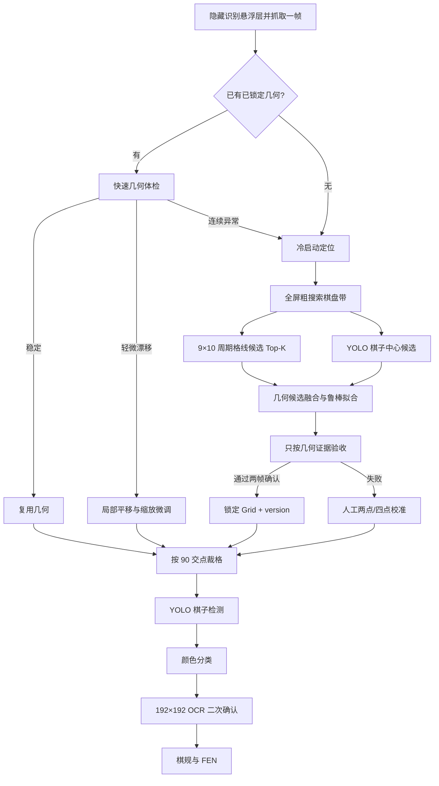

# 象棋棋盘定位：多证据融合实施方案

日期：2026-09-22  
适用项目：AI.js Pro 新引擎 / 象棋自动走棋  
目标设备：Android 手机屏幕截图，不处理相机拍摄的透视棋盘

## 1. 目标

棋盘定位只负责输出稳定、可信的 9×10 交点几何：

```text
originX, originY, stepX, stepY, orientation, version, confidence
```

棋子类型、红黑颜色、OCR 文字和棋规不再决定“棋盘是否定位成功”。它们只能在几何确定后用于识别、方向判断和局面校验。

验收目标：

- 冷启动定位成功率 ≥ 99%；
- 90 个交点的 P95 误差 ≤ 0.12 个格距，点击用交点误差 ≤ 0.08 个格距；
- 冷启动定位目标 ≤ 500ms，已锁定后的每帧跟踪目标 ≤ 50ms；
- 中残局只有 2～8 枚棋子时仍能定位；
- YOLO 漏检、错分类、OCR 未知格不能单独否决几何；
- 几何变化时递增 `version`，旧点击票据立即失效。

## 2. 当前实现的问题

### 2.1 先猜区域，再找格线

`tools/locate-board.js` 默认区域为：

```js
{ x: 0.025, y: 0.26, width: 0.95, height: 0.48 }
```

代码同时要求区域“紧贴棋盘外沿，误差不超过半个格距”。但是失败后又把区域上下平移到 ±12%，并把高度放宽到 +20%。放宽区域会改变第 0 条和第 9 条横线的序号锚点，容易得到“格距正确、整盘偏一行”的假成功。

### 2.2 第一份可用结果直接胜出

当前 `attemptLocate()` 按顺序尝试区域，第一个 `ok` 就返回，没有把所有候选放进统一评分。一个低质量但勉强过线数门槛的候选，可能挡住后面的正确候选。

### 2.3 定位与棋子识别互相绑死

线定位失败后，`pickGrid()` 用 YOLO 检测框搜索网格，但接受条件包含：

- 未知格 ≤ 4；
- 检测框覆盖率 ≥ 0.6；
- 可选的兵种数量与将帅约束。

新手机现场是“未知格 7、coverage 0.50”。这只能说明检测/分配还有噪声，不能证明棋盘几何错误。用识别质量硬拒定位，会形成：定位失败 → 无法裁正确格子 → 识别更差 → 继续定位失败。

### 2.4 `pickGrid` 主要搜索平移，不充分搜索格距

当前候选主要是固定 `stepX/stepY` 后搜索 `originX/originY`。换分辨率、游戏缩放、导航栏高度或皮肤后，格距先验偏 3%～5% 就可能让边缘格累计偏移半格。

### 2.5 跟踪模块没有成为唯一入口

已有 `src/vision/grid-tracker.js`，但悬浮面板仍维护一套 `tryReuseGrid()` 和临时平移救援。定位、复用、微调、重定位分散在多处，容易出现不同入口使用不同阈值。

## 3. 推荐架构



核心原则：

1. **格线决定棋盘，棋子中心只帮助精修。**
2. **YOLO 每帧最多跑一次。** 不为每个网格候选重复推理。
3. **OCR 不参与棋盘定位。** OCR 慢且会受字体、颜色、高亮和棋子动画影响。
4. **先锁几何，再识别棋子。** 不能用未知格数量反向否掉正确几何。

## 4. 冷启动定位算法

### 4.1 截图与坐标统一

- 抓帧前隐藏会覆盖棋盘的悬浮面板；绘制层不参与截图。
- 所有检测统一使用 `pixelWidth/pixelHeight` 坐标。
- 输出给点击器时再转换成逻辑坐标，禁止在算法中混用两种尺寸。
- 一帧由定位管线持有，完成后必须 `recycle()`；派生灰度图、裁剪图也在 `finally` 中释放。

### 4.2 全屏粗搜，不依赖固定 `regionRatio`

截图是游戏 UI，不存在相机透视，因此先按屏幕中下部做宽范围扫描：

- 横向范围：屏幕宽度的 0%～100%；
- 纵向范围：屏幕高度的 12%～92%；
- 排除状态栏、导航栏和已知悬浮窗区域；
- 灰度后计算横向、纵向暗线响应，可使用黑帽变换或“中心像素比左右邻域暗”的现有支撑度方法。

不再拿某个区域的首尾直接当第 0/8、0/9 条线，而是在宽范围内搜索一个规则点阵。

### 4.3 参数化格点阵搜索

分别建立竖线响应 `Rx(x)` 和横线响应 `Ry(y)`。候选评分：

```text
ScoreX(x0, sx) = Σ(c=0..8)  trimmedMean(Rx(x0 + c*sx))
ScoreY(y0, sy) = Σ(r=0..9)  trimmedMean(Ry(y0 + r*sy))
```

其中：

- `x0/y0` 是第 0 条线；
- `sx/sy` 是格距；
- `trimmedMean` 允许丢掉最弱的 2 条线，容忍棋子遮挡；
- 对 `|sx-sy|`、越界、过小/过大棋盘加入惩罚；
- 保留分数最高的 5～10 组候选，不立即返回第一组。

格距先用投影自相关或峰值间距估算，再围绕候选做细搜。建议搜索范围：

```text
stepX: 屏幕宽度的 7%～14%
stepY: stepX 的 0.90～1.10
origin: 保证 8×stepX、9×stepY 完整位于截图内
```

### 4.4 YOLO 棋子中心辅助拟合

YOLO 在整帧或粗棋盘带只运行一次，先做 NMS、置信度过滤，再取检测框中心。对每个格线候选计算：

```text
col = round((cx - originX) / stepX)
row = round((cy - originY) / stepY)
residual = distance(center, nearestIntersection) / meanStep
```

使用 RANSAC 或 Huber loss 优化 `originX/originY/stepX/stepY`：

- `residual ≤ 0.18` 的框算内点；
- 同一交点多个框只保留最高置信度；
- 棋盘外、低分框直接视为离群点，不进入 coverage 分母；
- 允许残局没有足够棋子，此时仅靠格线评分；
- 兵种标签和红黑颜色不参与拟合。

这样 YOLO 的职责是“提供交点样本”，不是决定棋盘边界。

### 4.5 候选统一评分

建议归一化为 0～1：

```text
finalScore =
    0.45 * lineSupport
  + 0.25 * pieceCenterInlierRatio
  + 0.15 * (1 - pieceResidualP90)
  + 0.10 * squareConsistency
  + 0.05 * temporalProximity
```

冷启动没有历史几何时，`temporalProximity` 记为中性值。棋子很少时，自动把 YOLO 两项权重转给格线证据。

禁止把以下内容放进定位硬门槛：

- OCR 是否识别出汉字；
- 未知格数量；
- 将帅是否都被模型识别；
- 兵种是否超限；
- 红黑颜色是否正确。

## 5. 几何验收与锁定

候选满足以下任一路径即可进入“两帧确认”：

### 路径 A：格线充分

- 竖线命中 ≥ 7/9；
- 横线命中 ≥ 8/10；
- `|stepX-stepY| / meanStep ≤ 0.08`；
- 最大格线残差 ≤ 0.15 格距；
- 90 个交点均在屏幕内，边缘允许 0.15 格距余量。

### 路径 B：格线部分缺失，但棋子中心充分

- 竖线命中 ≥ 5/9、横线命中 ≥ 6/10；
- YOLO 内点 ≥ 8，且来自至少 4 列、4 行；
- 棋子中心残差 P90 ≤ 0.18 格距；
- 格距方形性与边界检查通过。

连续两帧候选需满足：

```text
origin 漂移 ≤ 0.08 格距
step 漂移 ≤ 1.5%
```

通过后生成 `GridLock`，并把 `version` 加一。

## 6. 运行期跟踪

正常对局不再完整定位：

1. 用缓存几何采样若干条格线和四个边界；
2. 用本帧 YOLO 中心计算残差；
3. 平均残差 ≤ 0.18：直接复用；
4. 0.18～0.30：在 `origin ±0.20 格距、step ±2%` 内做小范围微调；
5. >0.30 或连续 3 帧无几何证据：重新冷启动定位。

缓存键至少包含：

```text
游戏包名 + pixelWidth×pixelHeight + 屏幕方向 + 游戏皮肤/模式
```

已有 `grid-tracker.js` 应成为唯一状态机；面板的 `tryReuseGrid()`、平移救援和服务层复用都调用它，避免三套阈值。

## 7. 人工兜底

自动定位失败时提供两个等级：

1. **两点校准**：点击棋盘左上第 0 交点和右下第 89 交点，直接计算格距；
2. **四点校准**：四角交点稳健拟合，用于横竖缩放不完全一致的皮肤。

人工结果持久化到上述缓存键。后续每帧仍做快速体检；分辨率或方向变化后自动失效，不能盲用旧坐标。

## 8. 代码调整建议

### 新增

- `src/vision/lattice-detector.js`：全屏响应、周期估计、Top-K 格线候选；
- `src/vision/grid-fusion.js`：格线 + YOLO 中心的鲁棒拟合和统一评分；
- `src/vision/grid-lock.js`：两帧确认、持久化缓存、版本管理。

### 调整

- `tools/locate-board.js`
  - `regionRatio` 只作为搜索优先级，不再作为格线序号锚点；
  - 遍历候选后统一评分，不返回第一个 `ok`；
  - 输出 Top-K 分数与拒绝原因。
- `src/vision/grid-search.js`
  - 拆成 `scoreGeometry()` 与 `auditRecognition()`；
  - 定位阶段移除 `maxUnknown`、兵种和将帅硬门槛；
  - coverage 只统计扩展棋盘框内的有效检测，排除外部离群框。
- `悬浮窗运行与测试.js`
  - `locateAndCalibrate()` 只调用统一定位服务；
  - 删除重复的整行平移救援；
  - 定位成功后再进入 90 格裁剪、YOLO、颜色、OCR。
- `src/vision/grid-tracker.js`
  - 接入真实循环，增加 `step` 微调与两帧锁定；
  - 阈值从单一平均残差改为 mean + P90 + 有效内点数。

建议的数据契约：

```js
{
  grid: { originX, originY, stepX, stepY, orientation, version },
  score: 0.0,
  confidence: 0.0,
  source: "lattice+yolo" | "lattice" | "manual",
  evidence: {
    verticalMatched, horizontalMatched,
    lineResidualMax,
    pieceInliers, pieceColumns, pieceRows,
    pieceResidualMean, pieceResidualP90
  },
  frame: { pixelWidth, pixelHeight, rotation },
  candidates: []
}
```

## 9. 开发顺序

### P0：先把证据画出来

- 在截图上绘制候选区域、9×10 交点、YOLO 中心、内点/离群点；
- 每次失败保存 Top-5 候选及分数；
- 把“格线失败”和“棋子识别失败”分成两类日志。

没有这一步，不应继续靠调 `regionRatio` 和阈值碰运气。

### P1：替换冷启动定位

- 实现全屏周期格线 Top-K；
- 保留现有 `board-locator` 作为回退；
- 用当前新手机的“未知格 7 / coverage 0.50”帧验证：即使分类差，几何也必须成功。

### P2：接入 YOLO 中心融合

- 一次推理复用检测框；
- RANSAC/Huber 精修原点与格距；
- 去掉定位阶段的未知格、兵种、颜色硬门槛。

### P3：统一跟踪与缓存

- 接通 `grid-tracker.js`；
- 两帧锁定、局部微调、连续异常重定位；
- 几何变化令旧点击票据失效。

### P4：回归与长测

- 设备：Mi 8、K40、新手机各至少 20 张；
- 场景：开局、中局、残局、棋子动画、高亮、弹窗、深浅皮肤；
- 每张人工标注四角交点；
- 输出成功率、交点 P50/P95 误差、冷启动耗时、跟踪耗时；
- 连续运行 30 分钟，确认 `activeFrames ≤ 1` 且 PSS 不线性增长。

## 10. 最小可落地版本

如果先做一版快速修复，范围控制在三项：

1. `attemptLocate()` 不再首个成功即返回，收集所有候选并按格线质量选最优；
2. `pickGrid()` 定位阶段取消 `maxUnknown` 和原始 coverage 硬拒，改用棋子中心内点数与残差；
3. 同时搜索 `origin ±0.5 格、step ±4%`，并用两帧一致性锁定。

这三项可以先解决“区域稍偏就错行”和“coverage 0.50 导致永久定位失败”，再逐步换成完整的全屏周期格线方案。
