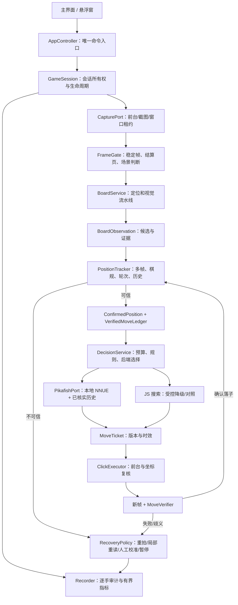

# 象棋自动走棋框架重构任务书（AI.js Pro QuickJS）

日期：2026-09-23  
对象：`samples/象棋自动走棋/`（写作时的 `apps/app/src/main/assets/sample/QuickJS 新引擎/项目与打包/象棋自动走棋/` 已迁出主 APK）
用途：给 DeepSeek 或接手开发者逐阶段实施；本文是设计与验收任务书，**不表示代码已经按本文完成**。

> **执行状态（2026-10-19，dev-1112）**：A0（基线冻结）已完成；A1/A2/A3 的批次已陆续落库（入口收口、pipeline-factory、PositionTracker/VerifiedMoveLedger、驱动回放与失败路径场景）；P4 棋谱历史有试验与 `dev-661` 发布验收记录；A4（原生历史 `position fen … moves …`）与 A5（性能/多盘 A/B）仍有未完成项。“带画面”的 K40 验收曾因截屏授权缺失挂起，后续报告以离线回放/真机日志替代证据。当前逐项状态见 [`整仓重构全程计划_2026-09-23.md`](整仓重构全程计划_2026-09-23.md)（A 轨道）与 [REMAINING_WORK](../REMAINING_WORK.md) §0。

## 0. 目标、边界和已知事实

目标是把现有“截图 → 视觉 → 局面 → 算棋 → 点击 → 回屏确认”做成**一条可追踪、可恢复、可回放的闭环**。先在 AI.js Pro QuickJS 工程里开发和真机调试，不把重新打包 APK 作为本轮前置条件。运行时模型、OCR、颜色判断、棋规和引擎全部在手机本地；PC 的 Python + ADB 脚本只用于对照实验、离线回放和定位问题，不能当作手机端已实现功能。

截至本文编写时可核实的现状：

- Redmi K40 上对 QQ 象棋“特级大师”的最近一盘，手机结算页显示“人机对战，总步数达到上限判和，119 回合”，累计 **0 胜、17 和、15 负**。对应截图：`.artifacts/k40-now/engine-final.png`；PC 实验日志：`.artifacts/k40-now/engine-seek-20260923.log` 与 `engine-seek-fast-20260923.log`。这盘使用 PC Pikafish + 截图识别 + ADB 点击，不是 AI.js Pro 手机端原生链路。
- 对手自身使用 Pikafish，曾见 `go depth 25 movetime 5000`。同级强引擎对抗，重构不能承诺“必胜”；评估必须用多盘胜/和/负，而不是只看单手 `cp`、WDL 或一盘优势。更早报告里的“约 158 回合上限”与最近一盘的 **119 回合**不一致；游戏规则/计数条件待实测，代码不得写死任一数值。
- 手机工程已有 `src/vision`、`src/chess`、`src/engine`、`src/automation`、`src/services`、`src/app`，包括 YOLO、OCR、红黑分离、Pikafish、状态机和点击回验。应**收口并迁移**，不要同时重写全部算法。
- `main.js` 与 `悬浮窗运行与测试.js` 仍分别直接创建 `board-service` 和 `auto-driver`；`src/app/bootstrap.js`、`src/services/game-session.js` 已存在，但尚未成为两个生产入口的唯一装配点。`auto-driver.js` 现约 4700 行，混合观测、事实维护、恢复、算棋、点击与日志。
- 手机端 `pikafish-engine.js` 每次用当前盘面 `buildFen(...)`；Java/JNI 的 `nativeAnalyze(String fen, ...)` 再投喂 `position fen ...`，**没有传已确认的完整着法历史**。PC 实验链路也曾有相同问题。仅靠当前摆位加外层简化重复计数，不能完整处理长将/长捉及规则循环。
- `engine-router.js` 的 `auto` 模式可在 Pikafish 失败时回退到 JS 搜索。此行为适合演示/建议，但“对弈特级大师”模式若静默降级，就会让使用者误判实际棋力。

相关历史材料：`docs/reports/2026-09-20_象棋当前架构路线图.md`、`docs/reports/2026-09-23_象棋特级大师对局诊断.md`、`docs/reports/2026-09-23_象棋特级大师_攻坚实录_供GPT分析.md`。旧报告的数字只代表当时版本；本文以当前源码和最近结算页为准。

## 1. 重构原则

1. **一局一所有者**：同一时间只能有一个 `GameSession` 取得捕获、搜索和点击控制权。主界面与悬浮窗只是两个 UI 客户端，不各建一套驱动。
2. **观测不是事实**：单帧 YOLO/OCR 输出是候选；多帧稳定、棋规、上一确认局面及回屏验证后，才进入已确认的棋谱。
3. **搜索不能直接点击**：引擎只返回候选着法；执行器必须重新核对会话、局面、轮次、几何版本、前台包和票据有效期。
4. **点击不等于落子**：发送点击与确认棋盘变化分成两个事件。只有确认后才追加着法历史，失败不推进基线。
5. **低置信度显式停机**：无法唯一解释的盘面、轮次未知、模型/引擎缺失、游戏结算页、资源超预算时进入暂停或恢复，不靠猜测继续点。
6. **可复现**：每手可找到输入帧摘要、局面、候选、实际后端、耗时、点击坐标、回屏证据和终局原因；敏感图像按用户选择保留，不无限积累。
7. **先稳定后棋力**：框架迁移与策略实验分开。架构稳定后再验证开局多样化、求胜偏好、残局搜索，不把“调参数”当成修复识别或规则错误的方法。

## 2. 目标调用链



**控制流必须是单向的**：UI → Controller → Session → 各服务。视觉模块不调 UI，不直接调用引擎或点击；引擎不直接改棋盘事实；日志不参与业务决策。

## 3. 建议目录和迁移映射

以下是目标职责，不要求一次性搬动所有文件。优先保留现有纯函数，再通过新服务接口收口。

| 层 | 目标职责 | 当前代码及迁移方式 |
|---|---|---|
| `src/app` | UI 命令、配置、ViewModel、唯一 bootstrap | 保留 `bootstrap.js`、`controller.js`、`session-store.js`；两个入口改成薄壳；`main.js` 不再直接建 driver |
| `src/services` | `board-service`、`game-session`、新增 `position-tracker`、`decision-service` | 保留现有服务；把 `auto-driver` 内的已知事实、轮次、恢复与算棋分阶段抽出 |
| `src/vision` | 棋盘几何、纯检测、OCR、颜色、多帧证据、画板 | `vision-pipeline.js` 为唯一生产视觉编排；`recognizer.js` 暂留兼容层，迁完后删除；`ocr-runtime.js` 为 OCR 后端唯一入口 |
| `src/chess` | FEN、合法着法、局面变换、规则与历史表示 | 复用 `fen.js`、`legal-moves.js`、`transition.js`；新增“已验证着法账本”与一致性检查，不把猜测写入历史 |
| `src/engine` | 后端路由、Pikafish 适配、本地 JS 引擎 | 保留 `engine-router.js`；扩展原生请求携带可信着法历史；竞技模式不静默降级 |
| `src/automation` | 状态机、动作票据、点击、回屏确认、短编排器 | 保留 `move-ticket.js`、`click-executor.js`、`move-verifier.js`；把 4700 行 `auto-driver.js` 缩为协调器；先抽再删旧分支 |
| `src/runtime` | AI.js Pro API、窗口、帧资源、调度、原生接口 | 所有宿主 API 只从 ports/adapter 进入；PC ADB 不进入正式工程 |
| `src/diagnostics` | 结构化事件、截图索引、性能与内存 | 保留 `recorder.js` / 有界 `log-ring.js`；新增对局级导出，日志默认限量 |
| `tools` | 自检、回放、真机探针 | 生产入口不得通过 `tools/recognize-board.js` 间接拿检测框；探针单列 `tools/probes/` 可后迁 |

不要在第一批 PR 同时移动所有路径和改变算法；每批至少保持旧入口可运行、可回退。`docs/README.md` 当前可能有并行修改，合并时再补本方案索引，避免覆盖别人工作。

## 4. 核心数据契约

坐标规范固定为 **9 列 × 10 行，规范盘面 `row=0` 是黑方底线，`row=9` 是红方底线**；它们不等同于屏幕的上、下边，棋盘翻转只由 `orientation` 映射到屏幕坐标。ICCS 的 rank 0 在红方底线，转换只在棋规/引擎边界进行。`null` 表示确认无子；`?` 表示疑似有子但类型/颜色未定，两者不得混算。

```js
BoardObservation = {
  sessionId, frameId, capturedAtMono, foregroundPackage,
  geometry: { originX, originY, stepX, stepY, orientation, version, confidence },
  cells: [ /* 长度 90 */
    { state: "empty" | "piece" | "unknown", candidates: [
      { piece: "R" | "N" | "B" | "A" | "K" | "C" | "P" |
               "r" | "n" | "b" | "a" | "k" | "c" | "p",
        score, evidence: { yolo, ocr, color, prior } }
    ], box, quality }
  ],
  stable, scene: "board" | "result" | "menu" | "unknown",
  timing, diagnostics
};

ConfirmedPosition = {
  sessionId, positionVersion, board: Array(90), sideToMove: "w" | "b",
  geometryVersion, evidenceFrameIds, confidence, fen,
  historyStatus: "complete" | "partial" | "unknown"
};

VerifiedMove = {
  ply, side, iccs, beforePositionVersion, afterPositionVersion,
  source: "our-click" | "opponent-observed" | "manual-confirmed",
  beforeKey, afterKey, verifiedFrameIds, verifiedAtMono
};

MoveTicket = {
  sessionId, positionVersion, geometryVersion, sideToMove,
  iccs, from, to, engineBackend, searchId, createdAtMono, expiresAtMono
};
```

所有跨线程/模块消息带 `sessionId` 和单调递增版本；迟到搜索结果、旧几何下的点击票据、上局 OCR 结果直接丢弃。帧对象不存进长期状态，保存时只记 `frameId` 和按需的有界图片文件。`ConfirmedPosition` 由 `PositionTracker` 单点写入，UI、引擎、画板只能读取快照。

### 棋谱账本和启动中局

- 标准初始盘面经确认后，以该盘面为 `initialFen`，每个已验证己方/对方着法追加到 `movesUci`。提交采用“回屏证实 → 写事件 → 生成新快照”的顺序；写事件失败则不得把棋谱宣称完整。
- 中途接管时若无可靠完整棋谱，标记 `historyStatus=partial`。允许以当前 FEN 搜索，但必须显示“历史不完整”；重复规则判断保守处理，不伪造先前着法。游戏重开、撤回、换边、几何重建和无法唯一解释的跳变需要新会话或显式恢复确认。
- 对方一次变化若可由**唯一合法着法**解释，且连续稳定帧一致，可记 `opponent-observed`；多个合法解释或棋子类别未定时停在恢复态，不猜其中一手。
- `VerifiedMoveLedger` 提供 `positionCommand()`，只输出已校验的 `position fen <initialFen> moves <m1> ...`。同时保留基于布局+轮走方的局面键供外层检测，但它不取代引擎的完整历史规则。

## 5. 视觉闭环：定位、棋子与颜色

沿用已形成的“棋盘定位 → 90 交点 → YOLO 棋子候选 → 局部 OCR/字形 → 红黑颜色 → 证据融合”路线。不要让 YOLO 七类输出直接等同最终棋子类别，也不要让 OCR 或颜色单独覆盖已确认局面。

1. **场景/稳定帧**：切前台后的第一帧预热；检测结算页、菜单、弹窗和动态棋子。`scene !== board` 时不进入棋规推断，更不能点击。稳定闸门拒绝帧是“未观察”，不算作识别失败并污染恢复计数。
2. **几何**：以棋盘格线、棋子中心与局部残差交叉核验。正常帧沿用已校准网格，漂移超阈值才局部精修或全盘重定位。几何版本变化使搜索结果及票据立即失效；悬浮窗画线采用同一网格实例。
3. **检测**：检测器会话常驻、只返回框与分数；禁止通过完整旧 `recognizeScreen()` 再取原始框。正常盘面采用差分，只对发生变化或置信不足的格子重读；定期做全盘扫描纠偏。检测为空与“该格已确认空”分开表达。
4. **识别**：`ocr-runtime.js` 包装 PP-OCR/可选 ONNX 字形分类；需要时只裁存在棋子的局部区域，优先用现有灰度/彩色互补策略。`piece-color.js` 独立提供红黑证据；同字异色、木纹/高亮干扰时记录候选和分数，留给融合层。
5. **融合/规则**：多帧、YOLO、OCR、颜色、上一步合法变化一起打分；棋子数量、九宫、兵卒方向、将帅照面等做硬校验。发现矛盾时输出“不可信”和证据，不通过补猜把 `?` 强行清零。统计 `unknownCells` 只数 `?`，正常空位 `null` 不计入。
6. **恢复**：顺序为等待新稳定帧 → 变化格重读 → 全盘重读 → 几何重定位 → 用户校准/暂停。恢复结果必须与最近 `ConfirmedPosition` 构成可解释的合法变化；失败不能倒退或替换已核实棋谱。

每个视觉结果至少输出 `stageTimings`、检测框数、映射残差、OCR/颜色冲突数、未知格数、校验失败原因。画板显示原图、9×10 网格、候选标签/分数、实际点按起终点和前后帧差异，画板不得被下一帧识别为棋盘内容。

## 6. 引擎与赢棋策略分层

### 6.1 先修原生接口和后端可见性

当前 Java/JNI 只接受 `nativeAnalyze(fen, movetime, timeout, multiPv)`，native 侧仅发送 `position fen ...`。建议新增**兼容旧 API** 的带历史接口（示意）：

```text
QuickJS DecisionService
  → PikafishPort.analyze({ initialFen, verifiedMovesUci, movetimeMs,
                          timeoutMs, multiPv, sessionId, searchId })
  → Java bridge（校验 moves 格式和长度）
  → JNI：position fen <initialFen> moves <verifiedMovesUci...>
  → go movetime N
  → bestmove + score/depth/nodes/time/backend/version
```

优先用结构化参数或经过严格逐项校验的着法数组构造原生命令，不拼接未校验的 OCR 文本。旧 `analyze(fen,...)` 保留给历史不完整的中途接管/回归比较。native 引擎目前是进程级单例，搜索与停止需要 `searchId`/会话令牌；停止旧搜索并确认返回后才开始新搜索。取消/超时也要释放等待，不把旧 `bestmove` 发给新局。

日志和 UI 每手显示：**实际后端**（Pikafish/JS）、NNUE 标识、threads/hash、movetime、深度、候选、FEN/历史状态与降级原因。“竞技/强棋”模式强制 Pikafish，原生失败则暂停并报错；“演示/建议”模式才允许明确提示后回退 JS。不能把 `auto` 的预期后端写成这一手实际使用的后端。

### 6.2 策略层只做可验证的实验

- 先建立基线：固定开局、相同先后手、设备和算时，多盘记录胜/和/负及首次偏差。对手同为 Pikafish，单纯增加搜索时间或提高 NNUE 版本可能只增加和棋率。
- 开局多样化：本地候选开局库只收**离线对战筛选且格式/来源可追溯**的线；用局面键和已走历史索引，不按“第 N 手强制”复刻。候选必须仍通过引擎和合法性门；与对手实际应招偏离就停止查库、转正常搜索。
- 求胜偏好：`MultiPV`、WDL、复杂度/子力接触度仅在主线评分差处于校准容差内试验；记录“为什么替换首选”与替换后的实际胜率。不要全局固定给进攻着法加分，避免从安全和棋变成必败。
- 残局：记录“已走回合/观察到的规则上限/估计剩余预算”；有明确必胜线时优先验证杀法距离与转换速度。游戏本次在 119 回合判和，历史报告曾出现约 158 回合，**不得硬编码上限**。可选本地残局知识库必须覆盖本游戏规则且经回放验证；没有资料时保持引擎原选着。
- 资源：先在 K40 测 threads/hash/movetime 的**同局面速度、深度、内存、温度和最终对局结果**，再改默认值。PC 端 512 MiB 或 40 秒的结论不能直接套到 K40 手机上。

## 7. 自动化状态机与执行协议

建议业务态：`IDLE → ACQUIRING → OBSERVING → THINKING → READY → EXECUTING → VERIFYING → WAITING_OPPONENT`；任意态可到 `RECOVERING`、`PAUSED`、`FINISHED`。`FINISHED` 只能由明确的结算页/规则结果进入；未知弹窗进入 `PAUSED`。

出手前必须同时满足：

- 单一会话持有控制权，目标游戏处于前台，截图会话有效；
- 最近稳定盘面与票据 `positionVersion` 一致，已确认轮到我方；
- 几何版本/方向与票据一致，起终点落在棋盘交点安全区；
- 引擎给出的着法通过本地合法性检查，搜索结果未过期；
- 无点击正在执行，无悬浮窗遮挡点击点；必要的窗口租约已取得。

点击分“起点、观察选中态、终点、观察落子态”。当起点选中失败时允许限定次数换通道或重试；终点不生效也须先复查盘面，不能盲点第三次。验证结果至少区分 `CONFIRMED`、`CONFIRMED_AND_OPPONENT_REPLIED`、`UNCHANGED`、`AMBIGUOUS`、`SCENE_CHANGED`；只有前两者能提交我方着法。若对方应手过快，在同一组稳定帧中唯一推得我方着法+对方着法才提交两手；否则恢复。悬浮窗从起点前到终点后持有“整手藏窗租约”，停止/异常路径在 `finally` 恢复可见。

## 8. 性能和内存预算

先量真机基线，再调目标。以下是**验收目标，不是目前已达到的成绩**：

| 指标 | 建议目标及处理 |
|---|---|
| 正常差分识别 | P95 ≤ 1 秒；全盘重读单列耗时，不混在一类 |
| 普通对局从稳定帧到点击起点 | 不含配置的引擎思考预算，额外编排 P95 ≤ 1.5 秒 |
| 点击回屏确认 | P95 ≤ 2 秒；失败必须有明确原因与前后帧 |
| 连续 60 分钟运行 | 释放后的 native/Java 堆不持续单调增长；记录 5 分钟粒度的 PSS、峰值、模型实例数 |
| 图像资源 | 每次裁剪、灰度图、截图、OCR 临时帧均有唯一所有者和 `finally` 释放；缓存最多保留最近必要帧摘要 |
| 引擎资源 | 一局最多一个 native 会话和一个正在运行的搜索；停止后验证线程/Hash 可回收或可复用 |

采样时把截图授权、悬浮窗、YOLO 会话、OCR 会话、Pikafish 内存分别统计，避免把系统截图缓冲或 PC 进程内存误算成 JS 泄漏。每次会话结束自动关模型/搜索/窗口租约/定时循环；日志环与截图文件按数量、大小上限轮转。

## 9. 分阶段任务与交付门槛

| 阶段 | 开发任务 | 本阶段通过条件 |
|---|---|---|
| P0 冻结基线 | 留存 K40 棋局截图/回放、现有自检结果、手机端和 PC 端各自的耗时/内存/终局；把当前自动模式真实调用链画出 | 文档能指出两入口、实际视觉路径、实际引擎后端；没有把 PC 战绩写成手机战绩 |
| P1 收口入口 | `main.js` 与悬浮窗都改为调用 `bootstrap → controller → game-session/board-service`；建立单所有权和会话令牌 | 两个 UI 在同一棋局显示相同局面版本、后端、运行态；不可能同时启动两套点击循环 |
| P2 收口视觉 | `vision-pipeline` 为唯一生产路径；纯检测与 OCR/颜色/规则分离；旧识别只在显式兼容模式使用 | 回放与真机能列每格候选及证据；正常空位未知数为 0；不可信帧 0 次点击 |
| P3 事实与自动化 | 抽出 `PositionTracker` 和 `VerifiedMoveLedger`，缩小 `auto-driver`；完善恢复/点击验证/结算页 | 快速应手、漏点、遮挡、重建基准、撤回、换局等场景均能暂停或正确追加棋谱；失败不推进版本 |
| P4 原生历史 | 扩展 `$pikafish` Java/JNI 与 JS 适配，传已确认着法；竞技模式禁静默降级 | 同一 `initialFen + moves` 在 PC 与 K40 上得到一致合法局面；每手可查实际后端，历史断裂明确标记 |
| P5 性能与对弈 | 资源释放、回放压测、同条件多盘 A/B；开局/求胜/残局策略作为独立开关 | 内存与耗时达目标或附测量说明；报告完整胜/和/负与终局类型，策略收益有对照数据 |

**每阶段完成前先做迁移适配，不删旧模块**；确认两个入口、离线回放和真机通过后再删除重复路径。不要把 4700 行驱动一次性拆成几十个空壳文件，也不要把一轮自检通过当作真机对局可用。

## 10. 必跑验收场景

1. **纯逻辑**：`node tools/self-check.js`、`node tools/run-regress.js`，覆盖标准开局、吃子、将军、马腿/炮架、同字异色、`null` 与 `?`、翻转棋盘、三次重复候选与历史断裂；新增用例应能失败于旧实现的真实问题，而非镜像实现。
2. **录制回放**：对至少一盘真实 K40 录制的连续帧重放，逐手输出观测 → 已确认局面 → 搜索输入 → 票据 → 验证结果；跨模型版本、几何版本、UI 前后台切换的旧结果必须作废。
3. **手机只识别/建议**：明确断言点击端口零调用；切到游戏、悬浮窗出现/隐藏、截图授权中断时可恢复。
4. **手机自动走棋**：至少一次从标准开局到真实结算；记录每一步“点了、是否被游戏接受、是否正确识别对方应手”。结算页后零点击，且自动释放窗口/模型/引擎资源。
5. **对弈 A/B**：至少交替多盘（建议每组不少于 10 盘，仍不能保证显著性），固定对手难度、先后手、设备、算时和版本；分别统计胜/和/负、平均回合、因重复/上限判和、识别/点击错误、内存峰值。对局上限与规则以手机结算页记载为准。

交付物：代码差异、`SELF_CHECK`/回放结果、K40 运行日志、至少一张画板和一张终局截图、失败案例、实际 backend/NNUE 配置、对比表。任何“已经打败特级大师”“已完全本地运行”等结论都必须指明**手机端还是 PC 端**、实测版本和证据。

## 11. 给 DeepSeek 的执行要求

按 P0→P5 顺序做小批次提交。每批先列修改文件与接口契约，再改代码，然后运行对应自检/回放；真机用 Redmi K40 实测并回填结果。正在修改的源码不得被文档假定为稳定版本，开始每批前先看 `git status` 和当前文件内容，保留他人未提交改动。新增 QuickJS 工程 `.js` 首行遵守 `// @engine quickjs`；若改 `modules/engine/src/main/cpp/` 原生代码，按仓库构建约定先重编原生库再做 APK 构建。**本阶段只要求 AI.js Pro 工程内调试和交付，不自动发布更新源或打包 APK。**
