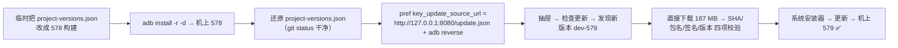

# K40 验证：自建更新源 + 象棋识别链路（2026-09-14）

对象：K40（`cccc62c7`，M2012K11AC，LineageOS 23.2 / **Android 16** / SDK 36，1080×2400，**无 root**）
对照：小米8（`ce4d2bdb`，LineageOS / Android 15，1080×2248，有 Shizuku）

> 背景：K40 刚刷完机（`/sdcard` 出厂默认、无第三方应用、`su` 不存在），
> 因此这一轮既是「新手机能不能用」，也是「同一套链路换设备还成不成立」的验证。

---

## 一、装机与权限（新机初始化）

| 项 | 做法 | 结果 |
|---|---|---|
| dev-579 | `adb install -r`（本地 `.artifacts/updates/` 的产物，**不需要网络**） | ✅ `versionCode=579 / dev-579` |
| 悬浮窗权限 | `appops set com.jdkshen.aijspro SYSTEM_ALERT_WINDOW allow` | ✅ `allow` |
| 无障碍服务 | `settings put secure enabled_accessibility_services <pkg>/com.stardust.autojs.core.accessibility.AccessibilityService` + `accessibility_enabled 1` | ✅ `dumpsys accessibility` 可见（但脚本首启仍报「无障碍=未就绪」，见 §四） |
| 天天象棋 4.4.5.2 | 从**小米8 上 `pm path` + `adb pull` 提取**（196 MB，同签名同版本），再装到 K40 | ✅ `404050022` |
| 启动冒烟 | Android 16 上 `targetSdk 28` 的包 | ✅ 无崩溃、主界面正常渲染 |

---

## 二、自建更新源端到端验证（真升级，不是「已是最新」）

⚠️ 关键前提：**`update.json` 的 versionCode 必须严格大于机上已装版本**，相等不提示更新。
机上当时是 579 = 源里的 579 → 只会提示「已是最新」。
所以先用「当前代码 + 临时版本号 578」构建、降级装上，再造出真实的一档差：



| 环节 | 证据 |
|---|---|
| 手机侧可达性 | 手机自己 `curl http://127.0.0.1:8080/update.json` → `HTTP 200 / 19574 bytes`（`adb reverse tcp:8080`，**不需要连 Wi-Fi**） |
| 弹窗 | `新版本 dev-579` + 本次更新说明 + **更新历史（29 个版本）**，按钮 `直接下载` / `稍后再说` |
| 安装前校验 | 系统安装器弹出「要更新此应用吗？」= 已通过 `UpdatePackageVerifier`（SHA-256 → 包名 → 版本不低于 + 签名一致） |
| 结果 | `versionCode=579 / dev-579`，`lastUpdateTime=02:34:41`（升级前 578） |

> ⚠️ `UpdatePackageVerifier.verify()` 里有 `longVersionCode(archive) < expectedVersionCode` 的拦截：
> **不能**靠「写个虚高版本号的 update.json + 旧 APK」来伪造升级测试 —— 会被明确拒绝（这是好事）。
> 也正因如此，`project-versions.json` 的临时改法必须还原（本轮已确认 `git status` 干净）。

现场偏好：K40 的「更新源」现在是 `http://127.0.0.1:8080/update.json` ——
只在 `adb reverse` 活着时有效；拔线后要改成 `http://<PC 局域网 IP>:8080/update.json`。

---

## 三、象棋链路验证：**抓帧/识别跑通，但格点校准在这台机器上是错的**

工程推法（注意 `adb push` 被源路径里的**空格**拆坏过）：

```powershell
# 源路径含空格 → 先落到 ASCII 暂存目录再推
Copy-Item "…\QuickJS 新引擎\项目与打包\象棋自动走棋\*" .artifacts\chess-k40\proj -Recurse
adb push .artifacts\chess-k40\proj /sdcard/xiangqi-k40/proj
# 入口脚本改名成 ASCII（脚本靠 __dirname 找模块，与自身文件名无关）
Copy-Item proj\悬浮窗运行与测试.js proj\panel.js
```

autorun（`/sdcard/.aijspro-floaty/floaty-autorun.json`，shell 可写）：

```json
{"captureProbe":true,"contract":true,"locate":true,"recognize":true,"mode":"watch","start":true,"stopAfterMs":70000}
```

跑法：游戏（人机对战，满盘新局）在前台 → `am start -n …/.external.open.RunIntentActivity -d file:///sdcard/xiangqi-k40/proj/panel.js`
→ 首次抓帧会弹投屏授权（Android 14+ 的新弹窗：**下拉里选「共享整个屏幕」**，不能点「共享一个应用」）

### 结果

| 环节 | K40 | 小米8（此前） |
|---|---|---|
| 抓帧探测 | ✅ 成功，`screen 1080×2400` | ✅ |
| 契约测试 | ✅ `CONTRACT PASS pass=15 fail=0` | ✅ |
| 定位校准 | ⚠️ **完成了，但结果是错的**：起点 `(91,639)`、格距 `(115,114)`、偏移 `(9,0)`、方式 `captured-frame` | ✅ 起点 `(78,…)` 量级正确 |
| 识别 | ❌ **子 20 / 空 62 / 未知 8** | ✅ 子 31 / 空 59 / 未知 0 |
| 状态机 | ❌ 一直 `WAIT_TURN → RECOVERING`，进不了我方回合 | ✅ 能到我方回合 |

### 根因：格点起点偏了约半格

拿 `screencap` 抓同一屏（`.artifacts/chess-k40/board-k40.png`，1080×2400），
用棋盘亮面边界量出真实格点，与应用校准值对照：

| | 首列中心 x | 首行中心 y | 格距 |
|---|---|---|---|
| **实测** | **70.5** | **688.2** | **117 × 116.3** |
| 应用校准 | 91.0 | **639.0** | 115 × 114 |

- 纵向差 **≈49px ≈ 半格**（格距 116），横向差 ≈20px，格距还小 2px；
- 误差**逐行累积**：到第 10 行时偏 **≈70px（>半格）**，最下一行实际已经落在格点之外；
- 于是每格的裁剪都**跨在两个子之间** → 认不出（未知 8）+ 颜色串位（第 8/1 行出现 `R`/`K` 这类反色）。

复现材料：`.artifacts/chess-k40/grid-compare.png`（**绿=实测格点，穿过每个子中心；红=应用校准，整体上移右移**）。
工具：`.artifacts/tools/measure-board.py`、`.artifacts/tools/grid-overlay.py`。

### 为什么这台会错、小米8 不会

同样是 `captured-frame` 定位，说明**定位本身"成功"了，但结果没有被校验**：

- K40 屏更高（2400 vs 2248），棋盘在屏上更靠下 → 起点 y 差 49px；
- 校准逻辑接受了这个网格，**没有任何"子数/未知格数"的后验校验**，也没有回退 `pickGrid`；
- 这正是待办里那条：**面板/driver 的定位应改成「定位 → 校验（子数/未知格数）→ 不合格回退 pickGrid」**。
  K40（1080×2400）现在成了这条修复的**现成反面样例**。

---

## 四、其它待办 / 观察

1. **脚本首启报「无障碍=未就绪」**：虽然 `settings put secure` 已启用、`dumpsys accessibility` 也能看到服务，
   但面板启动日志仍是 `点击：无障碍=未就绪，Shizuku=不可用` —— 说明该判断看的不是系统设置，而是**服务是否真的连上**
   （或首次启动时服务还没绑上）。③ 自动走棋依赖它，需要单独确认一次。
2. **K40 无 root / 无 Shizuku**：`shell` 截图通道不可用（`shell=不可用`），只能走系统投屏；
   投屏弹窗默认是「共享一个应用」，**必须显式选「共享整个屏幕」**（dev-548 修的黑帧问题就发生在选错时）。
3. 本轮新增的 PC 侧工具（都在 `.artifacts/tools/`，可复用）：
   - `ui-nodes.py`：dump 界面节点（文本 + 真实像素坐标），可选显示**无文字的可点节点**（系统弹窗的分段选项就靠它）
   - `set-update-source.py`：经 `run-as` 改「更新源」偏好（**二进制 stdin/stdout**，避免 PS 管道破坏 UTF-8）
   - `measure-board.py` / `grid-overlay.py`：量棋盘真实格点 / 画对比图
4. 踩到的工具坑（已写进脚本注释）：
   - `adb shell run-as pkg sh -c 'cat > 文件'` —— **重定向必须整条包成一个参数**，否则 `>` 由外层 shell（uid shell）执行 → `Permission denied`
   - `uiautomator dump` 会**把下拉菜单收掉**：要看系统弹窗的选项，先点开再 `screencap`，别 dump

---

## 五、下一步建议（按优先级）

1. **修格点校验**：定位后做后验校验（子数/未知格数/颜色分布），不合格就回退 `pickGrid` 或拒绝使用该几何 ——
   K40 这帧就是验收样例（预期修复后 `子 32 空 58 未知 0`）。
2. 确认「无障碍未就绪」的真因（③ 自动走棋的前置）。
3. 修复后再在 K40 上跑 ③ 自动走棋（真实点击）与小雪8 的连续自动走棋回归。
