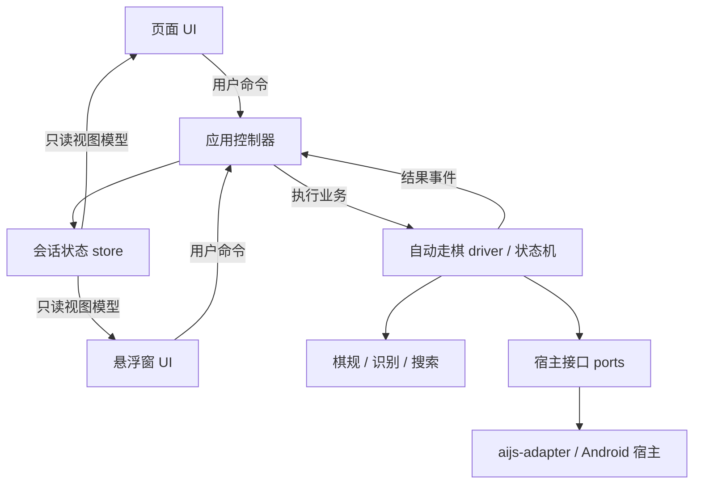

# 象棋 ③ 自动走棋：真机（K40 + 天天象棋离线局）定位报告

> 日期：2026-09-14　设备：Redmi K40（`cccc62c7`，LineageOS 23.2 / Android 16，无 root，Shizuku + 无障碍可用）
> 场景：`悬浮窗运行与测试.js` 面板 → ③ 自动走棋 → 腾讯天天象棋 `com.tencent.qqgame.xq` **离线局 vs「小白」**
> 目录：`apps/app/src/main/assets/sample/QuickJS 新引擎/项目与打包/象棋自动走棋/`
> 本轮记录：self-check **133/133 全绿**；③ 在真机上能连续发送点击、能自恢复；**吃子闭环仍待确认**（见 §5）。发送次数不等于成功落子次数。
> 审阅补充：2026-09-14，具体修改顺序、代码接入和验收要求见 **§9–§13**。补充内容是待实施建议，本次只修改本 MD，没有修改脚本或重新进行真机实验。

---

## 1. 现象（修之前）

③ 能定位、能算棋、能点击，但**走一手就卡死**：

- 卡在 `RECOVERING｜轮次未知超时（超时不是出手依据）：只恢复/等待`，**一整轮 90 秒空转**，最后一次重新定位之后再也不动作；
- 日志里确认阶段刷屏：`UNRELIABLE：起点/落点附近有 1 格对不上（多半是装饰/动画帧）→ 等下一帧再确认` ×65；
- 另一处刷屏：`轮次推不出来（UNKNOWN）：既没有合法单步也没有「一步+应手」能解释，需要恢复`。

## 2. 真机证据链（关键的一次定位）

在驱动的**失败分支**里补了一行诊断（现在保留，限频输出），真机回传：

```
诊断基准 rnbakabnr/9/1c2c4/p1p1p1p1p/9/9/P1P1P1P1P/2C4C1/9/RNBAKABNR w
诊断观测 rnbakabnr/9/1c2c4/p1P1p1p1p/9/9/P1P1p1P1P/2C4C1/9/RNBAKABNR w
  ｜容差：我方着法 39，试 1397，最小差 4，命中 0，
    最优 c2c6+e7e3:(4,2)空>c,(2,3)C>P,(4,6)c>p,(2,7)空>C
```

读法（`diff` 的 before=按着法推出的盘面，after=模型观测）：

| 差异格 | 候选 `c2c6+e7e3` 推出的值 | 模型观测 | 说明 |
|---|---|---|---|
| (2,7) 我方炮起点 | 空（炮已走） | 红炮 `C` | 观测里**子还在起点**，不支持这个候选 |
| (2,3) 我方炮落点 | 红炮 `C` | 红兵 `P` | 相对候选是同色兵种不同；相对基准则是黑卒 `p` 被读成红兵 `P` |
| (4,6) 对方炮落点 | 黑炮 `c` | 黑卒 `p` | 相对候选是同色兵种不同；相对基准则是红兵 `P` 被读成黑卒 `p` |
| (4,2) 对方炮起点 | 空（炮已走） | 黑炮 `c` | 观测里对方炮也还在，不支持这个候选 |

**可由两份 FEN 直接确认：这一帧的观测 = 基准 + 两格大小写差异，不支持上述两步候选。** 这与「尚未落子 + 颜色误读」一致；仅凭该帧还不能排除截屏延迟、选中装饰或动画影响。表格比较的是候选与观测，判断“两格换色”比较的是基准与观测，不能混用。
而 `transition.infer` 对此**没有任何规则** → `UNKNOWN` → 8 秒看门狗 → `RECOVERING` → **而恢复失败后没人再发恢复动作** → 永久空转。

另一张图（真机截图与识别对齐后）：

- 面板自报：`标准开局（红先）｜未知格 0｜建议 b2c2（深度 3，评分 20）` → **识别与几何是对的**；
- 真实棋盘与识别只差一处：我方炮落在 (2,3) 后被读成"红兵"（颜色对、兵种错），其余 89 格全对。

## 3. 本轮修了什么（5 条根因 + 1 条防呆）

| # | 根因 | 修复 | 代码位置 |
|---|---|---|---|
| 1 | 观测只差「同字母换大小写」时，`transition.infer` 判 `UNKNOWN`（真走子一定伴随起点变空，所以"只有同格换色"不可能是走子/吃子） | 新增：**只差大小写 ⇒ `UNCHANGED`**，并把盘面纠正回基准（`board: before.slice()`） | `src/chess/transition.js` |
| 2 | 「我方一手 + 对方应手」时，**两个落点格都被读错兵种** → 严格匹配 0 解 → 永久 RECOVERING | 新增**容差两步解释**：只允许差异落在两手落点上、每格必须与原子的**颜色一致**、且必须有**唯一**解释；命中后回传"按着法改正过"的盘面 | `src/chess/transition.js` |
| 3 | 推断给出了改正后的盘面，但算棋仍用**带反色的观测盘**出手 | 新增 `lastSideFix`：把 `lastBoard` / 快照一起按着法改正，并记 `stats.sideFixes`、日志 `盘面已按着法改正 N 格` | `src/automation/auto-driver.js` |
| 4 | 驱动 `recover()` 定位失败会 `return null`「下一轮再试」，但**状态机在 RECOVERING 里再也不发 RECOVER** → 空转 | 新增 `recoverRetryMs`（12s）限频重发恢复动作；进入 RECOVERING 才重置计时；`RECOVERED` 时清 `unknownSinceMono`（否则立刻又被看门狗判超时） | `src/automation/state-machine.js` |
| 5 | 确认阶段把「落点那格被读反色」当"动画帧"一直等（65 次 × 2.5s） | 验证器新增：与**基准**比只差"同字母大小写且不涉及本手起点" ⇒ 判 `UNCHANGED`（吃子一定同时改变起点，所以不可能是吃子） | `src/automation/move-verifier.js` |
| 6 | 失败原因不可观测（只报"推不出来"没法定位） | 失败时限频打印 `诊断基准 / 诊断观测 / 容差统计(我方着法数、试了多少、最小差、命中数、最优候选)` | `src/automation/auto-driver.js` |

新增断言（self-check 123 → **133**，全绿）：

- `R05e` 落点格被装饰读错兵种时，「一手+应手」仍要能认出来（含反例：起点还留着子时**不许**采信）
- `R05f` 只差「同字母换大小写」的装饰噪声 ⇒ 判没走子（直接用真机那两张盘面做夹具；含反例：真走子不能被吞）
- `P4` 只有别处颜色读反（棋其实没走成）⇒ `UNCHANGED`，且**真落子必须仍判 `CONFIRMED`**

## 4. 现在能做什么（真机实测）

一次 ③ 运行（重置到开局 → 200 秒）：

```
点击 11 / 算棋 11 / 确认 {UNCHANGED 19, UNRELIABLE 1, OPPONENT_REPLY 2}
状态分布 {THINKING 33, WAIT_STABLE 10}          ← 不再出现长期 RECOVERING
```

- 第一手 `b2c2` 落子 → 对方应手 `h7e7` → **`可靠基准已刷新（确认 OPPONENT_REPLY）：轮到我方`**（基准刷新链路 ✓）
- 之后每一手都能：**继续算棋 → 点击 → 确认 → 不落子就自己重试**（状态在 THINKING / WAIT_STABLE 之间推进，不再空转）

## 5. ⚠️ 本节结论已作废（以 §15 为准）：曾以为"游戏不接受吃子注入"

> **更正（当日 22:0x）**：下面这批 adb 实验的**坐标与上下文都不干净** ——
> 打的是「格中心」（= 交点 + 半步 ≈ 57px），而棋子的圆心在**交点**上；且没有把面板窗口真正排除干净。
> 随后用**单手探针**（§15）在同一局面重做，**吃子完全能落**（起点清空 + 落点变化 + 计步器变化）。
> 所以「游戏过滤自动化事件」这个结论**不成立**。本节只保留为实验记录。

| 手势 | 普通走子（b2c2） | 吃子（b2×马，规则合法：中间恰好隔一个黑炮当炮架） |
|---|---|---|
| 两次短点击（`input tap`） | ✅ 成功 | ❌ 无效 |
| 两次 350ms 按压（=`input swipe x y x y 350`，面板用的机制） | ✅ 成功 | ❌ 无效 |
| 两次 600ms 按压 | ❌ | ❌ |
| 长按起点 800ms 再点落点 | — | ❌ |
| 反序（先点目标，再点自己） | — | ❌ |
| 目标连点两次 / 目标点完再点一次 | — | ❌ |
| 目标点击位置下移 ~45px | — | ❌ |
| 拖拽 400ms / 1200ms / 3000ms | ❌ | ❌ |

**已确认没问题的部分**：注入点击**确实被游戏接收**了 —— 点我方炮后，像素差集中在 1400~1600 行带（选中高亮）以及 600~1300 行（落点提示点），说明"选中 → 显示合法落点"这条链路是通的。

**未测试的变量（下一步首选）**：面板 `clickMethod: "auto"` 到底走的哪条注入通道。我试过在 autorun 里写 `"clickMethod": "accessibility"`，但面板日志仍打印 `点击通道：auto` → **该次实验没有证明配置生效**，所以「无障碍 `dispatchGesture` 通道」其实是**没被独立测过**的。审阅时当前本地脚本已经读取 `auto.clickMethod`，并传给 `adapter.createTap({ method: clickMethodKey })`，应先核对手机副本、实际 autorun 路径及日志时间，而不是直接认定本地缺少这个旋钮。可能性：
- 无障碍手势通道能被游戏接受（`input` 注入被游戏按"非真实触摸"过滤掉了，特别是吃子这种需要二次确认的路径）；
- 或者「离线小白」这个模式本身对走子有限制（例如是新手教学流程）。

## 6. 需要人工做的一个动作（1 分钟，决定后续方向）

先重新确认是**新开局、0 步、红先且无弹窗**；此前重置的状态不作为后续实验前提：

1. 先点**我方第二列底线往上那格的炮**（屏幕坐标约 x=253, y=1552）；
2. 再点**同一列最上面那个黑马**（约 x=253, y=754）。

然后回答：**这一步能被吃掉吗？**

- **能吃掉** → 证明该局面和操作方式允许这步；仍需排查注入坐标、选中状态、间隔、窗口遮挡和实际通道。不能直接推出“游戏过滤注入”。每次通道对比前重置同一局面。
- **也吃不了** → 先看起点是否选中、目标是否属于合法落点、是否轮到红方、有无教程或弹窗。排除这些后再换一个可由真人成功走出的离线局面，继续验收；不必立即转联网模式。

## 7. 复现与验证方法（自用）

```powershell
# 1) 静态校验（无需设备）
cd "apps/app/src/main/assets/sample/QuickJS 新引擎/项目与打包/象棋自动走棋"
node --check src/chess/transition.js ; node --check src/automation/auto-driver.js
node tools/self-check.js            # 期望：SELF_CHECK OK passed=133 failed=0

# 2) 推模块到手机（面板脚本自己按 __dirname 加载这些文件）
adb -s cccc62c7 push <本地文件> /sdcard/xiangqi-k40/proj/<相对路径>

# 3) autorun 开关（shell 可写；改完重启面板生效）
adb -s cccc62c7 push <json> /sdcard/.aijspro-floaty/floaty-autorun.json
#   { "start":true, "mode":"auto", "captureBackend":"shell", "locate":true,
#     "stopAfterMs":200000, "gamePackage":"com.tencent.qqgame.xq" }

# 4) 启动面板（必须重新挂无障碍；force-stop 后要重挂）
adb -s cccc62c7 shell "settings put secure accessibility_enabled 1"
adb -s cccc62c7 shell "settings put secure enabled_accessibility_services com.jdkshen.aijspro/com.stardust.autojs.core.accessibility.AccessibilityService"
adb -s cccc62c7 shell "run-as com.jdkshen.aijspro rm -f cache/xiangqi-loop.lock"
adb -s cccc62c7 shell "am start -a android.intent.action.VIEW -d 'file:///sdcard/xiangqi-k40/proj/<urlencoded 面板.js>' -t text/plain -n com.jdkshen.aijspro/.external.open.RunIntentActivity"

# 5) 日志（脚本 console.log 只在 GlobalConsole 里）
adb -s cccc62c7 shell "logcat -d -s GlobalConsole:V > /sdcard/xiangqi-p4/x.log"
python .artifacts/tools/dump-floaty-log.py .artifacts/k40-diag/x.log 40 stats
python .artifacts/tools/dump-floaty-log.py .artifacts/k40-diag/x.log 30 timeline
```

**踩坑速查（本轮新增）**

- **外部 ADB 对照实验**可以先 `am force-stop com.jdkshen.aijspro` 排除本应用窗口干扰；**面板自动运行或无障碍通道实验不能这样做**，否则同时杀掉脚本和本应用无障碍服务。实际运行应隐藏/移除遮挡窗口并恢复游戏前台，详见 §10。
- 游戏棋盘几何（K40/1080×2400）：`originX≈81, originY≈697, stepX≈115, stepY≈114`；格心 y(row) = 697+114·row+57。
- 计步器在 (≈660~900, 2050~2160)，`0步`/`N步` 可用作"这手到底落没落子"的**真值**判据（比识别结论可靠）。
- `同字母换大小写`（`p↔P`、`c↔C`）在真机上非常常见，是游戏高亮装饰导致的**颜色读反**，不是棋子变了。

## 8. 给外部审阅（GPT）的问题清单

1. 「吃子这一步，已测 `input` 序列无效，而普通走子成功；无障碍尚未独立验证」——除"通道差异"外还有哪些可能？如何先用配置校验、坐标叠图、选中状态和完成回调，最小成本地区分？`dumpsys input` 的焦点信息不能单独证明游戏收到或过滤了某个事件。
2. 现有的"容差推断"边界（只容忍落点、要求同色、要求唯一解释）是否足够安全？有没有更稳的判据（例如用"两次观测之间哪些格**稳定地**变了"来区分真落子与读反色）？
3. `UNCHANGED ⇒ 重试点击` 的策略下，如何避免"点击其实落不了地，于是无限重试"？现在靠 `retryLimit/ticket TTL/看门狗` 兜，是否该加"同一着法重试 N 次后换着法"？

## 9. 给实现者的修改顺序

先完成下面三项，再增加手势种类或放宽棋盘推断。首个目标是从已知开局完成一手可验证的吃子。

| 优先级 | 修改位置（相对上述工程目录） | 要做的事 | 完成依据 |
|---|---|---|---|
| P0 | `悬浮窗运行与测试.js` 的 `readAutorun`、autorun 处理和 `buildDriver` | 输出实际配置路径、脚本版本、请求通道及解析后的实际通道；核对手机脚本副本 | 强制 accessibility 时实际通道也是 accessibility |
| P0 | `src/runtime/aijs-adapter.js` 的 `createTap`；`src/automation/click-executor.js` 的 `doTap` | 区分 tap/swipe/press/click，记录起点与落点各自的返回结果及完成时刻 | 一次实验能还原两次点击的真实顺序 |
| P0 | 面板窗口、绘制窗口和 `foregroundGuard` | 测试期间排除触摸覆盖，保留宿主和服务 | 同一配置下普通走子、吃子均可独立重现 |
| P1 | `state-machine.js`、`auto-driver.js` | 增加跨票据、跨恢复的同局面尝试上限；保留原始识别结果 | 不再重算同一手后无限重新点 |
| P1 | `auto-driver.js` 的 `note` | 修复日志数组的 `const` 重新赋值 | 超过 300 条日志后仍可继续运行 |
| P2 | `transition.js`、`move-verifier.js` | 给已有容差增加连续观测和证据记录，补反例 | 噪声不被误记为成功落子 |

### 9.1 先确认执行的是哪份脚本

当前本地源码已存在完整的 `auto.clickMethod → clickMethodKey → createTap.method` 链路。手机项目副本、内置示例副本和资源导入副本可能不同；重新发布 APK 也不等于覆盖手机已保存的工程。

1. 启动时打印 `BASE_DIR`、`AUTORUN_FILE`、固定的 `PROBE_BUILD_ID`，以及读取到的 JSON。实验记录也带这个版本标记。
2. 将面板脚本及 `src/runtime/aijs-adapter.js`、`src/automation/click-executor.js` 一起推到实际运行的工程目录，核对文件哈希。不要只推适配层。
3. autorun 参数解析完才创建 driver。运行期间改参数则停止当前 driver、作废旧票据并重新创建：`createTap` 的实际通道在创建时确定，不会随外部变量自动切换。
4. 强制通道不可用时明确失败，不能悄悄切回 `auto`；非法通道名也应报错，避免拼写错误污染对照实验。

`buildDriver` 中现有的创建语句可改成以下形式，保留其余代码：

```javascript
const tapper = adapter.createTap({ pressMs: clickPressMs, method: clickMethodKey });
tapFunction = tapper.tap;
logLine("点击请求=" + clickMethodKey + "，实际=" + tapper.method +
    "，按压=" + clickPressMs + "ms，脚本=" + PROBE_BUILD_ID);
```

在实际输出的 `AUTORUN_FILE` 中使用下面的配置。只有确认当前开局为红先，才保留 `declareTurn: true`；中途局面应人工声明轮次：

```json
{
  "start": true,
  "mode": "auto",
  "captureBackend": "shell",
  "locate": true,
  "gamePackage": "com.tencent.qqgame.xq",
  "clickMethod": "accessibility",
  "clickPressMs": 350,
  "declareTurn": true,
  "stopAfterMs": 30000
}
```

`stopAfterMs` 是会话停止钩子，不是单手重试上限。第一轮通道实验建议用单手探针，禁止自动搜索下一手；本节 JSON 只演示当前面板的配置接入，不保证自动搜索恰好选择测试吃子。

### 9.2 把“偏好通道”和“实际手势”分开记

`aijs-adapter.js` 当前在 `pressMs >= 120` 时实际调用原地 `input swipe`，但结果的 `method` 仍叫 `shizuku-input-tap`，会误导排查。应在创建命令时记录并回传真实名称：

```javascript
const actualMethod = ms >= shizukuMinPressMs
    ? "shizuku-input-swipe" : "shizuku-input-tap";
// 在 tapViaShizuku 返回对象中加入 method: actualMethod；
// tap() 透传 result.method，不再按请求通道重新猜测名称。
```

无障碍分支记录到底调用了 `press` 还是 `click`，并核对它在 QuickJS 宿主中的绑定链，最终是否走 `dispatchGesture`。若宿主只暴露一个布尔值，应在原生手势层补充 submitted/completed/cancelled/timeout 日志，再决定是否需要新增接口。

`dispatchGesture` 需要服务声明 `canPerformGestures`，可通过 `GestureResultCallback` 获取完成或取消状态。下一次手势应在前一次完成后发出，避免取消尚未结束的手势；调用返回成功与游戏棋子落地仍是两回事。原生层不要在承载回调的线程阻塞等待。[Android 官方接口说明](https://developer.android.com/reference/android/accessibilityservice/AccessibilityService#dispatchGesture(android.accessibilityservice.GestureDescription,%20android.accessibilityservice.AccessibilityService.GestureResultCallback,%20android.os.Handler))

## 10. 用最小对照实验定位“选中后落点无效”

### 10.1 两种实验分别处理窗口

- **外部 ADB 实验**：停止本应用以排除其窗口，使用 ADB 点击。这里测的是 ADB shell 通道，不能当作 Shizuku 或无障碍通道的验证结果。
- **Shizuku / 无障碍面板实验**：保持本应用及服务运行；停止自动循环，只执行单手探针。暂时隐藏面板和识别绘制窗口，确认游戏窗口状态后发起点、落点手势，在 `finally` 恢复面板。不要 `force-stop` 宿主。

只把窗口设成“不可获取按键焦点”不能证明它不拦截坐标处触摸；检查窗口实际矩形和可触摸状态。截图阶段藏窗也不等于点击阶段藏窗。`FocusedWindows` 可作为诊断信息，但还应核对目标坐标处是否有覆盖窗口。

§7 的 `enabled_accessibility_services` 写法会覆盖其他服务。实际验证应先保存原列表，只增补本应用服务，实验后恢复原值；优先通过应用设置启用，不要把整个列表硬编码成一个服务。

### 10.2 先验证坐标，再比较通道

当前 `click-executor.pointOf` 优先使用最近检测框中心，缺失时退回几何交点。报告里的 `+57` 是这次截图的经验偏移，不应加进所有设备的公式，否则检测框中心路径可能被重复偏移。

每次实验保存原始截图，并画出实际发送的起点/落点十字。日志记录 `latticeX/Y`、实际 `x/y`、`usedCenter`、框所在格、`geometryVersion`、帧尺寸与旋转、截图坐标到屏幕坐标的换算。框中心只能使用当前几何版本、未过期且归属于目标格的观测；旧局面的中心不能跨会话复用。空落点使用网格，吃子落点优先核对目标棋子的实测圆心。

每轮只做一手，流程如下：

1. 重置同一个红先开局，确认 0 步、32 子、无覆盖弹窗；保存 `before.png`。
2. 在原图确认炮与马的真实中心，并确认炮架恰好一个、棋规判定合法。不要凭旧截图坐标出手。
3. 发送起点点击，等手势完成；保存 `selected.png`，核对我方炮已选中及目标提示状态。
4. 选中未成功则终止本轮，不继续点目标。选中成功后，待提示稳定再发送目标点击并等完成。
5. 保存即时及延迟观测 `after-1.png`、`after-2.png`；核对起点为空、落点为红炮、黑马消失及计步变化。对方快速应手时，应手也纳入棋规解释。

建议先固定 350ms 按压、完成后约 600ms 间隔，比较真人、ADB shell、强制 Shizuku、强制 accessibility。每个通道在同一局面重复 3 次，并另做普通走子对照。失败后才逐个改变 100/200/350ms 按压或 300/600/1000ms 完成后间隔；这些是实验参数，不是已经证实的最佳值。原地长按和拖拽也不是等价手势，不要混记。

| 实验 | 请求 / 实际通道 | 手势完成 | 起点选中 | 起点清空 / 目标变化 | 步数变化 | 结论 |
|---|---|---|---|---|---|---|
| 真人普通 / 吃子 | 真人 | 人工记录 | 待填 | 待填 | 待填 | 待填 |
| ADB 普通 / 吃子 | shell / tap 或 swipe | 命令结果 | 待填 | 待填 | 待填 | 待填 |
| Shizuku 普通 / 吃子 | shizuku / 实际命令 | 命令结果 | 待填 | 待填 | 待填 | 待填 |
| 无障碍普通 / 吃子 | accessibility / press 或 click | 回调 / 超时 | 待填 | 待填 | 待填 | 待填 |

计步器像素变化可能来自闪烁和动画，不能单独视为落子真值；人工核读数值并与起点、目标变化交叉确认。若选中成功而落点失败，优先看目标实际中心、目标提示和第二次手势结果，再判断是否有通道差异。上述变量排除前，不下“游戏过滤自动化事件”的结论。

## 11. 避免同一局面无限重新点

保留已有票据级 `retryLimit` 和 TTL，再增加**局面级预算**。只换新票据或重新定位不算取得进展：

```javascript
// 建议数据结构；计数存放在 driver/machine 的会话生命周期内。
const positionKey = sessionId + "|" + trustedBaseFen + "|" + trustedSide;
const moveKey = positionKey + "|" + moveICCS;
// 每次首次执行或重试都累计 attemptsByMove[moveKey]，
// 另累计 attemptsByPosition[positionKey]，防止不断换着法绕过预算。
```

初始建议同一着法最多 3 次完整尝试（含第一次），同一可靠局面最多 5 次，停滞观察约 30 秒后暂停并落盘诊断。数值需要真机调整；识别不可靠不等于可以再次点击。只在确认真实合法局面变化后清除对应停滞预算，`RECOVERED`、新 actionId、几何版本变化不能重置它。

重试前必须同时满足：新鲜可靠观测仍支持原基准和我方轮次、没有对方新变化、起点子仍在、没有未完成手势、旧票据已取消。若采用容差，则应额外满足 §12 的多帧证据。达到上限就暂停，显示“同局面落子未确认”，让人看截图与实际通道。

暂不把“自动换着法”作为修手势的方案。以后需要绕开一手时，必须重新验证稳定局面、合法候选和轮次，并受同局面总预算约束；不能用超时推断轮到我方。

### 11.1 一处当前代码中的长跑问题

审阅时 `auto-driver.js` 声明了 `const history = []`，但 `note()` 在超过 300 条后执行 `history = history.slice(-200)`，会触发常量重新赋值异常。建议保留 `const` 并原地裁剪：

```javascript
history.push({ atMono: nowMono(), text: text });
if (history.length > 300) {
    history.splice(0, history.length - 200);
}
```

补一个能实际走到裁剪分支的测试：连续记录至少 301 条日志，确认无异常、保留末尾 200 条且最后一条正确；同时验证错误处理记录日志不会再次抛出同类错误。

## 12. 容差推断保留，但增加独立证据

“只差大小写”适合作为等待候选，不代表这一帧已经可靠，也不能用于宣布落子。两步解释即使唯一，也只是**在给定基准和候选集合内唯一**；模型可能持续误读同一格，因此两帧相同仍不保证真值。

1. 保存 `rawBoard`、候选解释、差异格和 `patchedBoard`，禁止覆盖原始观测；界面和诊断能看出哪些格由模型读取、哪些格按规则补齐。
2. 确认我方着法必须关联当前有效票据；起点确实清空、目标占用及棋子数变化与是否吃子一致。对方应手允许改变相关格时，需由完整两步合法解释覆盖。
3. 容差仅限已列出的落点，要求同色和唯一候选；起点仍留子、其他格变化、多个候选、换会话、旧几何/旧帧，一律不采信为成功。
4. 对容差解释追加跨时间的原始观测复核：连续支持同一合法变化，最好辅以人工核读计步或无装饰帧。冲突则撤销补齐、继续等待或恢复，不放宽成“差 N 格就算成功”。
5. 补齐表绑定确认周期，确认下一手、换局或出现矛盾时失效。纯换色噪声不能永久覆盖真实棋子被吃掉的变化。

这轮无需训练新模型。先保留选中前、选中后、落子动画后、装饰消退后的同格图块及真实类别，确认误读是否集中在高亮环；输入和验证闭环打通后，再据这些样本优化识别。

## 13. 实现后的验收与回填

下面是新增验收要求，尚未执行；§3 的 133 项通过只保留为原报告的实验记录。

- 配置测试：合法通道逐项透传、非法值报错、强制通道不可用明确失败、参数先解析再创建 driver、手机版本标记及哈希一致。
- 手势测试：起点失败不发落点；完成后才发第二次；取消/超时可结束且恢复面板；shell swipe 的实际方法名正确。
- 预算测试：创建新票据、恢复成功或换几何不能绕过同局面上限；确认真实变化后可继续；总预算能挡住轮流换着法。
- 容差反例：起点残留、两个合法候选、别处换子、跨周期旧补齐、真实吃子与颜色读反混合、纯噪声多帧重复。
- 长跑测试：日志超过 300 条不断循环；恢复动作继续限频重发，暂停后没有新点击、没有遗留任务占锁。
- 真机验收：至少一手普通走子、一手吃子、一次对方应手、一次人工暂停与恢复，均有原始截图和结果记录；另做超过 300 条日志的持续运行。

结果回填本 MD：脚本版本/哈希、配置路径与 JSON、游戏版本与模式、实际通道、两次手势起止时刻、框中心与网格点、原始与修正盘面、尝试次数、截图路径、最终 verdict。分别统计“接口调用成功”“手势完成”“棋规确认落子”，不要继续用“点击 11 次”代表成功走了 11 手。

## 14. 后续工程框架：方便改 UI、悬浮窗和业务代码

以下定义为**建议实施的工程约定**，不是已完成重构。保持当前 QuickJS、CommonJS `require`、宿主 XML UI 和现有棋规/引擎模块，不引入新的界面框架。先把大入口拆开，后续按职责修改。

当前 `main.js` 同时承担页面、配置和自动循环，`悬浮窗运行与测试.js` 同时承担布局、窗口、识别和自动循环；两处已经重复创建 driver。已有 `src/automation/loop-lock.js` 用于循环互斥，应保留并逐步统一生命周期。

### 14.1 各层职责和依赖方向



上图表示职责关系；页面与悬浮窗可能在不同引擎中，不能假定它们共享 JS 内存。跨引擎的命令和状态同步见 §14.5。

| 层 | 负责 | 边界 |
|---|---|---|
| 页面、悬浮窗 View | 布局、文字、按钮、拖动、收起、显示状态 | 只发命令和渲染，不算棋、不决定轮次、不直接点击游戏 |
| 应用 Controller | 校验命令、启动/暂停/停止、配置应用、统一业务调度、发布状态 | 不写 XML，不写棋规，不直接拼 shell 命令 |
| 会话 Store | 保存本引擎状态快照、生成界面需要的数据、通知订阅者 | 不执行截图、搜索、点击等副作用；不替代棋规状态机 |
| Automation | 稳定观测、票据、合法着法执行、确认、恢复、尝试预算 | 不依赖具体按钮 ID、窗口大小、主题颜色 |
| Chess / Vision / Engine | 棋规、识别、几何、轮次解释、搜索 | 纯计算部分通过普通 Node 测试；不引用页面或悬浮窗 |
| Runtime / Adapter | 截图、手势、窗口、线程、文件、主题来源、前台检查 | 宿主差异在此适配，业务层依赖接口而非全局对象 |
| Diagnostics | 结构化事件、日志限频、截图和审计记录 | 被动记录，不反向改变轮次或产生点击 |

### 14.2 建议目录及现有代码落点

下面的新增目录和文件是目标结构，实施时分阶段创建。既有 `chess/vision/engine/automation` 模块继续使用；`tools/recognize-board.js`、`tools/locate-board.js` 先经业务服务封装，不急于移动。

```text
象棋自动走棋/
├─ main.js                         # 保留入口：组装应用 + 打开页面
├─ 悬浮窗运行与测试.js              # 保留入口：组装应用 + 打开悬浮窗
├─ project.json                    # 保留工程入口、资源与打包配置
├─ src/
│  ├─ app/                         # 新增：两种入口复用
│  │  ├─ bootstrap.js              # 创建 ports/controller/store，注册退出钩子
│  │  ├─ controller.js             # 命令入口与会话生命周期
│  │  ├─ session-store.js          # 本引擎只读快照订阅
│  │  ├─ view-model.js             # 原始状态 → 页面/悬浮窗显示数据
│  │  ├─ config.js                 # 默认值、校验、迁移、读取 autorun
│  │  └─ owner-channel.js          # 单运行者、跨引擎命令及状态同步
│  ├─ ui/                          # 新增：只放展示
│  │  ├─ theme-tokens.js           # 颜色、字号、间距、圆角的统一定义
│  │  ├─ labels.js                 # 模式、状态、通道的显示文案
│  │  ├─ page-view.js              # 主页面事件绑定与局部渲染
│  │  ├─ page-layout.js            # 主页面 XML/布局工厂
│  │  ├─ floaty-view.js            # 悬浮窗事件绑定与局部渲染
│  │  └─ floaty-layout.js          # 悬浮窗展开/收起布局工厂
│  ├─ services/                    # 新增：复用现有工具与 driver 的业务入口
│  │  ├─ board-service.js          # locate/recognize/audit 的统一封装
│  │  └─ game-session.js           # 创建 driver、搜索任务与停止清理
│  ├─ runtime/
│  │  ├─ aijs-adapter.js           # 现有：截图和点击等宿主实现
│  │  ├─ ports.js                 # 新增：定义并组装宿主接口
│  │  ├─ window-manager.js        # 新增：窗口位置、隐藏租约和退出销毁
│  │  └─ scheduler.js             # 新增：主线程渲染、串行业务调度、取消
│  ├─ diagnostics/
│  │  └─ recorder.js              # 新增：结构化日志、限频、审计导出
│  ├─ automation/                 # 现有：driver/machine/ticket/executor/lock 等
│  ├─ chess/                      # 现有：规则、FEN、轮次解释
│  ├─ vision/                     # 现有：识别、几何、多帧合并、绘制内容计算
│  └─ engine/                     # 现有：搜索、UCI 等
├─ assets/                        # 现有模型；后续可放图标和样式资源
└─ tools/                         # 现有自检和真机探针；新增框架契约测试
```

入口最终只保留路径解析、`bootstrap`、创建 View、启动与退出挂接。不要以行数为目标机械拆文件；先保证每块职责可单独替换和验证。

### 14.3 统一命令、状态及模块接口

所有按钮通过控制器命令进入业务。建议命令集合如下，参数必须校验：

```text
START                { mode }
PAUSE                { reason }
RESUME               {}
STOP                 { reason }
SET_CONFIG           { patch }
DECLARE_TURN         { side }       # 显式用户声明；不能由超时自动触发
LOCATE_BOARD         {}
RECOGNIZE_ONCE       {}
AUDIT_DRAW           {}
NEW_SESSION          {}
EXPORT_DIAGNOSTICS   {}
```

暂停保留已确认基准和本局尝试预算，但作废待执行票据、取消搜索、阻止新的手势。恢复必须观察新帧并核对轮次；停止结束运行及清理任务，新会话才清空上一局基准和预算。正在执行的手势需完成或取消后再释放其窗口隐藏租约。

会话状态建议分成下面几块。实际棋局事实由 driver/状态机提供，Store 不再维护第二套轮次算法：

```javascript
// 示例数据契约，不是当前已经暴露的 API。
{
  schemaVersion: 1,
  revision: 18,
  session: { id: "s1", status: "paused", mode: "auto", mySide: "w" },
  config: { clickMethod: "accessibility", clickPressMs: 350, themeMode: "system" },
  runtime: { requestedTap: "accessibility", actualTap: "press", task: "idle" },
  board: { rawFen: "...", trustedFen: "...", geometryVersion: 3, observedAt: 0 },
  automation: { state: "WAIT_STABLE", moveICCS: null, confirmedMoves: 1, attempts: 2 },
  ui: { collapsed: false, panelPosition: { x: 0, y: 0 }, drawMode: "off" },
  diagnostics: { lastError: null, recentEvents: [] }
}
```

运行状态不持久化为“下次自动继续点击”；只保存用户配置和窗口偏好。`auto` 中的手数必须由确认事件累计。`rawFen` 与 `trustedFen` 分开，未知轮次保持 unknown。

定义以下接口，再让页面和悬浮窗按同一接口接入：

```javascript
// controller
dispatch(command);              // 受理/拒绝结果；耗时完成另发事件
getSnapshot();                  // JSON 可序列化的只读副本
subscribe(listener);            // 返回 unsubscribe 函数
dispose();                      // 幂等，取消任务并解除订阅

// page-view / floaty-view
mount({ onCommand, theme });
render(viewModel);              // 只更新变化字段，不产生业务副作用
applyTheme(theme);
dispose();

// ports：按当前宿主能力实现，可注入 fake 替身
clock.nowMono();
scheduler.runOnUi(task);
scheduler.enqueueBusiness(task);
capture.acquire(options);       // 帧归调用方管理，明确释放责任
tap.execute(point, options);    // 请求、实际通道、完成/失败状态
windows.acquireHidden(reason);  // 返回可释放的租约
theme.getEffective();
theme.subscribe(listener);
```

以上接口名字为框架约定，尚需实现并对接当前同步/异步宿主接口。不能在未实现前直接把这些片段粘进入口执行。`ports` 组装现有 adapter，纯业务模块不用直接访问 `ui/floaty/shell/images/threads`。

### 14.4 UI、悬浮窗及主题如何修改

统一 `theme-tokens.js` 的语义项，例如 `surface/text/textMuted/accent/danger/border`、字号、间距、按钮最小尺寸和窗口边距。页面和悬浮窗从同一主题生成显示样式，颜色不要散落在点击回调和业务模块中。

`themeMode` 定义 light/dark/system；system 应由 runtime 解析宿主的有效主题并通知 View。若当前宿主未暴露主题事件，先在打开或恢复界面时刷新，记录实时跟随尚未实现；不要宣称已有实时跟随。更换主题只重绘界面，不新建 driver、不清空棋局、不重启搜索。

| 要修改的内容 | 首选文件 | 修改方法及验收 |
|---|---|---|
| 页面排版、按钮位置 | `ui/page-layout.js`、`page-view.js` | 保持命令契约与已有控件 ID；换布局后只重新挂 View，运行会话不重启 |
| 悬浮窗大小、圆角、收起方式 | `ui/floaty-layout.js`、`floaty-view.js`、主题 tokens | 展开/收起保持业务状态；拖动位置由窗口管理保存并限制在屏幕内 |
| 悬浮窗拖动、隐藏和触摸穿透 | `runtime/window-manager.js` | 统一窗口生命周期；截图和点击用隐藏租约，不能各自无条件恢复窗口 |
| 文案、状态中文名称 | `ui/labels.js`、`view-model.js` | 更改显示映射；内部状态枚举和命令名称保持稳定 |
| 新增“重新定位”按钮 | layout + View 的事件映射 | 发 `LOCATE_BOARD`，控制器负责在合适阶段处理；不在按钮里调用定位函数 |
| 修改默认点击通道、按压 | `app/config.js` | 校验后应用；执行中切通道先暂停、取消旧票据并重建 tapper |
| 修改点击方式 | `runtime/aijs-adapter.js` | 保持 tap 结果契约和完成语义；补普通走子及吃子对照 |
| 修改重试或恢复 | `automation/state-machine.js`、driver | 同时验证票据级、局面级预算和未知轮次不能出手 |
| 修改识别或算棋 | `vision/`、`chess/`、`engine/` | 通过 board/game service 接入；UI 不随模型内部结构改变 |
| 新增诊断页面/导出 | `diagnostics/recorder.js` + View | 读取状态和记录器；不启动第二个识别循环 |

状态显示通过 `view-model` 生成 `statusText/canStart/canPause/canAudit/lastMoveText` 等字段。按钮是否可用也来自这个视图模型；按钮事件仍在 Controller 二次校验，防止旧 UI 状态放行非法操作。

### 14.5 两种入口共用业务，但只有一个运行者

现有主页面与悬浮窗可能由独立 QuickJS 引擎启动，`require` 缓存和 Store 都不跨引擎共享。禁止仅创建一个模块级变量就声称已经实现全局单例。

第一阶段继续使用 `automation/loop-lock.js` 互斥：每个入口创建本地 Controller，只有持有运行锁的入口创建活动 driver；另一入口显示当前 owner，并明确要求先停止或切换，不默认抢锁。需要同屏控制时再实现 `owner-channel.js`：

1. 运行 owner 持有租约和代次 `ownerEpoch`，串行接收命令。页面和悬浮窗按 owner 发布的快照显示同一个会话。
2. 通道接口定义 `send(command)/subscribeSnapshot()/close()`。优先使用已验证的宿主跨引擎机制；没有可用机制时，在 adapter 内实现小型文件邮箱。具体读写能力先做探针，不让 View 直接操作文件。
3. 跨引擎消息带 `schemaVersion/commandId/sessionId/ownerEpoch/expectedRevision`；重复 commandId 去重，旧 owner 或旧会话消息拒绝。START 受理结果与最终启动完成分开记录。
4. owner 先处理 STOP/PAUSE，再处理普通命令，业务调度不能被长时间搜索堵住。搜索继续复用现有 worker；发送后等待 ACK 有超时，超时表示状态未知，不等于已经停止。
5. 快照带递增 revision，只含小型 JSON；识别帧用路径或记录 ID 引用，不写入 Bitmap/引擎句柄。文件实现应临时写入后原子替换，校验 schema，避免读取半截 JSON。
6. owner 退出、租约过期或切换时，先取消任务、票据和手势调度；新 owner 创建新会话并重新确认基准。旧 worker 的回调带会话及任务 ID，过期结果丢弃。

租约过期不等于旧进程的手势已经终止；点击前也需核对 owner 代次。跨引擎抢占、自动接管应在验证停止与互锁行为后才启用。首轮拆 UI 不必同时完成邮箱，先保留清楚的互斥状态即可。

### 14.6 调度与资源生命周期

- 一个会话只创建一个业务循环；窗口收起、主题变化和日志展开不能另建定时器或识别任务。
- UI 线程只接收命令、更新界面；搜索放 worker，截图/识别/手势在可取消的串行业务调度中执行。适配时确认宿主调用线程要求，不在 UI 回调中 `sleep` 或同步算棋。
- UI 状态更新合并到一次渲染，比较字段后局部更新；不要每轮重建整段 XML 或窗口。日志界面仅追加变化，完整日志交给记录器限长管理。
- 隐藏窗口使用可嵌套租约：截图、点击分别 acquire/release，最后一个租约释放才恢复窗口，避免截图结束提前把仍在点击中的面板显示出来。
- 每个订阅、定时器、worker、窗口、帧都有明确 owner。`dispose` 可重复调用；释放帧前确认消费者已结束，不在异步识别仍使用时回收。
- 退出钩子统一取消业务、停止 worker、解除订阅、销毁本入口窗口、释放自己持有的锁。不能无条件删别的 owner 的锁文件。

### 14.7 逐步迁移，不一次重写

| 步骤 | 拆分操作 | 本步验收 |
|---|---|---|
| 1 | 完成 §9 的脚本版本、配置及真实通道诊断，修日志裁剪 | 先建立可复现基线，普通/吃子结果分开记录 |
| 2 | 提取 `labels`、主题 tokens 和两种 layout 工厂 | 页面/悬浮窗视觉与交互保持可用，业务调用次数不变 |
| 3 | 提取 View 事件绑定、渲染与窗口管理 | 拖动、收起、主题和日志修改不重启循环，隐藏窗口可靠恢复 |
| 4 | 提取统一 config 与 bootstrap | 两入口默认值、校验、autorun 路径和实际通道一致 |
| 5 | 提取 Controller、Store、view-model；用命令替换直接业务调用 | View 可换 mock Controller，控制器可换 fake ports 测试 |
| 6 | 将重复的 locate/recognize/driver 创建收进 services，保留 loop-lock | 两入口不会同时出手；暂停、退出、换会话正确取消 |
| 7 | 按实际需要增加跨引擎 owner-channel；探针复用正式 services | 重复/过期命令和 owner 退出不产生额外点击 |

每一步独立验证后继续；移动文件要同时修改所有相对 `require`、脚本启动路径和打包资源引用。保留两个现有入口文件名，减少手机已有快捷入口失效。

### 14.8 框架验收及后续修改约定

框架测试关注业务边界，不为每个颜色或布局常量编写镜像测试：

- fake ports 下走完整 START → 观察 → 算棋 → 点击 → 确认 → PAUSE/STOP，验证调用顺序及取消行为。
- 替换页面 layout、收起悬浮窗、切主题、打开日志时，确认 driver 创建次数和点击数不会增加。
- 两个入口同时启动只有一个 owner；重复命令只执行一次；旧会话搜索结果不能产生点击。
- 模拟截图或手势异常，确认窗口隐藏租约释放、任务可停止、错误记录有原始证据。
- 更新工程后运行已有 `tools/self-check.js` 与棋盘契约测试，并通过 §13 真机验收。涉及内置示例发布时再执行仓库的示例标记/无 Node 校验和正常发布流程；仅修改此文档不发布 APK。

**给后续修改者的约定**：先说明要改哪一层、需要哪条命令/状态字段；新业务经 Controller 接入，宿主能力经 ports 接入。同一配置只在 config 定义一次，同一文案只在 labels 定义一次，同一主题样式只在 tokens 定义一次。代码示例必须区分“建议接口”和“已实现 API”；每次验收回填脚本版本及实测证据，不能把设计完成写成真机功能完成。
