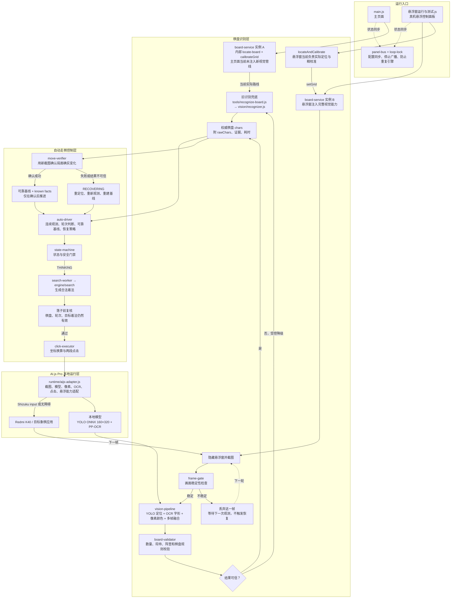
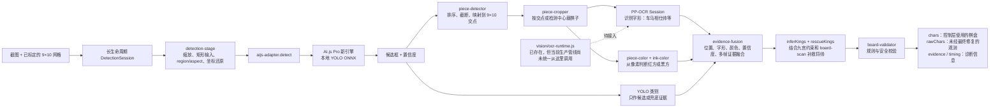
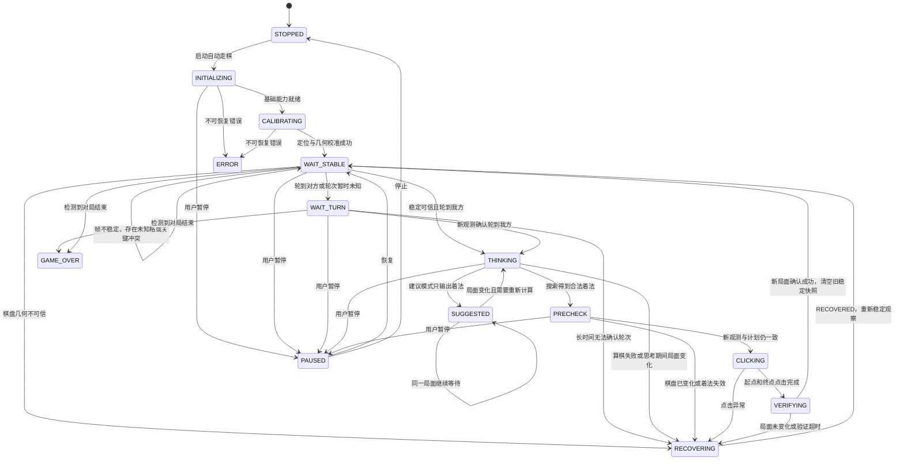
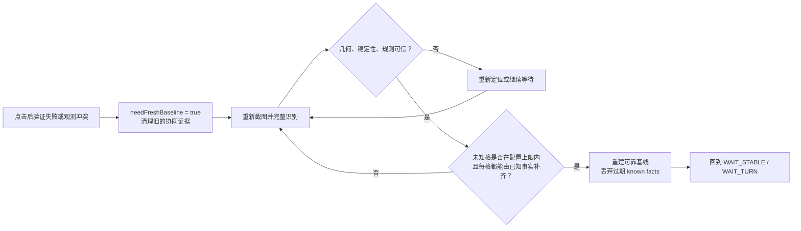
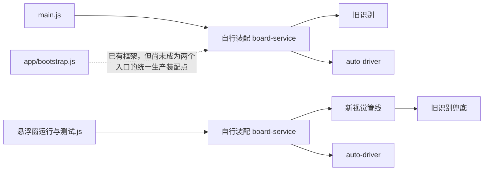
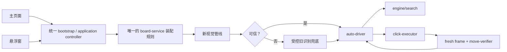
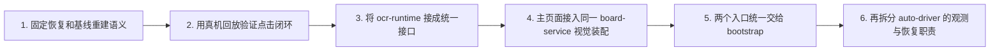

# 象棋当前架构路线图

> 更新时间：2026-09-20  
> 依据：当前仓库中的实际调用关系，而不是早期设计稿。DP 正在继续修改恢复链路，因此恢复细节以后续代码为准。

## 1. 当前生产运行总路线

这张图里最关键的一条闭环是：**识别 → 思考 → 落子前复核 → 点击 → 重新截图 → 落子确认 → 更新可靠基线**。点击成功本身不算走棋成功，只有新画面通过确认后才能进入下一回合。

## 2. 新视觉管线内部路线

各算法的职责边界如下：

| 模块 | 唯一主要职责 | 不应承担的职责 |
|---|---|---|
| YOLO | 找到棋子在哪里、提供候选框 | 单独决定最终棋子身份和红黑方 |
| PP-OCR | 识别棋子上的汉字 | 仅凭文字颜色猜阵营 |
| 像素颜色算法 | 区分红字和黑字 | 推断棋子名称 |
| 多帧融合 | 合并连续帧证据、抑制偶发误识别 | 绕过棋盘规则直接改局面 |
| 规则校验 | 检查数量、将帅、阵营和局面合理性 | 生成搜索着法 |
| auto-driver | 管理轮次、可靠基线、点击闭环和恢复 | 直接实现视觉模型 |
| engine/search | 在可信局面上生成合法着法 | 决定识别结果是否可信 |

## 3. 自动走棋状态路线

`THINKING` 是状态机状态，`COMPUTE` 是它发给驱动的算棋动作；驱动优先交给 `search-worker`，不可用时再走同步引擎。悬浮窗中的不稳定帧会被直接丢弃并等待下一帧，不会因此进入 `RECOVERING`。

恢复阶段当前还有一条专门的基线重建路线：

## 4. 当前架构与建议目标架构

当前两个入口仍各自装配依赖，主页面和悬浮窗实际走的识别路线不一致：

建议最终收敛为一条装配路线：

## 5. 对当前架构的判断

当前路线的主体已经合理：YOLO 负责位置、OCR 负责字形、像素负责阵营，多帧证据经过规则校验后才进入控制层；点击以后还要重新观测和验证，符合自动走棋需要的安全闭环。模型和算法均在 AI.js Pro 本地运行，不依赖云端推理。

目前仍有五处需要继续收敛：

1. `main.js` 尚未接入新视觉管线，主页面与悬浮窗的识别结果可能不一致。
2. `vision/ocr-runtime.js` 尚未成为生产 OCR 的统一入口，当前管线直接使用 PP-OCR Session。
3. `app/bootstrap.js` 还没有成为两个 UI 入口的共同装配点。
4. `auto-driver.js` 同时承担观测、历史事实、轮次、恢复和点击编排，后续应拆出独立的观测仓库与恢复策略。
5. 视觉观测与 `known facts / reliable baseline` 之间仍可能冲突；正在修改的恢复逻辑必须坚持“新鲜可信观测优先、确认后再推进基线”。

## 6. 推荐实施顺序

先保证“能连续完整走棋”，再做入口和模块收敛。这样每一步都能用现有真机日志、截图、回放和自检工具验证，不会一次性重构后失去故障定位依据。
