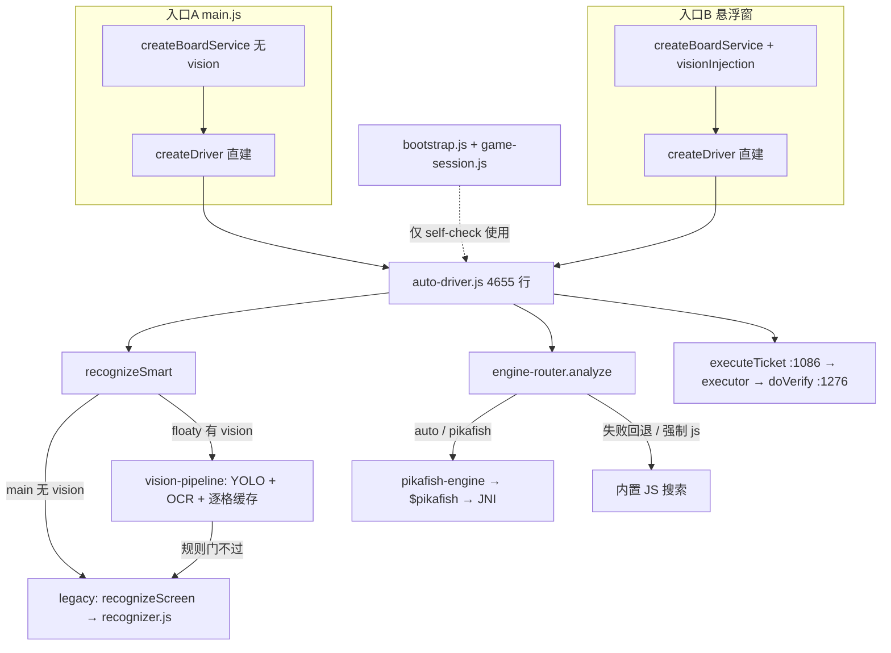

# 象棋自动走棋 · 重构 P0 基线冻结报告

> 依据：[`docs/plans/象棋自动走棋_框架重构任务书_2026-09-23.md`](../plans/象棋自动走棋_框架重构任务书_2026-09-23.md) §9 的 P0。
> 本报告**只冻结事实**：不改业务代码、不发布、不打包。
> 核对时间：2026-09-23 晚；工作树 `chore/upgrade-gradle-8 @ 0c24cd6`（全仓 238 个文件未提交，其中象棋工程 118 个）。

## 0. P0 交付门槛对照

| 任务书要求 | 本报告位置 |
|---|---|
| 能指出两个入口的真实装配链 | §1 |
| 实际视觉路径 | §2 |
| 实际引擎后端 | §3 |
| PC / 手机证据分离 | §4 |
| 现有自检结果 | §5 |

## 1. 两个生产入口的真实装配链

两个入口**各自直接创建驱动与棋盘服务**；`src/app/bootstrap.js` + `src/services/game-session.js` 已存在，但只有 `tools/self-check.js` 在用（self-check.js:5722 require、5971 createApp），生产入口未接入 —— 与任务书 §0 判断一致。

### 入口 A：`main.js`（Activity 主界面）

- `main.js:535`：`createBoardService(...)` —— **无 vision 注入**（注释原文：「视觉流水线（YOLO+OCR）暂时只注入悬浮窗」）
- `main.js:656`：`driverModule.createDriver({...})` 直接创建；`recognize` 走 `boardService.recognizeSmart`（`:662`）、`analyze` 走 `engineModule.analyze`（`:664`）、`tap` 走 `adapter.createTap`
- 固定配置：`tickMs 900 / movetimeMs 1200 / modelVersion chessai_160x320_v5r / confidence 0.25 / RED_BOTTOM / computeMode worker`
- 循环：`driverTick()` 定时器轮询 `autoDriver.tick()`；互锁 `loop-lock` + `panel-bus("main")`

### 入口 B：`悬浮窗运行与测试.js`（悬浮面板）

- `悬浮窗运行与测试.js:2760`：`driverModule.createDriver(wrapDriverDeps({...}))`（同样直建，未走 game-session）
- `:3149`：`createBoardService(...)`，注入 `vision: visionInjection`（约 `:3122` 起：pipeline 懒加载 / frame-gate / samples / countUnknown）
- `:3224`：`visionPipelineModule.create(...)`（YOLO detect-only 常驻会话 + 复用面板 OCR 会话 + 灰度/彩色策略）
- 定位/校准由面板自己管（pickGrid 兜底 + calibrateGrid）；服务层 `locate` 是显式 stub（返回「定位由面板负责」）
- 无头验证钩子：`/sdcard/.aijspro-floaty/floaty-autorun.json`（adb 可写）；互锁同上（`panel-bus("floaty")`）

## 2. 实际视觉路径（按入口）

- **main（主界面）**：`recognizeSmart` → 无 pipeline → `recognizeLegacy` → `tools/recognize-board.js recognizeScreen` → `src/vision/recognizer.js`（旧路径）
- **floaty（悬浮窗）**：`board-service.js:207 recognizeSmart` → 稳定帧闸门（frame-gate）→ 视觉流水线（YOLO detect-only + PP-OCRv6 + 逐格变化缓存）→ 规则门 `validation` 不过则带 `fallbackReason` 退回 legacy
- 共同点：抓帧藏窗、几何版本、校准偏移「未开 autoAlign 不采纳」都在服务层内（`board-service.js:132-205`）
- 定位差异：main 用 `locateBoardOnScreen + calibrateGrid(maxShift 18)`（`main.js:544-556`）；floaty 由面板侧 `locateAndCalibrate`（pickGrid 兜底）

## 3. 实际引擎后端

- `engine-router.js:124 analyze`：`auto`（默认）→ Pikafish 可用就用；**失败仅本步回退 JS 并记 `lastFallback`**；`pikafish` 强制模式失败不降级；`js` 只用内置
- `pikafish-engine.js:168 analyze`：`buildFen(resolved.board, resolved.side)` → `$pikafish.analyze(fen, movetime, timeoutMs, multiPv)`
- Java 侧：`QuickJsHostBridge.java:1008` → `PikafishNativeBridge.nativeAnalyze(String fen, long, long, int)`（`PikafishNativeBridge.java:64`）→ JNI `pikafish_jni.cpp:308`，内部只投喂 `position fen ...`
- **确认：全链路没有传已确认着法历史**（任务书 §0/§6.1 的要害点，Java/JNI/JS 三处一致）
  - 后果：长将/长捉/规则循环只能靠驱动外层简化计数；排除表 `excludeIccs` 用 MultiPV（≤5）挑路
  - 可观测面已存在：`engineDescription() / lastEngine() / lastFallback()`

## 4. 证据清单（PC / 手机分离）

### PC 链路（**不是手机战绩**）

| 证据（`.artifacts/k40-now/`） | 内容 | 状态 |
|---|---|---|
| `engine-seek-20260923.log` | PC Pikafish + 截图 + ADB；到 step 102；单步全周期 45.6s（其中引擎 40.01s） | 慢速档可长跑 |
| `engine-seek-fast-20260923.log` | 快速档：我方 16 步后「点击未生效 / 连续 3 次失败 中止」 | 快速档中止 |
| `live-fight*.log`（8 份）＋`live-crush.log` | CV 对局链路多次运行；`live-fight8` 同因「有未知棋子 → 3 次校验失败 中止（我方 6 步）」 | 视觉闭环缺陷证据 |
| `engine-final.png` | K40 结算页截图：119 回合上限判和（任务书 §0：累计 0胜/17和/15负） | 终局事实来源 |

### 手机链路（AI.js Pro 进程内）

- `audit-now.log`（09-22 07:59）：floaty 一轮 tick **12616ms**（其中重定位 10302ms×1、识别 840ms×2）；正常停止留痕「驱动已停、定时器已清、循环锁已释放」
  - 结论①：手机端能停干净；结论②：**重定位是耗时大头**
- `np-*.txt`：logcat 原始留档（系统层噪声为主，非战役总结）
- **缺口（下一批补）**：手机端完整对局记录（到结算页）；主界面入口的手机端跑通记录；内存/PSS 采样

## 5. 自检 / 回归现状（本机 node v24.16.0，2026-09-23 实测）

工作目录：`apps/app/src/main/assets/sample/QuickJS 新引擎/项目与打包/象棋自动走棋`

| 命令 | 结果 |
|---|---|
| `node tools/self-check.js` | **PASS 275/0** |
| `node tools/run-regress.js` | 场景 8/0 通过；**legacy 契约 1 失败** → `REGRESS FAILED` |
| `node tools/test-cells-contract.js` | **18 ok / 1 FAIL**（共 19 用例） |

失败用例：`requireTypeLimits=true 时应拒绝`（`tools/test-cells-contract.js:319`）。

- 归属初判：属**未提交的进行中改动** —— `src/vision/grid-search.js`（M，+291/-38）与 `tools/test-cells-contract.js`（M，+67）；09-21 留档 `reg-out.txt` 当时是 `CONTRACT PASS pass=19 fail=0`
- 机理待定位（P2 范围）：`searchByDetections` 末尾为 `chosen = bestAccepted || best`（合法性优先于代价）；失败意味着**有某个错位候选绕过了兵种硬门**（例如偏移网格下少落一枚士/落进冲突而低于上限）。具体候选待 P2 排查，P0 不动
- 另注：任务书写「self-check 105 项」已过时，现为 275 项

## 6. 与任务书事实核对表

| 任务书声明 | 核对结果 |
|---|---|
| 两入口各建驱动，bootstrap 未成为唯一装配点 | ✅ 属实（§1） |
| `auto-driver.js` 约 4700 行 | ✅ 4655 行 |
| `nativeAnalyze(fen, ...)` 无着法历史 | ✅ 属实（§3，三处一致） |
| K40 结算 119 回合判和 | ✅ 有截图与任务书记录（本次未再跑手机对局） |
| `engine-router` auto 可静默降级 JS | ✅ 路径存在；`lastFallback` 可查 |

本次未核对：设备序列号与机型对应（下一批 `adb devices` 记录）、内存基线。

## 7. 下一批（P1 开工前置）

1. **手机侧补一次完整对局**：floaty autorun（watch → auto）跑到结算页，留结算截图 + 本轮账日志（补 §4 缺口）
2. **P1 第一步**：两入口切 `bootstrap → controller → game-session`（小步；先适配后删码，旧路径保持可回退；P1 门槛＝两 UI 同一局面版本/后端/运行态）
3. 失败契约用例归 P2（视觉收口）处理，不阻塞 P1

## 8. 进行中改动落库（与 P1 解耦，2026-09-23）

为让 P1 从干净工作树开工，象棋工程内的未提交改动已全部落为本地提交：

| 提交 | 内容 |
|---|---|
| `a2d280e` `feat(xiangqi): 收敛 09-19~09-23 进行中改动：视觉流水线/引擎路由/自动化协议` | 90 个文件（+26261/-1529），含全部新模块（vision-pipeline、engine-router、pikafish-engine 等）与工具探针 |
| `2306bfa` `chore(xiangqi): 忽略本地测试留档（cc*/rg*/sc*/selfcheck* 等）` | 新增工程内 `.gitignore`，运行输出不再污染 `git status` |

- 提交后复测：self-check 275/0；cells 契约 18/1（同 §5 已知遗留）；run-regress 场景 8/0、legacy 1 失败（同因）
- 工作树：**象棋工程内 `git status` 已清零**；提交未推送（保持本地）
- 未纳入：`.txt` 测试留档文件（已忽略，仍留在磁盘）
- 全仓仍有约 123 个其他区域的未提交改动（apps 其余 / docs / modules 等），不在本次范围
