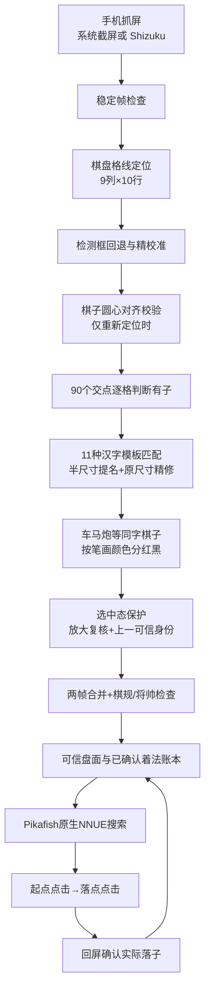

# 象棋助手当前算法与剩余工作

日期：2026-09-24。以源码提交 `fb6a6a9e`、工程脚本 `0.6.14`、宿主 APK `dev-679` 为准。运行端是 AI.js Pro QuickJS，算棋与视觉都在手机本地执行；联网不是算法前提。

## 当前真正运行的链路

### 1. 棋盘定位

主路径通过棋盘底色/格线找 9 条竖线和 10 条横线，得到左上交点与横纵格距。线定位失败或精校准不可信时，才尝试基于棋子检测框的 `pickGrid` 回退；最终候选还要通过帅/将、旧几何连续性和新加的棋子圆心校验。圆检测用 OpenCV HoughCircles，属于**几何证据**，不负责认字，也不在每帧运行。

### 2. 棋子识别

固定几何后，对 90 个交点逐格用灰度二值化检查暗色占比、字心墨迹和亮棋面；判定有子才做模板匹配。模板共有 11 种汉字；先在半尺寸图提名，再用原尺寸精修。车、马、炮同字不同阵营时，再按原图笔画的红/暗颜色分边。当前自动走棋主路径是这套**逐格字形模板**；YOLO/ONNX 文件虽仍在工程中，但不承担正常帧的兵种分类。

游戏选中棋子会放大字形。当前先做 1.10/1.18 倍的定向复核；若整盘有子/空位分布完全没变，则同一交点的棋子身份沿用上一张可信盘面，原始误读单独保存在 `rawChars`。真实移子或吃子会改变占位，仍由多帧与棋规判断，不强行套用旧身份。

### 3. 算棋与执行

规则门检查将帅、子数、未知格和局面合法性。驱动维护可信盘面、轮次与已确认着法；账本与当前盘面一致时，将着法历史交给原生 Pikafish NNUE，否则只用当前 FEN。现在没有 JS 弱引擎回退。搜索可用 MultiPV 避开游戏拒收或疑似重复的走法。点击由 Shizuku 或无障碍执行，点起点和落点后必须回屏确认，失败不直接把预期着法当事实。

## 已验证到什么程度

- 本地：自检 307/307、格子契约 19/19、回放场景 11/11。
- K40：dev-679 已发布并安装；前一版同一圆检测实现，开局 32/32、残局 8/8 个圆心对齐，单次约 87–131 ms。实际开局重新定位读出 32 圆、未知格 0；悬浮窗「象棋助手」四字完整。
- 实拍选中红相与红马，字形仍分别读为 `B`、`N`。这两帧没有复现用户说的误认，所以新身份保护在**真实误认帧**上的收益仍待量化。
- 曾观察到自动走棋推进，但没有对 dev-679 完成一整局胜负和内存长跑验收。当前 K40 已从 ADB 列表断开，暂时无法继续现场抓日志。

## 还没弄好的，按优先级

1. **真实误认样本闭环**：保存点击前、选中后、落子后同一格的原始截图和 `rawChars`，统计误认是否集中在某个兵种、颜色或皮肤。若选中导致占位也误读，再加「选中动画帧延迟重拍」，不能仅靠身份保留。
2. **整局验收**：在 K40 连续跑到胜/和/负，记录每手识别、思考、点击、确认、重定位耗时与内存峰值。当前只能说若干局面可运行，不能宣称能稳定赢特级大师。
3. **跨设备实拍**：720/1280 宽缩放图的圆心检测分别匹配 32 个真实交点；这只是缩放回放，还需不同分辨率手机的真实截图，尤其是其他棋盘皮肤和较大系统字体。
4. **版本信息统一**：`src/app/version.js` 是 `0.6.14`，宿主是 `dev-679`，但工程 `project.json` 和 `README.md` 仍写 `0.6.3`。打包独立棋盘 APK 前要同步工程元数据，避免用户误以为运行旧算法。
5. **极端几何**：圆心能否决半格错位，但无法单凭圆心分辨整行错锚；稀疏残局仍依赖旧几何连续性和帅/将约束，需保留真实反例回放。

## 建议下一轮顺序

先采真实误认帧并做「原图、逐格读数、可信基准、最终盘面」四项对照；再补动画帧重拍和点击后稳定期。不要先换整套模型：现有问题主要是**选中态与时间上下文**，重训普通棋子分类器未必解决。等识别错误类型有统计后，再决定是否新增选中态模板或小型 ONNX 分类器。
