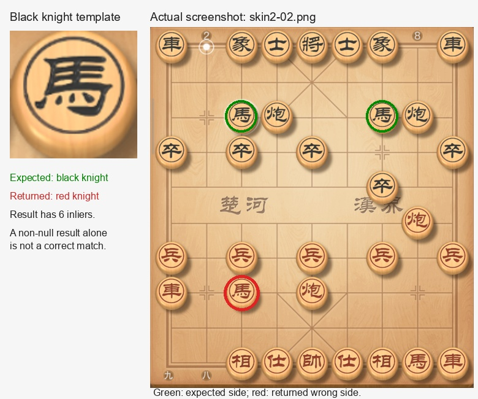

# SIFT 象棋图片实测（dev-771）

## 结论

QuickJS、Rhino 在同一台 Redmi K40 上完成 **872 次匹配调用**，无接口异常，两个引擎的命中、漏检和错认数量一致。

- **整盘定位可靠**：普通、加速模式均 9/9 命中。加速模式的系列调用中位耗时为 QuickJS **120 ms**、Rhino **125 ms**。
- **默认缩图不适合这些小棋子**：14 类单子 × 9 张截图，只有 46/126 正确，另有 71 次漏检、9 次红黑错认。
- **棋盘区域 + 原分辨率改善明显**：116/126 正确，仍有 5 次漏检、5 次红黑错认。去掉提供模板的首张截图后，独立局面为 **102/112（91.1%）**。
- **加速模式不能一概开启**：小目标粗扫失败后回退，本组单子耗时从约 174–175 ms 增至 284–285 ms；黑将的重复帧也出现缓存未命中的情况。

据本组结果，SIFT 适合先定位棋盘。完整棋局识别更适合在格点附近做字形匹配，再校验颜色与阵营；当前通用 SIFT 单模板接口还不足以可靠地完成这项工作。

## 数据与判定

- 设备：Redmi K40（M2012K11AC），Android 16 / SDK 36，arm64；应用 dev-771。
- 输入：`docs/reports/chess-skin-eval/` 内 `skin-a/b/c.png` 和 `skin2-01…06.png`，共 9 张真实对局截图，均为 1080×2400，同一木纹皮肤、相同朝向。
- 模板：从 `skin-a.png` 裁出棋盘 `[12,600,1056,1176]`，以及红黑各 7 类棋子的 104×104 图片。另 8 张包含走棋、吃子和高亮变化。
- 整盘要求中心及四角误差均不超过 15 px。保存结果经四角复核，36 次整盘调用的最大角点误差 **2.317 px**。
- 单子要求返回位置距标注棋子中心不超过 20 px，且**字形类别与红黑方均一致**。同类有多枚时，返回任意一枚均可。非空结果不能直接算命中。
- 每次单模板只要求返回一个同类位置；以上百分比是**单模板匹配正确率，不是全盘所有棋子识别率**。
- `skin-b.png` 的原 JSON 把黑炮记在 r2c3；按截图及独立 `run-py-eval-9.py` 修正测试标签为 r2c1。`skin2-04.png` 的动画中未知棋子保留 `?`，若命中此位置单列为 unknown；本次无此情况。
- 792 次系列调用：每个引擎普通/加速各 135 次，原分辨率区域 126 次。另对棋盘、红帅、黑将执行共 80 次相同帧重复匹配。

## 参数与耗时

所有模式保持 `threshold=0.7`、`minMatches=6` 等默认可靠性条件，没有通过降低门槛增加命中。

| 模式 | 场景参数 | 模板参数 |
| --- | --- | --- |
| normal | 全图，scale=0.5 | 棋盘 templateScale=0.5；单子 templateScale=1 |
| fast | 全图，scale=0.5，fast=true | 同 normal；粗扫成功使用约 0.333，弱匹配回退至 0.5 |
| board-fullres | region=[12,600,1056,1176]，scale=1 | 仅单子，templateScale=1 |

图像在计时前读入，模板通过 `createSiftMatcher` 提前准备。下表是逐帧 `matcher.match()` 的脚本端墙钟中位耗时，**不含文件读取、模板准备、绘图和日志**；区域内像素未变化时允许正常命中缓存。两引擎串行运行。

| 目标与模式 | 正确 / 漏检 / 错认（每个引擎） | QuickJS | Rhino |
| --- | --- | ---: | ---: |
| 整盘 normal | 9 / 0 / 0 | 162 ms | 172 ms |
| 整盘 fast | 9 / 0 / 0 | 120 ms | 125 ms |
| 单子 normal | 46 / 71 / 9 | 173.5 ms | 175 ms |
| 单子 fast | 46 / 71 / 9 | 284 ms | 285 ms |
| 单子 board-fullres | 116 / 5 / 5 | 250 ms | 265 ms |

首次建立模板仍有成本，例如 normal 棋盘模板准备 QuickJS 113 ms、Rhino 119 ms；单子模板准备中位约 10–19 ms。不能把缓存后的几毫秒当作首次完整运行耗时。

### 相同帧缓存（5 次重复调用中位数）

| 模式 / 目标 | QuickJS | Rhino | 特征与索引缓存命中 |
| --- | ---: | ---: | --- |
| normal / 棋盘 | 18 ms | 20 ms | 两引擎均 5/5 |
| fast / 棋盘 | 21 ms | 24 ms | 两引擎均 5/5 |
| normal / 黑将 | 4 ms | 5 ms | 两引擎均 5/5 |
| normal / 红帅 | 3 ms | 4 ms | 两引擎均 5/5 |
| fast / 黑将 | 295 ms | 291 ms | 两引擎均 0/5，反复粗扫后回退 |
| fast / 红帅 | 6 ms | 7 ms | 两引擎均 5/5 |
| board-fullres / 黑将 | 3 ms | 3 ms | 两引擎均 5/5 |
| board-fullres / 红帅 | 2 ms | 3 ms | 两引擎均 5/5 |

## 错认证据

下图使用真实 `skin2-02.png`：模板是黑马，绿色圈是合法黑马位置，但 normal 返回红圈内的红马，虽然具有 6 个几何内点，仍记为错误。

原分辨率模式残留问题主要为马的红黑混淆和移动后的红车漏检。当前 SIFT 灰度特征没有阵营颜色约束；缩图后相近字形也更难区分。以上测试只覆盖同一皮肤和分辨率，不代表其他皮肤、旋转或实时截图表现。

## 复测材料

- [逐次结果 CSV](chess-sift-eval-dev771/results.csv)：792 条系列调用，含位置、类别、耗时、内点数、搜索尺度与缓存状态。
- [汇总 JSON](chess-sift-eval-dev771/summary.json)：系列统计及重复帧原始耗时。
- `tools/prepare-sift-chess-fixtures.py`：使用 Pillow / OpenCV 生成模板、网格标签和两个引擎的脚本，输出到 `.artifacts/sift-chess-fixture/`。
- `tools/test-sift-chess-device.js`：调用现有公开 SIFT API，每个模板独立释放 matcher，结束时回收所有图片。
- 原始设备 JSON：`.artifacts/sift-chess-{quickjs,rhino}.json`、`.artifacts/sift-chess-accurate-{quickjs,rhino}.json`。

复测：运行准备脚本，把 9 张截图和生成目录内容推到 `/sdcard/Download/ai-sift-chess/`；依次运行 `test-quickjs.js`、`test-accurate-quickjs.js`、`test-rhino.js`、`test-accurate-rhino.js`。输出在该目录的 `output/` 下。最后的脚本还将四角误差纳入判定；本轮保存的全部整盘结果已离线按同样条件复核通过。
