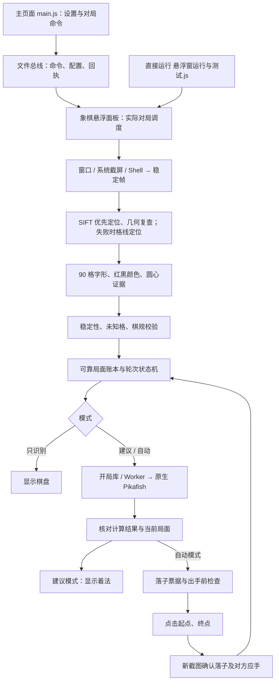
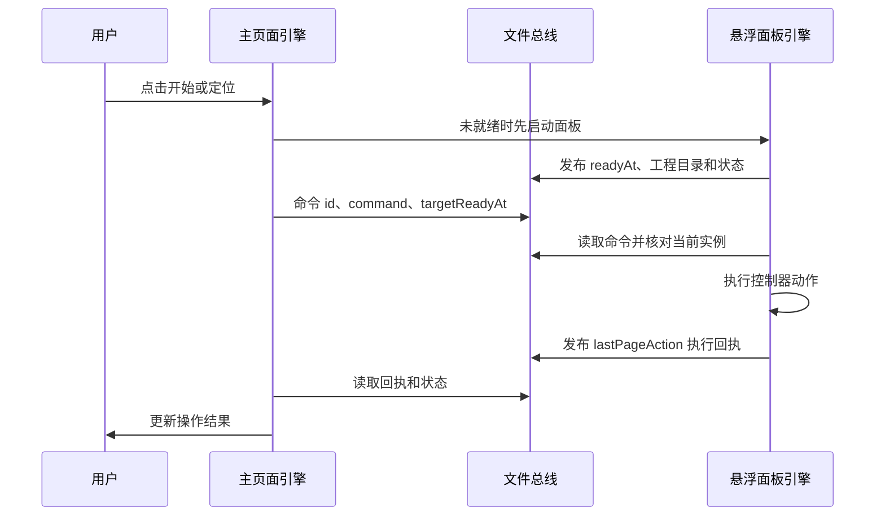
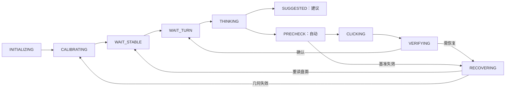

# 象棋自动走棋：架构与运行流程

更新：2026-10-05，当前工程 **0.6.73**。源码、宿主 APK、手机已导入的项目副本需要分别核对；导入的旧副本不会随 APK 自动覆盖。

0.6.73：`observation-safety.recheckRoyal` 将短暂将帅漏读与持久异常分开处理。异常帧仍禁止补回和出手，等待 420ms 后，以 `freshRead`、`independentRead`、`referenceBoard:null`、两帧同步读取复核；健康的新像素结果才进入后续盘面、轮次和落子确认。第二帧失败、移动中的两帧冲突、窗口变位或同一缓存帧均不放行。真实确认链中持续缺将仍暂停；`driver/verification.js` 不再对已取消的票据派发额外确认。面板循环在轮首与确认后都检查暂停，暂停时不抢前台、不观察、不运行盲读定位计时器，也不把没有新观察写成“未知格 ?”。

0.6.72：求胜模式在不超过 24 子、我方还剩 1～4 枚车马炮且有兵卒时提前请求 5 路候选。`automation/line-material.js` 逐手做合法校验，提前检查原主变前 16 半回合的同盘同轮次重复；原主变已经重复时，把重复或无法验证的候选加入软避让名单，与实际避重、避兑一起比较。原 PV 因预测和棋提前结束也能检查，不补造后续着法。此外，对至少 16 层且同深度的候选，比较相同的前 12 半回合，优先保留更多我方兵卒或进攻子力，同时要求我方车马炮数量、价值与双方车马炮总数不减少。两种偏好都限行棋方均势窗口 -25～80cp，分差与避重、避兑共用 20cp 上限，不叠加让分；非法主变、杀棋和实际被拒的着法不参与。主变是预测，不写入识别基准和确认棋谱。搜索总时间上限不增加，换招时同步更新评分、主变与预思考种子。真实局面无接近评分的替代时仍可能和棋；完整新策略对局尚需验收。

0.6.71：重复盘面达到核对门槛时，每会话独立读取两张全盘新帧，禁用旧棋子补齐；不一致、未知格或第二帧失败则暂停，读数一致才继续搜索。暂停后不再采集并修改确认棋谱。

0.6.69：`driver/loop.js` 在启动搜索前调用 `endgame-policy.js`，自动求胜时若我方已无车马炮兵，要求原始观测、当前盘面与可信账本的我方棋子位置一致，且两张不同新帧连续确认。首帧只复核，第二帧暂停驱动并通知面板停止，不把该策略当作游戏和棋裁决。关闭求胜或设置 `stopWithoutAttackers:false` 可继续保和。`win-seek.js` 按最后一枚车马炮识别软兑子风险，仍有兵也启用；`driver/search.js` 有软偏好时请求五路候选，记录返回候选数和当前合法着法数，保留评分、深度保护及唯一应对。

0.6.68：观察层遇到由唯一合法应手解释的同兵种反吃，仅作废旧落点提示，保留前盘面与棋谱；轮次层仍要求跨帧佐证后入账。`history.js` 只把成功且非重复确认的着法交给 `win-seek.js` 的往返记录，吃子、修订、换局清空记录。`move-policy.js` 将已确认同子往返与整盘重复候选合并，Worker 与同步搜索共用多路评分比较；评分窗口 -25～80cp，保持分差、深度、杀分保护，重复候选不进入硬排除表。

工程版本来自 [project.json](project.json)。`src/app/version.js` 和 `release-manifest.json` 由构建生成，不能单独手改。使用说明见 [README.md](README.md)，维护工具见 [tools/README.md](tools/README.md)。

0.6.70：`driver/baseline.js` 的恢复推断不再只采纳轮次；把 `inferred.board` 的全部格子写回恢复观测，包括应当变空的应手起点，然后再做将帅检查、可靠基准更新与 `trackRebuild`。`position-tracker.reconcile` 仍要求完整合法重放与恢复盘面闭合，才补入已有棋谱。原有“重建当帧不出手、下一帧再佐证”的顺序保留。

## 1. 整体运行：一手棋怎么完成

项目在 AI.js Pro 的 QuickJS 引擎内运行。先从游戏截图读出棋盘，确定可靠局面和轮次，再调用宿主的 Pikafish 算棋；自动模式点击起点、终点后，重新截图确认棋子确实走到了目标格。



| 模式 | 识别 | 算棋 | 点击游戏 |
| --- | --- | --- | --- |
| 只识别 `watch` | 是 | 否 | 否 |
| 着法建议 `advice` | 是 | 是 | 否 |
| 自动走棋 `auto` | 是 | 是 | 是，需通过出手检查 |

只识别和建议模式使用禁用的点击实现，误调用也会记录并返回失败。“我方红/黑”表示执棋方，轮到谁走仍要由当前棋局与观测证据确定。

## 2. 目录与装配关系

```text
象棋自动走棋/
├── main.js                         主页面：布局、参数、远程对局操作、诊断
├── 悬浮窗运行与测试.js              薄入口：单实例检查 → panel-app
├── 基础示例.js                     独立演示，与完整工程分开运行
├── project.json                    工程版本、引擎/UI 配置、权限
├── release-manifest.json           自动生成的逐文件 SHA-256 清单
├── src/
│   ├── app/
│   │   ├── bootstrap.js            端口、服务、控制器、会话装配
│   │   ├── panel-app.js            悬浮面板状态与动作装配
│   │   ├── page-actions.js         主页面命令及回执
│   │   ├── panel-bus.js            主页面与面板跨引擎通信
│   │   └── panel/                  启动、截图、校准、前台检查、调度、退出
│   ├── ui/                         主页面布局、参数绑定、标签
│   │   └── panel/                  面板、日志窗、收起条、参数控件、绘制
│   ├── services/                   棋盘服务、棋局会话、可靠局面账本
│   ├── automation/
│   │   ├── auto-driver.js          驱动装配和公共接口
│   │   ├── state-machine.js        观察、算棋、出手、确认、恢复状态
│   │   ├── search-worker.js        独立 QuickJS 算棋任务
│   │   ├── search-budget.js        按局面分配搜索预算
│   │   ├── move-ticket.js          绑定局面与几何版本的落子票据
│   │   ├── click-executor.js       格点换算与两次点击
│   │   ├── move-verifier.js        新观测确认落子
│   │   └── driver/                 按职责拆分的驱动动作
│   ├── vision/                     SIFT/格线定位、校准、字形、颜色、证据（识别直通 reuse-gate）
│   ├── engine/                     开局库、Pikafish、关键步复核
│   ├── chess/                      FEN、棋规、合法着法、局面转移
│   ├── runtime/                    图像/输入/引擎端口、软件悬浮球避让
│   └── diagnostics/                记录器、计时、日志、能力探针
├── assets/                         board-sift 标定、glyph-tpl 字形、检测模型
├── experiments/                    旧 YOLO 分类、棋子 OCR、差分对照
├── tests/                          离线自检与格点契约
├── tools/                          PC 回归、图片评估、运行探针
└── reports/                        本地测试输出，不参与运行
```

- [bootstrap.js](src/app/bootstrap.js) 创建宿主端口、记录器、会话存储、棋盘服务、会话、控制器及总线；入口传入总线时复用它。
- [panel-app.js](src/app/panel-app.js) 为每个面板建立独立 `panelState`、`panelActions`，装配截图、识别、窗口、启动和调度模块。
- [auto-driver.js](src/automation/auto-driver.js) 为每个驱动建立独立 `driverState` 与动作表，注入定位、识别、算棋、输入、前台检查能力。
- [game-session.js](src/services/game-session.js) 管驱动的构建、开始、停止及配置变化后的重建。

同一实例通过参数共享状态，通过动作表调用其它模块；主页面、面板、算棋 Worker 的 JS 对象不能直接跨引擎共享。

日常对局按钮统一交给悬浮面板执行，但 `main.js` 仍保留诊断、服务装配和本地驱动相关代码，约 1,100 行，尚未完全成为纯界面入口。改布局看 `src/ui/`，改对局流程看 `src/app/panel/` 和 `src/automation/driver/`。

## 3. 点“开始”后如何启动

### 主页面与悬浮面板通信

[page-actions.js](src/app/page-actions.js) 负责开始、定位、识别、新会话、轮次声明、收起和绘制命令。面板未启动时先打开面板，确认就绪且工程目录一致后再发命令。



总线默认目录 `/sdcard/.aijspro-floaty/` 中，`bus-state-main.json`、`bus-state-floaty.json` 各写自己的状态与心跳；`bus-command-main.json`、`bus-command-floaty.json` 是给对应入口的单槽命令，处理后清空。

它不是持久任务队列：页面一次只保留一个待执行请求，命令绑定 `targetReadyAt` 防止新实例重放旧命令。默认 8 秒没有新心跳即视为过期，准备面板和等待执行回执分别有超时反馈。

### 面板分步启动

[start-flow.js](src/app/panel/start-flow.js) 按以下顺序执行，步骤间通过定时回调更新进度并允许取消：

1. 检查运行/启动状态，申请悬浮面板的循环所有权。
2. 尽量保持目标游戏在前台；已有网格可复用，没有网格则定位校准。
3. 自动模式确认游戏前台焦点，构建带真实点击端口的驱动。
4. 建议与自动模式预热 Pikafish；只识别模式跳过。
5. 启动会话、记录运行状态、更新界面，安排首次 tick。

停止会递增启动 generation 标记，旧的延迟步骤不能继续启动循环。

防重复运行分两层：`panel-singleton` 检查重复面板；[loop-lock.js](src/automation/loop-lock.js) 用所有者与心跳文件协调主页面和面板，默认租期 12 秒。这是协作式文件互锁，不是操作系统的原子互斥锁。

## 4. 截图如何变成可靠局面

### 后台正常观察（0.6.62）

`panel/async-vision.js` 对接 `runtime/vision-worker.js` 和 `vision-task.js`。只有已校准的窗口截图启用后台观察；普通录屏/Shell、缺线程能力或 worker 退出后退回同步。默认 `visionMode:worker`；autorun 可写 `visionMode:inline` 对照。

| 所在线程 | 工作 |
| --- | --- |
| 面板 QuickJS | ImGui 按钮、120ms 结果轮询、可信局面采纳、轮次/票据检查、落子顺序 |
| 一个常驻视觉 worker | 隔离窗口截图、等稳定、SIFT 几何复查、字形/颜色、多帧合并、结算探针 |
| 一个常驻搜索 worker | Pikafish 搜索、预判和预思考串行；重建驱动仍复用 |
| 一个常驻 IO worker | 批量面板日志、探针/绘制 JSON 文件保存；退出前排空 |

每个视觉任务带局面、会话、几何、状态和窗口信息。等待结果的 tick 不计观察失败，不覆盖可靠局面；结果与当前请求一致且采集时间不超过 1.8 秒才采纳。每次只处理一个视觉任务，队列保留最新请求，取消序号持续生效。所有图像在视觉 worker 内持有并显式释放，只传 JSON；模板和几何参照复用，结束时协作退出并释放。心跳读取容忍半写入 JSON，不强行中断 JNI。

目前后台链只用于 WAIT_STABLE / WAIT_TURN / RECOVERING 的正常观察。启动定位、出手前复查、落子确认和实际输入继续使用现有顺序；并行数量固定为一个视觉任务，避免截图、识别堆积。后台观察耗时与面板 tick 耗时在日志分别显示。K40 的短时 A/B 结果和范围见仓库 `docs/reports/2026-10-04_象棋后台观察_dev792.md`；完整长局另行验收。

### 常驻搜索与 IO（0.6.64）

`runtime/task-worker.js` / `task-service.js` 通过宿主 `events.bus` 交换 JSON 内存消息。每条任务通道只发送一个未确认任务，队列最多 64 项和 4 Mi 字符的 JSON 文本；启动握手完成后才发送，结果按通道及任务编号匹配。所有原生调用在 Worker 内串行执行。

`automation/search-worker.js` 复用一条常驻搜索通道，`search-task.js` 执行真实 engine-router 搜索并保留 PV、历史、复核与排除等字段。取消立即作废结果，旧搜索自然收尾后才执行新任务；超时后通道停用，返回失败，不再与旧 JNI 搜索重叠启动同步搜索。`game-session` 在重建驱动时保留搜索 Worker，脚本退出时协作关闭。面板显式 `exit()` 先执行一次清理，随后调用宿主退出；`events.on("exit")` 作为幂等兜底。

`runtime/io-queue.js` / `io-task.js` 保存日志和诊断 JSON。日志仍按 20 行或 2 秒批量提交，8 MiB 上限不变。关闭时将未完成任务作为一个有界批次交给 Worker 排空；重复编号不会再次追加。没有消息通道时沿用同步保存，Worker 尚未握手就退出时同步保存未发送文本。诊断 PNG 保存、配置/互锁小文件和视觉通道的 IPC 文件仍保持原路径，不跨引擎传递图像句柄。

### 截图与稳定帧

[aijs-adapter.js](src/runtime/aijs-adapter.js) 适配宿主截图、图像与输入能力。截图有系统截屏、Shell、自动三种偏好；自动优先系统截屏，失败后尝试 Shell，Shell 需要可用的 Shizuku/Root。

[capture.js](src/app/panel/capture.js) 比较棋盘区域采样，避开动画、拖影与遮挡；近期帧替换时回收上一帧。正常截图只在面板遮住棋盘时暂避，对局结束按钮的遮挡复核另行限频。

### 定位与几何缓存

[locate-board.js](src/vision/locate-board.js) 当前按 **SIFT → 原生 Canny/Hough → 图色格线 lattice** 顺序尝试。候选网格经校准、字形/棋规、独立圆心证据检查后，通过 `publishGrid` 同步到面板、服务和驱动。

[sift-board-locator.js](src/vision/sift-board-locator.js) 调用真实 SIFT 特征匹配接口 `images.createSiftMatcher()`，用 [模板与交点标定](assets/board-sift/README.md) 换算 9×10 交点。当前网格主要适合接近横竖对齐的棋盘平移、缩放，不能假定任意旋转与透视都能走棋。

完整盘面校验通过后才缓存几何与河界参照。之后逐次检查参照，最多每 30 次再进行 SIFT 复查：

- 参照一致：复用网格，继续识别棋子。
- 参照变化：先复查，几何没变就继续使用原坐标。
- 确认几何变位：拒绝当前观察，重新定位。
- 暂时找不到模板：拒绝不确定帧，等待稳定，不强行采用旧坐标。

**只缓存棋盘几何，每帧仍重新识别棋局。**参照改变不等于棋盘移动；恢复状态也不等于必须重新定位。

### 棋子分类与证据合并

[board-service.js](src/services/board-service.js) 编排截图、几何复查、稳定性、字形识别与未知格闸门，`recognize()` 与 `recognizeSmart()` 使用同一实现。

生产分类只有 **字形模板 + 红黑颜色**。主页面图片识别、面板单帧和自动观察共用字形源，校验失败不切回旧分类器。检测模型只提供框、圆心、行列等几何证据；PP-OCR 可辅助读取对局结束等界面文字。旧棋子 OCR、YOLO 分类与差分链位于 `experiments/`，不注入正常对局。

驱动结合多帧读数、已确认历史、合法着法和单格证据建立可靠局面。未知格、冲突、几何不可靠会阻止当前出手。预测应手仅辅助符合观测的合法候选裁决，不能单独证明对方实际走了哪步。

| 数据 | 含义与用途 |
| --- | --- |
| `grid` | 原点、格距、朝向、几何版本和质量，用于采样与坐标换算 |
| `rawChars` / `chars` | 原始/处理后的 90 格读数，`?` 为未知，用于校验与证据合并 |
| 可靠局面、FEN、历史 | 当前可信布局、走棋方和已确认着法，用于棋规与算棋输入 |
| search job | 绑定当前局面和预算的搜索任务，用于计算、取消和结果接收 |
| move ticket | 会话、局面/几何版本、着法与预期落子后 FEN，用于出手与确认 |

## 5. 算棋、出手、回屏确认

### 搜索与线程

[engine-router.js](src/engine/engine-router.js) 选择可用的短开局库或 Pikafish；[pikafish-engine.js](src/engine/pikafish-engine.js) 调用原生 `$pikafish` 与 NNUE。原生能力或权重不可用时报告失败，没有内置 JS 搜索后端兜底。

引擎驱动可以注入：[pikafish-engine.js](src/engine/pikafish-engine.js) 的 `setDriver(engine)` 能把后端换成任意「与 `$pikafish` 同形状」的驱动（`available/isRunning/start/analyze/analyzePosition/stop/quit`），`setDriver(null)` 恢复宿主 `$pikafish`。象棋引擎插件（[plugins/xiangqi-plugin](../../plugins/xiangqi-plugin)）就是用它把自己那份 Pikafish 接到本工程的算棋链路上的——业务代码不需要为「宿主有没有 `$pikafish`」写分支。

[search-worker.js](src/automation/search-worker.js) 将搜索放在独立 QuickJS Worker；线程函数不依赖外层闭包，参数经 JSON 传入，模块按工程绝对目录加载。面板轮询结果，正在算棋时不重复截图。缺线程能力时有同步兼容路径，会影响界面响应。

脚本负责流程编排，主要计算能力在宿主：SIFT + FLANN 在 C++ 层完成，Pikafish/NNUE 通过原生接口搜索。更新脚本可以改变预算、缓存与状态逻辑；改原生实现或 Java 窗口管理则必须重新构建宿主 APK。

| 执行位置 | 主要工作 |
| --- | --- |
| Android UI 线程 | 原生窗口、控件和触摸状态修改 |
| 主页面 QuickJS 引擎 | 参数绑定、命令、回执和状态显示 |
| 面板 QuickJS 引擎 | 截图识别、驱动 tick、点击、确认的编排 |
| 搜索 Worker + 原生引擎 | Pikafish 搜索，结果交回主循环 |

独立 Worker 不意味着可随意并行多个原生 Pikafish 搜索；预思考、正式搜索和取消要遵守已有任务协作流程。

[search-budget.js](src/automation/search-budget.js) 在默认限时模式按可靠局面分配首搜：普通 1.8 秒，16 子以内 2.4 秒，10 子以内 3 秒，被将军优先取 2.8 秒。首搜取目标与用户预算较小值，关键步可复核，首搜与复核共用总预算，默认 5 秒。未知格或缺将帅时不按可靠残局加时；自动分配开启时后台预思考最多 700ms。固定层数走目标层数与最长等待，不套上述分档。

**整手耗时 = 截图/稳定等待 + 多帧观察 + 搜索/复核 + 出手前检查 + 两次输入与间隔 + 落子确认。**调度在思考期间每次等待约 120ms 轮询，其余 tick 完成后通常再等 1400ms；两者都不是每手棋的固定时长。排查慢要看分段日志。

### 落子票据与输入

[move-ticket.js](src/automation/move-ticket.js) 将着法绑定到产生它的会话、局面版本、FEN、几何版本和有效期。出手前重新检查局面、轮次、几何与目标游戏前台焦点，基准变化后旧搜索结果不能直接点击。

[click-executor.js](src/automation/click-executor.js) 把格点换成屏幕坐标，可采用可信实测中心；点击起点、等待选中、点击终点，两次点击之间也检查取消。方法、按压与等待由配置注入，实际输入通道写入日志。

输入返回成功只说明点击已执行，棋子是否走成由 [move-verifier.js](src/automation/move-verifier.js) 用**新观测**确认：

| 结果 | 含义与后续 |
| --- | --- |
| `CONFIRMED` | 与预期落子后局面一致，提交历史，等对方 |
| `OPPONENT_REPLY` | 己方落子与对方合法应手均出现，连续记账 |
| `UNCHANGED` | 可靠盘面未变，按选中状态等待、恢复或有限重试 |
| `UNEXPECTED` | 其它可靠局面，作废旧票据并解析/恢复 |
| `UNRELIABLE` | 看不清、不稳定或几何不可信，等新观测，超时再恢复 |

不能把 `UNRELIABLE` 当作没落子直接重点击。

### 状态机主路径

下图为简化主路径，完整事件与动作看 [state-machine.js](src/automation/state-machine.js)：



只识别走观察分支，跳过算棋、轮次出手与点击；停止、暂停、对局结束、错误可中断流程。恢复包括重拍、证据修正、基准重建，不能一律理解为重新定位。

## 6. 象棋悬浮窗与软件悬浮球

软件 AI 悬浮球由宿主 Java 管理，象棋面板、日志、收起条、识别画板由工程脚本管理：

| 窗口 | 控制方式与生命周期 |
| --- | --- |
| 软件球/菜单 | `runtime/own-overlay.js` 申请宿主共享避让令牌，最后一个持有者释放后恢复；用户主动关闭后不重新打开 |
| 象棋面板/日志/收起条 | `ui/panel/` 判断遮挡，切根 View 显隐并保留窗口挂载；不遮棋盘时正常抓帧不收放，收起状态保持 |
| 点击期间的象棋面板 | `app/panel/driver-loop.js` 管整手点击租约；需要藏窗时从起点前保持到终点后，停止/异常路径释放 |
| 识别画板 | 自动模式显示我方黄色箭头 + 对方预判**逐路**蓝色箭头（敌1/敌2…排名标签，越靠后越淡；**档位策略菜单可调：关/快 500ms×3/标准 900ms×5/深 1500ms×5**，2026-10-06）；隔离截图保留绘制内容 |

**0.6.54 新宿主：**`FloatyWindowManger`、`FloatingMenuVisibility`、`CircularMenuWindow` 管共享令牌。避让时保留球和菜单窗口，隐藏 View、取消触摸拦截；页面恢复仍遵守避让，多任务不能提前恢复球。这需要发布并安装含 Java 修复的新 APK。

**旧宿主：**兼容脚本在每次抓帧前检查页面是否重新打开球，必要时再次隐藏；它没有完整多任务共享保护，只更新脚本不能替代 Java 修复。

实时面板在 `app/panel/board-service.js` 装配通用会话时传 `win: null`，实际显隐和点击租约由面板模块管理，不能把它们全部归到通用窗口管理器。

## 7. 驱动内部职责与维护规则

`src/automation/driver/` 按以下职责维护，`auto-driver.js` 负责装配：

| 模块 | 职责 |
| --- | --- |
| `history` | 可靠局面账本、已确认历史、跨帧佐证 |
| `effects` | 状态机动作分发与校准入口 |
| `search` | Worker、预判/预思考、结果接收 |
| `move-policy` | 拒收着法、重复局面、求胜过滤 |
| `execution` / `verification` | 出手前检查、票据执行、回屏核对与恢复 |
| `recognition` / `evidence` | 观测合并、已知事实、单格证据、票据盘面重建 |
| `board-repair` | 幻影清理、证据修正、重拍 |
| `observation` / `baseline` | 整轮观察、局面采纳、基准重建、对方应手采纳 |
| `turn` / `loop` | 轮次与会话清理、tick 与状态推进 |

1. 正常入口与 `src/**` 不依赖 `tools/**` 或 `experiments/**`；工具可加载生产模块，自检按需加载 `tests/**`。
2. `position-tracker` 管可靠局面，`state-machine` 管何时出手，`click-executor` 管输入，`move-verifier` 管落子是否成立。
3. 图像、输入、算棋端口通过 runtime 适配；窗口模块仍直接使用 `ui`、`floaty`、Java View 和事件能力。
4. 换几何统一走 `publishGrid`；换会话作废票据与基准，不能只改面板一份状态。
5. 图像句柄按缓存替换、停止、退出分别回收；SIFT matcher 和检测/OCR 会话不能每帧随意重建或遗留。

## 8. 停止、换局与退出

[lifecycle.js](src/app/panel/lifecycle.js) 将动作分开：

- **停止：**取消启动步骤与后续 tick，停会话，释放近期帧、软件球避让、循环锁和点击租约；保留校准几何，便于再次开始。
- **新会话：**先停止，再递增会话，作废票据/基准，清面板与服务的几何。
- **对局结束：**结合棋局和界面证据停止；QQ 成绩页底部按钮模板需连续两帧同时命中，避免结束画面反复重定位。
- **退出/重载：**关闭窗口、释放图像、SIFT、检测/OCR 等资源；自动重载有交接状态。原生崩溃可能不执行退出钩子，需结合实机验证恢复。

## 9. 日志与排障入口

先记录宿主版本、工程版本、启动源码 SHA-256、模式、我方颜色、截图/点击通道，再看异常前后完整一手日志。

| 表现 | 优先检查 | 源码入口 |
| --- | --- | --- |
| 开始卡住 | 启动阶段、锁、授权、前台、引擎预热 | `app/panel/start-flow.js`、`automation/loop-lock.js` |
| 反复重新定位 | 真变位、参照暂失、未知格恢复还是结算页；看 SIFT 复查和原始读数 | `vision/sift-board-locator.js`、`app/panel/calibration.js`、`services/board-service.js` |
| 每手慢 | 截图、稳定等待、观察次数、搜索复核、预检查、输入、确认分段耗时 | `app/panel/capture.js`、`app/panel/driver-loop.js`、`automation/search-budget.js` |
| 有着法不落子 | 模式、轮次、票据、未知格、前台、点击权限 | `automation/driver/execution.js`、`app/panel/foreground.js` |
| 点击成功棋子不动 | 实际通道、坐标、按压、选中状态、`UNCHANGED` | `automation/click-executor.js`、`automation/move-verifier.js` |
| 悬浮窗闪/软件球出现 | 遮挡、显隐、点击租约、球租约、宿主是否含共享令牌 | `ui/panel/placement.js`、`runtime/own-overlay.js`、宿主浮窗类 |
| 页面/面板不同步 | 总线权限、心跳、readyAt、命令 id、执行回执 | `app/page-actions.js`、`app/panel-bus.js` |
| 换局沿用旧坐标/着法 | 新会话、会话号、几何版本是否更新 | `app/panel/lifecycle.js`、`automation/move-ticket.js` |

## 10. 窗口截图与 ImGui 绘制

主界面“截图来源”新增 `window`（Android 14+、新版宿主和无障碍服务）。适配器调用 `images.captureWindow({screenCoordinates:true})`：只取目标窗口，再按窗口边界映射到屏幕尺寸的黑色画布，保持棋盘网格、取样和落子的屏幕坐标。

窗口截图没有 MediaProjection 授权流程，失败不会改抓整屏。第一次成功后绑定游戏包名；窗口移动或旋转后停用旧坐标，需要重新定位校准。点击前还会检查窗口 ID、包名、边界、方向与 foreground 状态。foreground 保留活动应用，或宿主覆盖窗活动时底下仍有输入焦点的应用，不采纳普通后台窗口；active/focused 仍是系统原始值。

该通道下，普通抓帧不隐藏操作面板或应用悬浮球，循环允许持续识别绘制；画板改用 `drawing.show({renderer:"imgui"})`，由 Dear ImGui + OpenGL ES 3 渲染最新快照。操作面板仍沿用现有控件，遮住点击位置时仍保留点击租约。

**0.6.55 显示链：**`driver/search.finishCompute → JOB_RESULT → move-ticket → ui/render-state → ui/panel/overlay → drawing.update → ImGui`。引擎评分、实际深度、耗时和 PV 随当前票据传递，不从日志猜测。`RenderState` 仅含数字、字符串和图形，没有截图句柄；渲染器不参与识别和算棋。

**0.6.60 自动走棋箭头：**默认 `drawMode:"moves"`，自动模式只画我方黄色方向箭头与对方预判蓝色方向箭头，没有正方框、圆圈、棋子标签或诊断 HUD。建议模式不绘制走法；审核识别仍可手动选格子/完整绘制。

我方执行检查通过后、首次点击前发送 `notifyMovePlan`。对方预判取驱动的 `predictionForDisplay()`（对面视角搜索或当前 PV）的 top-K（2026-10-05 起默认 5 路），每一路都画出（非法/重复过滤，第 1 路最亮、越靠后越淡），并在我方预期后局面里逐条检查合法。**预判档位（关/快/标准/深 = 单次预算 × 路数）在面板「策略战绩」菜单可调，默认标准 900ms×5 路（2026-10-06 起）**。预测显示不参与点击，也不作为真实走棋事实。

绘制模块保留已发送走法：确认及等待对方期间，最新盘面必须等于该步的预期后局面，会话/模型/几何与局面版本必须一致，才能持续显示；对方实际走棋后旧箭头失效，新走法出来再更新。短暂未知格不反复清屏；暂停、停止、硬截图失败、几何变化仍清除。保留显示不会延长点击票据的有效期。

启动或首次抓帧前，可用时自动选窗口截图（会话内选择，不覆盖保存偏好），清旧几何再定位。截图不清箭头、不藏操作窗；相同箭头快照不重复提交。缺少隔离截图能力时继续自动走棋，提示连续箭头所需能力并停用实时绘制，避免普通截图混入箭头或反复清屏；Android 14+ 的窗口截图需要无障碍服务。普通通道手动审核绘制仍在截图前清内容。

**0.6.61 操作链：**启动默认进入 `ui/imgui-compact-window.js`，自动、录屏、Shell、窗口截图模式均可使用。参数和日志窗先隐藏挂载，避免完整面板在启动时闪现；“更多”显示完整面板，其“ImGui”按钮返回小窗。`autorun.collapse=false` 可显式默认展开。有边界的原生窗通过 `drawing.panel.poll()` 给出按钮 ID，脚本线程以 100ms 定时器读取，再发送现有 START/STOP/RELOCATE/RECOGNIZE 控制器命令。模式切换先停止，待明确开始；运行期间手动定位/识别禁用。停止同批优先，旧开始事件过期丢弃。原生拖动标题不会绕经 JS 线程；完成事件只记录用户位置，阻止自动贴板抢回。

“更多”隐藏小窗并打开完整参数和日志；隐藏原生窗会禁止触摸并清掉输入，展开/收起保留窗口。几何与 HUD 使用操作窗实际宽高。截图通道变化先停止循环，作废几何与绘制，保留小窗和收起状态。退出或重载关闭定时器和原生窗；清除走法只清绘制层。

**0.6.58 截图显隐：**`placement.captureHideTargets → window.beginCaptureVisibility → capture.grabFrame/grabStableFrame/grabSettledFrame`。窗口截图的定位强制干净帧也不再隐藏覆盖窗。普通截图分别检查操作窗与日志窗，只暂避遮住识别区域的窗口；结算页复核只遮住底部的日志时保持操作窗显示。一次多帧采样共用一次隐藏，失败/中断也释放自己的显隐租约。点击租约或外层截图已经隐藏的窗口直接借用，不增加隐藏深度、不提前恢复。

普通全屏截图没有隔离覆盖窗：面板确实压住棋盘或定位尚未确定区域时，仍需暂避以得到干净图片。将面板放在棋盘外，或选择可用的窗口截图通道，可避免这类必要藏显。

无障碍服务已连接时小窗使用无障碍覆盖层，未连接时使用普通悬浮窗权限；旧宿主缺少完整 `drawing.panel` 接口时回退兼容小窗。普通截图与面板重叠时仍暂避，窗口截图仍隔离覆盖层。显示权限、截图权限、点击权限分别检查：录屏需要授权，Shell 需要相应权限，免无障碍自动落子需要可用的 Shizuku 点击通道。所有通道的走法与审核画板均使用 ImGui；普通截图须清绘制内容以免识别到框线。

小窗请求完整面板的宽度，宿主按屏幕夹紧并保证触摸尺寸；窄屏按需要换行，定位与遮挡检查使用实际宽高。autorun 显式 `start:false` 阻止旧会话自动恢复，未指定该字段时仍保留崩溃/重载恢复。

原生绘制与按钮使用 APK 自带的静态中文字体，先检查图集构建结果；失败时清掉图集并重建已检查的拉丁字库，避免 ROM 字体不兼容导致第一帧闪退。没有覆盖的字可能显示方框。

其他截图通道保持原有遮挡处理。NCNN YOLO、完整 ImGui 参数面板、固定 60/120fps 尚未接入，脚本阻塞时也不能立即执行原生按钮命令。详见仓库 `docs/guides/WINDOW_CAPTURE_IMGUI.md`；应用内“图片与图色处理”文档也有新 API 的参数和示例。

## 11. 版本、打包与验证

宿主 **dev-N** 是 APK 版本，工程 **0.6.x** 是脚本版本，源码 SHA-256 标识具体文件内容。手机已导入的旧项目不会因 APK 更新自动覆盖。

仓库沿用 `tools/publish.ps1 → tools/dev-update.ps1` 发布线。构建任务 `:app:prepareXiangqiRelease` 调用仓库根 `tools/xiangqi-release.py prepare`，生成版本模块与逐文件清单；时间戳不参与指纹，未提交新文件也计入。发布前核对 APK 中版本、文件集合、每个文件内容与总指纹，`-SkipBuild` 同样受检查。

| 验证入口 | 工作目录 | 范围 |
| --- | --- | --- |
| `node tools/verify-xiangqi-architecture.cjs` | 仓库根 | 依赖、动作装配、实例隔离、唯一分类链、入口体积 |
| `node tools/run-regress.js` | 象棋工程 | 场景回归、自检、格点契约 |
| `node tools/panel-load-smoke.js --full` | 象棋工程 | 模拟面板加载、按钮、参数、收起/展开 |
| `node tools/glyph-pc-eval.js` | 象棋工程 | 真实截图的盘面、未知格、修正评估 |
| `python tools/xiangqi-release.py verify-source` | 仓库根 | 当前文件与生成清单一致 |
| `python -m unittest discover -s tools/tests -p test_xiangqi_release.py -v` | 仓库根 | 发布清单正常包与异常包校验 |

0.6.56 已通过架构检查、17 类场景回归、面板行为与完整加载模拟、窗口截图/点击守卫和 ImGui 命令回归。K40（Android 16）通过窗口截图与绘制示例、原生按钮点击/清零/拖动/关闭、窗外触摸和截图隔离验收。这里没有完成 0.6.56 在真实棋局中的整局自动落子和长时间运行验收。Node 若暴露内置 `global.events`，离线模拟需屏蔽它，避免脚本将它误当 AI.js Pro 的事件对象。

## 将帅与吃子安全检查（0.6.63）

当前帧的 `rawChars` 在历史补齐之前检查。红帅、黑将必须各有一枚；缺失/重复先禁止落子，两张不同的新帧确认后停止自动运行，日志保留计数。未知或消失的将帅不能向空格用棋规补回。多帧合并遇到后帧缺将帅，不得退回前帧。

同占位保护只保留同阵营兵种；异色读数保留，圆心像素阵营优先。点击前再次用当前完整、圆心验证的原始盤面检查合法性，避免被将军时按旧盘面走其他子。

窗口视觉 worker 在 WAIT_STABLE / WAIT_TURN / RECOVERING 每 120ms 调度；任一时刻仍只有一个观察任务。对方应手需要连续两次观测佐证，不能因为等待时间长自动缩减证据门限。

### 绘制请求隔离（0.6.65 / 宿主 dev-796）

面板的 drawing.update 只提交不可变 JSON 与文字；最多保留一份待处理请求。GL 绘制线程取最新请求，解析完成后替换画面；坏请求保留上一份完整画面。新请求不先清空箭头，关闭清除待处理数据。此项隔离了绘制处理与观察结果采纳，不更改稳定帧判断、点击票据或将帅安全门。

### 吃子确认与棋谱恢复（0.6.67）

`execution` 发送点击前，删除起点和落点的旧补齐提示；`lastReliable` 保留完整前盘面。落点被吃掉的旧棋子不能当成新落子后的事实。`observation` 确认时同样丢弃与票据后盘面冲突的提示，让新截图参与验证；正常吃子不触发 `resyncReliableAt`。验证票据因其他识别修订而重建时，`verification` 入账使用同一份基准和期望盘面。

`history` 发现已验证着法与旧账本不连续时，先用独立账本检查走方、合法性和后盘面，再从已验证的前盘面重开 `partial` 历史段。缺失的旧着法不补写；后续确认及对方应手继续入账并更新重复局面计数。非法着法、不匹配的后盘面不能触发恢复。正常吃子保留已有棋谱。

回归 `tools/regress/cases/capture-history.js` 包含 K40 `h0h9 → g7h9` 吃子链、票据重建、故意断谱、双方走马循环和非法确认；PC 与 QuickJS 可运行同一份场景。完整对局胜率仍需要另行统计。
